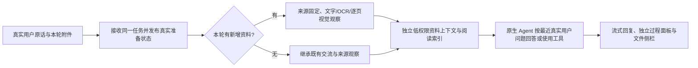

# 附件上下文、多轮与执行展示修复

实验 ID：`attachment-context-streaming-20261019`。本轮是输入、上下文和交互修复验收，不是 Motif 训练或 PPT 制作效果实验。真实模型均在 Linux 服务器运行 DeepSeek Flash / Off；所有平台费用、次数及额外输出上限为 `null`，沿用共享账本，不清零。私人原稿不进入公开记录，全部测试输入为合成资料。

## 结果

最终代码 `d2291646e2e0da98006373ce093bbb667eb9546d` 已通过统一入口发布，认证与网关检查通过。[PR89](https://github.com/jingyio/GeneLoop/pull/89)、[PR90](https://github.com/jingyio/GeneLoop/pull/90)、[PR91](https://github.com/jingyio/GeneLoop/pull/91) 已合并；证据消费修复跟踪 [PR92](https://github.com/jingyio/GeneLoop/pull/92)。最终 CI、服务器全量结果和合并状态在本文末尾补记，不能把正在运行的检查称作通过。

真实同题复测共 **24 轮、28 个执行侧，严格检查全部通过**。四种格式每种六轮：首次 A、无附件问候、回问 A、同名更新 B、回问 B、切场景读取 B。八个来源的 14 页观察全部成功；16 个无新附件轮的所有侧均无新增来源和视觉调用。当前真实用户消息逐字保留，未发现提取 JSON 混入人类内容；更新版本、历史数值与跨场景答案一致，无未经要求的解析/OCR汇报。

| 输入 | 最终六轮/七侧 | 首次读取时间 | 更新 B 时间 | 原始读取范围 |
|---|---|---:|---:|---|
| PDF | 全部通过 | 11.629 秒 | 11.639 秒 | 每版 3 页：原生文字表、像素柱图、扫描页 |
| PPTX | 全部通过 | 18.408 秒 | 59.374 秒 | 每版 2 页，图片内数值及编号 |
| DOCX | 全部通过 | 15.837 秒 | 16.734 秒 | 每版 1 页，正文及嵌图 |
| XLSX | 全部通过 | 20.258 秒 | 14.581 秒 | 每版 1 个渲染页，另保留原单元格及公式值 |

四个普通问候的 ACK 为 0.176–0.212 秒，总时间 1.643–2.202 秒。首轮附件 ACK 约 2.5 秒；这是接收耗时，不能声称主模型已经立刻开始思考。原生网页使用同一任务的真实准备进度解释读取阶段，主模型事件发生后才显示对应阶段。

Word 首读从先前同题 47.087 秒/16 次工具，变为 15.837 秒/0 次工具；Excel 更新从 154.624 秒/28 次工具变为 14.581 秒/0 次工具。PPT 更新此前 369.818 秒、62 次工具后人工取消；最终正确完成，但仍用了 **16 次工具**。Excel 最终首读也用了 4 次工具。这里保留冗余处理反例，不声称提示规则能保证模型永不重复，也不将单次时延差当稳定性能倍率。

网页端实际验证：执行面板在三次工具调用、后续步骤重挂及结束后保持展开；长代码显示可点击文件卡片，并进入原生右侧只读预览和下载；带 PDF 的问候及下一轮“你好”只显示文件卡片与原话，无解析正文。最终版本重新打开原代码侧栏通过，截图存私有验收目录。

## 已证实的根因与改动

1. 旧代码将提取结果追加到真实人类消息。同一真实请求原文只有“你好”2字，原生人类消息却达 103,856 字；模型自然把 PDF 当本轮主题。新代码将低权限资料放入 `geneloop-attachment-context` plugin 来源，当前用户原话独立接收；资料中的指令不获得权限，不计成人类轮次或标题材料。
2. 历史附件每轮重新提取、逐页串行调用视觉模型，当前问题还进入视觉提示。同一 11 页原件先后只有 7 页和 4 页通过。首次接收到原生主模型轮开始为 61.367 秒，之后首助手事件仅 5.649 秒，主要等待发生在模型之前。现在仅处理本轮新增资料；历史已观察证据和原始图片引用保留，普通问候不重解析；视觉提示独立于当前问题，最多 3 页并发，成功页按原件、代码、依赖及资源版本私有缓存。
3. 会话旋转使用短历史窗口，易丢早期目标、来源和像素。现在完整承接既往交流并扁平去重不可变来源，版本观察分别保留。30 轮混合上下文、13 次旋转及原生附件转码回归验证早期目标、最近更正和图片保留。旧污染消息只有与持久任务原始接收内容吻合时才清理展示并迁移，原始日志不改；用户粘贴同形 JSON 保持用户原文。
4. 任务编号等整个 submit 完成才交比较服务，准备期间无法订阅。现在 preview 创建同一任务后立即绑定并订阅实际读取进度；保留原接收锁、预算、取消及幂等链。真实 Session/HTTP 门控测试证明视觉处理阻塞时已有 task_id 和页面进度，但无伪造思考。补齐原生 append 所必需的公开 `surfaceOp` 标记。
5. 原始视觉观察嵌在多层 JSON，近似 OCR、模板限制与独立核验警语一起给主模型，可能诱发额外核验。真实 PPT A 的 OCR 把 74 识成 14，但视觉观察正确读到 A74/B92；Excel 的完整单元格/图像结果也没有阻止反复安装与 OCR。现在在完整证据前提供按 SHA/格式/页绑定的阅读索引，区分 OCR 线索、视觉模型观察及独立事实核验，普通阅读优先使用已有内容，计算或相关缺失/实质冲突再按需工具。原始 OCR、完整观察、失败、不清楚项均保留，不将 Flash 当独立真值。
6. 同一原件重传也要分开“来源身份”与“观察时间”。新索引保留旧成功及本轮失败的各自 provenance，不因本轮 catalog 的 current 标记遗漏旧成功，也不把旧观察提升为本轮新核验。
7. 工具步骤重挂会重置局部组件状态。现在展开选择按会话/轮次/比较侧保存；长代码卡片只保存原代码字节，不执行 HTML/SVG，不冒充后台已验证落盘交付。

## 真实反例、迁移与费用

旧版三页合成 PDF 复现：首次完成 66.067 秒；下一轮只发“你好”，仍输出 981 字 PDF 复述，耗时 10.272 秒。这与最终同题事实查询提示不同，不将 66 秒与最终 12 秒作严格速度对照。新版在同一旧污染会话续聊两轮通过，问候不新增视觉调用、历史数值正确；旧子会话 SHA 和父日志原字节前缀不变。

首个候选正式启动触发端口 PID 快照拒绝，自动恢复旧版。生命周期修复只对本次已知子进程有界重读，外来 PID 仍拒绝。随后候选上传完成 3 次视觉请求，却因内部 Session 事件缺少 `surfaceOp` 未能启动主模型；已通过统一入口回退并补真实 Session/HTTP 测试。失败不是零费用，原报告及独立对账均保留。

接口修复版 b70 同题 PDF、Word 通过；PPT B 取消；Excel 五个严格失败侧仅因 image_code 返回带标签字符串而非整数，事实数值正确但不能改 grade。最终版本使用原提示、原夹具和原评分，全 28 侧通过，未编辑模型答案或放宽标准。

| 实验组 | 代理估费 USD | 说明 |
|---|---:|---|
| 原生 surface 失败 | 0.001923300 | 3 次视觉，主模型 0 次 |
| b70 PDF | 0.014306904 | 补 live 结算对账，原终态快照曾过早 |
| b70 PPTX | 0.090012504 | 含取消失败轮 |
| b70 DOCX/XLSX | 0.037264488 | 含五个严格格式失败侧 |
| 旧污染会话迁移 | 0.002274732 | 2 轮、2 请求 |
| 最终 d229 四格式 | 0.100014372 | 62 请求：48 主模型、14 辅助视觉 |
| 六组总和 | 0.245796300 | 不含独立网页成员 UI 测试或其他用户流量 |

最终 28 个任务的 live 用量与精确 task_id 账本逐项一致；逐行 8 位舍入后的账本和为 0.10001438。供应商账单实付未知，不能称已实付。一次聊天终态统计早于结算的现象由独立 live/ledger 补充对账解释，不覆盖原失败/原统计报告。共享累计账本始终保留，无请求或费用清零。

## 兼容、复现与边界

- 当前 `paper-web-v16` / `ppt-master-v11` 通过公共 exporter 重新认证运行接线及证据消费 helper；旧发布库全部保留，原 IR、serialized library、schema、来源证据及能力主张逐字节不变。没有新增训练、重挖或晋升质量/成本结论，最终 verified Motif skips=0。
- 最终四个跨场景短主请求均未实际重叠；准备/准入阶段串行会使第二侧晚于第一侧开始。保留架构的两侧并行执行路径，但不能用 Promise.all 或这些样本声称实际同时请求，更不能称此为 Motif 降本。
- PDF 每个渲染页面的像素送辅助 Flash，PPT/Word/Excel 使用隔离 Office 渲染的可见页面；最终选择模型取得来源绑定观察。Pro 不接收其不支持的原生图片，不能说主模型自己看过所有原始像素。原始表格单元格与保存的公式值另行保留，不冒充重新计算。
- 最长边 2400 像素、复杂字体/版面、外链、动画、模糊图例和扫描识别均有能力边界。失败页保留具体状态，不标为完整成功；只有相关缺口影响本轮问题时自然说明。纯文字追问不自动重试旧失败页，重新上传同原件可重试；本次未新增任意历史页面重读工具。
- 私有证据统一在 `.local/attachment-integrity-20261019/`，包括 synthetic fixtures/expected/manifest、各 run 的 results/原事件/用量与补充对账、真实来源索引离线校验和网页截图。最终 run 为 `real-multiturn-d229-final`；旧失败目录不覆盖。
- 服务定位以服务器私有 `GENELOOP_SERVICE_HOME` / `GENELOOP_SERVICE_CONFIG` 为准，只用 `npm run service -- <start|restart|status|check|rollback>`；代码、配置、证书和预算资源保留回退版本，不启动第二套临时发布进程。

## 确定性检查与发布补记

10 项附件上下文/读取索引、26 项 bundle、真实 Session/HTTP 与取消/规范化门控、真实八份 plugin 的离线来源/页/像素索引均通过。这些检查不替代上述真实模型答案验收。首次真实解析的协议伪视觉用例只证明协议，不证明读图质量。

环境反例保留：本地无符号链接权限的用例不能当产品失败，也未降低守卫；缺少正确 Python/UTF8 入口造成的 fixture 失败在正确入口复验通过。服务器旧文献 MCP 因 Poppler 动态库失败四项，仅测试子进程用同版私有包装后定向通过。初次全量还复现生命周期 PID 快照，随后 Linux 22 项生命周期回归通过。最终独立 Node 默认发现误选未构建的 scenario dist 测试，同样保留日志，并以统一 project 入口的正式 Node 清单重新验证；不把错误命令的结果伪装为产品通过。

最终服务器检查：生产源码 d229 的 Python 全量 **1114 passed、2 skipped、0 failed**；最初正式 Node 为 886 passed、3 skipped、1 个八图 SDK fixture 等待超时，独立复验通过，原记录保留。仅该八图测试的两个完成等待改为显式30秒（其他helper仍原窗口，产品时钟/所有像素与身份断言不变），测试专用 checkout 178b8d3 与生产 d229 的差异严格只有此测试文件；重新执行正式87文件 Node，全量 **887 passed、3 skipped、0 failed**。目标用例在满载下10.955秒，解释原等待窗口耗尽；不改写为原全量从未失败。continuation、无模型 smoke（18题/83来源）及 motif 检查（4条/46 replay）通过。没有因测试修改生产检出或重复付费请求。

GitHub Actions 的最终 PR head 尚未取得终态，不能称本轮远端 Ubuntu/Windows CI 已通过；已完成的前序PR89–91检查与本轮Linux实跑分开记录。最终服务check确认 owner/gateway均运行、owner_authenticated=true、gateway_login_status=200；该检查无模型费用。公开变更/最终交接随PR92记录。共享累计账本、旧服务计划、旧库与原始日志继续保留。
