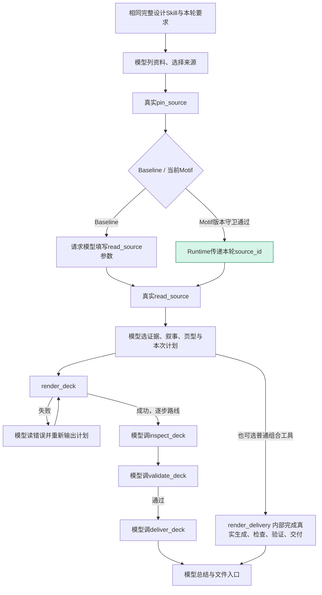

# PPT token 与可训练轨迹审计（2026-10-16）

本轮按用户要求只读分析已有真实轨迹与费用账本；未新增模型调用、未训练候选、未改线上库或运行逻辑。生产基线为 PR #40 已发布的 `83ae34307052db31521bf2a7b99bbdacc685f2da`；较早样本明确保留其旧配置，不与新版合并成收益结果。公共实现与原研究分支已合入的 V6/V9/V10/V17 记录作为机制来源。

## 证据与口径

读取当前正式范围5组和隔离验收19组PPT对照的已保存事件、冻结配置、Motif审计及原共享ledger；重点拆解3组完成任务。19/5是记录数，不是独立研究决定数；合成附件重复、同题重跑及两侧运行不能充作独立训练任务。最新Pro预算准入拒绝为0请求，不进入token效果比较。

私有匿名化工具/usage导出 `ppt-token-workflow-audit.json` SHA256：`52af3268992c7828aa54e2964671548e650c10b3d868d815af1eeca400299fec`。逐请求ledger条数与重点样本真实请求数一致；合成工具流没有模型usage，不能把原生step数当付费请求数。原始文件、凭证和内容不进入Git。

| 已有样本 | 指标 | Baseline | Motif |
| --- | --- | ---: | ---: |
| A 唯一最终三页、首次故意缺页，已加载完整Skill | 云请求 | 9 | 9 |
| A | 输入token（含缓存） | 122,862 | 123,978 |
| A | 未命中输入 | 8,430 | 4,554 |
| A | 缓存命中输入 | 114,432 | 119,424 |
| A | 输出token | 1,618 | 1,614 |
| A | 总token | 124,480 | 125,592 |
| A | 代理峰值估费（美元） | 0.005157192 | 0.004019544 |
| B Word+PDF正常三页，已加载完整Skill | 云请求 | 10 | 5 |
| B | 总token / 输出token | 146,150 / 1,699 | 68,150 / 1,281 |
| B | 代理峰值估费（美元） | 0.004618644 | 0.002744268 |
| C 较早正式多文件三页，未加载完整Skill，仅诊断旧浪费 | 云请求 | 13 | 11 |
| C | 总token / 输出token | 225,634 / 5,105 | 214,644 / 7,468 |
| C | 代理峰值估费（美元） | 0.010343898 | 0.012521376 |

不把不同token等价计价。上述既有记录按当时代理配置计价：Flash未命中输入$0.30/M、命中输入$0.006/M、输出$1.20/M，见 `src/adapters/deepseek_cost_gate.py`；这不是新的官方价格声明或账单实付。

## 为什么Baseline可能更省

1. A中Motif少了一次请求模型来生成read_source调用，但模型随后单独回复一次缺页说明，再由原任务steer继续；Baseline在同一轮直接修正。原生step为9/10、真实云请求均9。Motif多1,112总token（+0.89%），没有减少请求，但未命中输入少3,876，估费仍低22.06%。其中首请求未命中输入4,024/184，相差3,840，占全部未命中差99.07%；费用优势主要来自缓存分布。两侧首请求输入总量相同、Motif较晚启动，与公共前缀缓存被预热相符，但供应商内部缓存过程未被观测，不能把此费用差归因于学得Motif。这是明确的单轨迹原因，不是稳定收益证据。
2. C中两侧各4次工具错误，错误类型不同。Baseline的两次build_delivery缺title/slides和两次外层参数错误之后，render_deck共输出3份完整计划；Motif在第2页经历text_overflow→table_overflow→invalid_plan（表格行列/短单元格）→text_overflow，render_deck共提交5次整稿。生成调用输出token为3,461/6,374，占各侧全部输出67.8%/85.3%。Motif虽然少2次请求，全部输出仍多46.29%，估费高21.05%。省一次读取无法抵消反复整稿重写。
3. B的5次请求差不能全归Motif。仅read_source批次1次有verified bypass；其余差来自Baseline两次单页读取和3次检查/验证/交付调度，与Motif自行选择组合render_delivery、额外一次查可恢复稿的不同路线。两侧均可调用同一组合工具，不能把手写组合链的全部收益记为学习所得。
4. 完整Skill是共同提示内容，不是执行一次后缓存成免费子程序。模型仍需理解来源、选择结构、输出本次计划；静态前缀即使命中缓存仍计入总输入token。资料返回、计划重写、错误反馈和恢复消息又会扩大后续请求的上下文。当前库不覆盖这些大头。

## 当前真实workflow

当前 `motif-libraries/ppt/online-manifest.json` 只有一个pin_source→read_source结构，无生成/布局代码节点。Skill负责设计指导；工具负责读写与真实渲染；Motif目前只替换中间一次句柄搬运请求。一次batch自动读取5份资料仍只替换一次云请求，不是省5次。

## 可训练候选与优先级

### P1 成功后的版本化检查、核验和交付

真实参数边：`render_deck.deck_id → inspect_deck.deck_id`；同一deck_id交validate；`validate_deck.validation_id → deliver_deck.validation_id`，并要求passed为true。本次扫描有14条完整逐步后缀、分布9组对照记录；这只是机会，不是独立训练认证。

A的Baseline后缀有3次真实请求，合计44,305总token/192输出token、代理估费$0.001233900；占该次总token35.59%、估费23.93%。这是这三个已有请求的账本和，不是新Motif已实测节省；删去请求后上下文、缓存与后续决策会变，实际净收益须新任务验证。

应训练执行条件和参数绑定，而不是记住旧deck/validation ID。每节点核验job/来源/工具schema/生成器、当前deck SHA、input_version、输出授权和前一步成功回执；实际inspect/validate/渲染一个都不跳过。失败回模型，旧回执不能授权新文件。科学事实、证据充分性与视觉审阅仍不能由passed=true代替。

当前在线manifest明确拒绝非read-only工具，生成和validate_deck是写动作/屏障。即使inspect和deliver的服务函数为只读，现有小库也不能穿过写屏障自动闭合整条链；需要复用既有交付宿主能力、定义受授权的版本化执行契约并重新认证，不能将read_only标成true绕过。

现有`render_delivery/build_delivery`已手写实现同一固定链。因此先让普通工程基线稳定使用它；训练版必须与这个B1相比，不能仅比故意多轮的原子B0。最小工程路径已存在，不应新造Agent循环。

### P1 失败页局部读取、合并和重新验收

从C的第2页重复失败看，价值可能大于读取边。保存失败计划和版本，工具明确返回失败page/field后，只读受影响页；模型输出本页的语义修改，宿主复用未改页面/notes/来源，合并patch并真实重验。训练的是错误定位与路由、已明确patch的合并和版本化再交付，不是盲目缩字、删除条件、换科研结论。

原分支`PlanRecovery`/`PendingPlanStore`已有`read_pending_plan/repair_pending_plan`与scope保护；当前Web `web-scenario.json`只挂载19工具，没有这两个工具，而且原恢复store还与host_delivery策略绑定。上一轮新增steer只是保证继续工作，没有把原CLI局部恢复完整接入Web。这是当前产品缺口；不能只加白名单就假称可用，必须同时验证job策略、草稿持久状态、版本绑定及成员隔离。

可提炼的轨迹：失败→读取该页→模型给patch→合并→render/validate→交付；每个确定性区间各为候选。内容取舍仍回模型。条件/页型布局修复程序只能在内容与来源保持、支持字段和独立新页型验证后成为候选；表格过密需删科学内容时弃权。

### P2 已选页面集合的批量取证与图件目录

模型先明确选定pages/candidate集合；Runtime根据真实source/version批量read_page/extract_figure并校验返回范围，不再让模型逐条拷贝句柄。图件目录整理可用受限纯JSON程序保留全部真实candidate/page/bbox/caption；图意和哪个图支持结论仍由模型选择。

当前小样本多为短文本、没有图，不能拿它们训练完整论文选图。正常Word+PDF样本两次单页读取也不是无条件可删：read_page对PDF还增加页面几何/图件候选，只有已完整读取、无截断、所需证据和几何均已具备才可复用。每次batch按真实替代的模型请求数计。

历史V6已实现图件目录工具及其读取Motif，但原记录中generated+Motif相对普通DSH仍多40.48%估费，四组事实质量未统一合格。该实验说明能编译/执行，不证明目录是当前最大降本点，也不能把旧私有候选默认视作已上线。

### P2 已成功PPT的显式范围增量修改

用户指定page和明确字段值→读取当前计划/指定页→只合并本轮changes→保留非目标页→真实验收→交付新副本。训练复用定位、依赖和scope路由；来源、模板、页版本变动即失效。不重写整份稿，也不复制旧论文内容。

`direct-edit-cli.ts`已有显式字段修改零模型工程入口，V10也记录普通模型7/10请求对零模型直接修改。明确常量替换优先走此入口；只有需要从真实反馈确定局部范围/触发条件且已有重复证据，才是进一步训练对象，不能把普通字面替换包装为学习创新。

## 推荐验证协议

保留相同来源、完整Skill、模板/布局、页数、模型/推理、schema集合/顺序、质量门槛及费用预算；比较B0原子普通Harness、B1已有组合交付+局部恢复普通脚本、B2从正常轨迹学习的条件化Motif。对B2单独消融“只读边”“交付续接”“失败页恢复”，避免把模型自行选不同工具当学习贡献。

至少两个独立真实研究决定作训练，一个未见研究决定作一次冻结留出认证，另用新完整论文/多源更新作前瞻评测；不同页型、表格/真实图件、自然溢出和来源变更都覆盖。合成故意缺页只作负例与恢复诊断，不作独立正常训练轨迹。不能从同论文续写凑训练/留出，也不预写DAG再声称从轨迹发现。

记录完整请求（含失败/恢复）、未命中/命中输入、输出token、逐请求费用、真实旁路、CPU渲染/校验、学习认证费、人工修订与独立质量检查。首要指标为同质量下总费用和人工投入；总token、工具次数和verified skip只是解释指标。累计收益须扣除学习/失败候选/重认证成本；每任务净节省≤0时没有盈亏平衡点。

当前结论：优先闭合已存在的交付工程路径和局部恢复，接着学习跨任务的触发条件、参数依赖与异常回退；只扩充pin/read小边覆盖率，无法解决整稿重写和不稳定工具选择带来的主要浪费。尚未训练/部署上述新候选，未宣称其净收益已成立。
