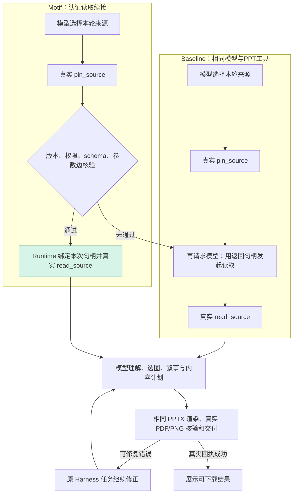

# PPT 网页、原分支与 Skill/恢复：2026-10-16

## 问题与只读证据

用户要求解释上轮只有一份 PPT、原 PPT 分支的测试集/提示词/Skill、生成效果差距、Motif 的实际复用范围，并要求 Web `/ppt` 自动加载完整 Skill、可纠正错误后继续工作。本轮以已合并 `e7d18d0` 为基线，不修改上游 Harness 或原学习证书。

原分支固定 `feature/research-ppt-agent@73751854d65465d2ceb878a525002431d13cdd05`，已 fetch 复核。上轮旧网页 `bfc86c1` 的 `ppt-pdf` 运行确有两侧：Baseline 7 请求、0 文件；Motif 10 请求、1 verified skip，交付六页 PPTX/PDF/六张 PNG，违反用户三页要求。Baseline 遇页数冲突后结束的是本轮回复，不是进程崩溃；不能把它当成 Motif 质量优于 Baseline 的结果。

### 原实验实际覆盖

- V2/R2：两训练、一留出认证，评测 E1 三论文→15页、E2 两论文→8页方法比较、E3 单论文→6页、E4 旧6页 PPT 改 academic、E5 PDF+PPT→10页更新。原记录承认来源重叠和 E4 纯文字 academic 输入的限制。见 `research-ppt-v2-20261010-plan.md` 与 `research-ppt-v2-20261010-results.md`。
- V5：RAG→8页 lab；QLoRA→7页 academic；InstructGPT+DPO→10页 lab；T5+RAG→9页 academic；四论文组合→12页 lab。题面、矩阵、SHA 和训练/留出/评测边界有记录；原始 `tasks.json`、论文和完整运行提示保存在私有 `.local`，不是仓库自带的公开完整标准测试集。见 `research-ppt-v5-design-rsi-20261010.md`。
- V11：PiSSA/LoftQ/DoRA 的既有、已辅助核对内容重排，以及独立 VeRA 新稿。新稿再经 Codex 明确辅助修订，不能把最终展示稿当成原始模型一次生成。见 `research-ppt-v11-scientific-design-20261012.md`。
- V15/V17：完整 DoRA / 75页 last-ai 等真实来源，lab 风格、实际原图/来源/讲稿；V17 是普通逐步 B0 对宿主交付+局部恢复 B1，记录明确未执行 Motif。`trial.py` 无 active 候选时 optimized 仍是 baseline 模式；组名 optimized 不是算法归因。

### 提示词与 Skill

共享 `scenarios/research_ppt/prompt.md` 描述工具契约、来源、科研图、页面类型、短文字、讲稿与交付。原 CLI `cli.py:130` 默认还追加 `skills/research-design/SKILL.md` 全文，并冻结任务 instruction、slides、template、operation、sources。

Skill 为项目独立重述的 `research-ppt-design / research-design-v3`，`provenance.json` 记录参考 harness-anything、Academic PPT Master、PPT Master 的固定来源与 MIT 许可。吸收证据为主体、方法/结果页、实验条件与克制层级；不是整套上游 Agent、SVG 执行器、品牌资产或任意原生母版。公共生成依旧是 JSON→PptxGenJS→LibreOffice。CLI 普通组与 Motif 组都应加载相同 Skill。

私有旧任务 `effective-config.json` 逐字段只读核对：Baseline/Motif instructions 均为 6757 字符、SHA `01f78e6077ed77099b4f84e3a2f0084066d679a5e039354c219bca043496620a`；有 Skill 名称引用，但没有完整正文/章节。Web registry 只读 `prompt.md`，未走 CLI 的追加代码。这是已确认的提示接入差异，尚非单因素质量消融。

上轮输入只是 1 页四行合成文字、没有图或实验结果，且用默认 academic；原实验使用完整真实论文，多用 lab，部分展示为明确辅助修订。材料、要求、Skill、模板与审阅环节均不相同；Flash/Off 在两边都有使用，不能简单归因于换模型，也不能把所有视觉差距归因于融合。对齐输入与协议后才有公平质量比较。

## 当前 Web 的 Motif workflow

产品库 `motif-libraries/ppt/library.json` 只有独立轨迹认证的 `pin_source.source_id → read_source.source_id`；两份正常训练轨迹标识 t1-vit/t2-ddpm。证书是 structural_only、quality_cost_promoted=false。来源、权限、工具/schema、实现与本次句柄验证后，由 Runtime 直接发起真实读取，减少中间一次模型调度；不是复制旧全文/旧答案/PPT，也没有把全稿策划、选图或排版学成一个宏。

下游普通组合 `render_delivery = render→inspect→validate→deliver` 两侧均可使用，是手写工程能力。V17 的 host_delivery 对照更把固定链与失败草稿局部 patch 收到宿主；它不等于本产品读取 Motif，也不能据其费用差把整条生成链归为学得的优化。

## 本轮实现

- Web registry 默认追加固定 Skill 全文并登记摘要；所有 `/ppt` 新任务的两侧相同，CLI 原行为保持。
- 在公开 `tools/result`、`agent/turn-stopping` / `agent.steer` 生命周期续接原任务。仅真正尝试生成后启用；问候不会强制生成。明确页数来自已绑定 job，可修复页数/参数/容量/布局错误交回同一模型修正；来源/权限/版本拒绝不放宽。
- 支持真实 MCP `Error: JSON`、`INVALID_ARGS`、后端嵌套报告。区分生成与实际交付，兼容逐步回执的 deck/validation/input/file SHA/预览，以及组合 delivered 回执。成功、取消或阻断后不自动重做；剩余预算沿用，不新增请求数量限制。
- 页面显示真实“正在修正演示文稿”，续接次数计入普通任务统计，不涂成 Motif verified skip。不注入新人工消息、不新建 Agent 循环、任务或预算路线。

## 验证与待补状态

服务器完整初版回归：Python 773 passed / 193 skipped，Node 721 passed / 3 skipped；smoke 与 motif:check 通过，均无新模型调用。随后针对真实 MCP 包装和逐步回执增加回归，最终数量、真实网页、CI、发布和收尾在本记录追加；当前不宣称已发布。

真实联调负面证据保留：第一次脚本创建工作区超时，0模型调用；第一组有意缺页的题面同时写“三页/两页”，被现有数量解析认为含糊而登记6页，且错误包装识别不全，Motif 停在错误说明，Baseline 经续接交付6页。不能将此组记为三页成功；修复错误包装/回执并用唯一最终页数的后续诊断题重新验证，旧费用/记录不覆盖。浏览器的初始空工作区导航也保留为测试入口限制，后续通过实际侧栏打开本组记录核验，不通过再次发送制造重复任务。

本轮验证只针对功能与恢复；合成来源的简短稿不是原论文实验的同内容质量复现，未新增视觉质量/同质量成本收益结论。原始数据保存在 `.local/ppt-error-recovery-20261016/` 与 `.local/ppt-recovery-web-20261016/`，不提交私人轨迹或产物。

### 修复后真实网页验证与截图字体

真实 Flash Off；每对 $0.23 / 每侧 $0.115，累计费用/请求与额外输出上限 null。两组都通过原生上传、发送、流事件和实际点击下载完成，未用重新发送补采已有任务。

| 场景 | Baseline | Motif | 交付核验 |
| --- | --- | --- | --- |
| 故意首次缺页，唯一最终三页要求 | 9请求，1工具错误，模型自行修正 | 9请求，1工具错误，1次原任务续接，1 verified skip | 各3页PPTX/PDF/3张PNG |
| Word+PDF，默认Skill正常使用 | 10请求，0工具错误 | 5请求，0工具错误，1 verified skip | 各3页PPTX/PDF/3张PNG |

20个文件均通过真实网页链接下载，字节/SHA与交付记录一致；四份PPTX均可解析，有16/18/21/21个可编辑文字对象、各3页讲稿；四份PDF逐页渲染检查，未发现缺字、文字溢出或遮挡。正常组保留两份来源唯一标记、合成测试说明和无结果/无图件边界，未编造实验数值。原子及组合交付成功后没有额外生成。两侧冻结配置均包含完整Skill，正文SHA为 `43f25ad5da37a32d810fe5936bf1396c97aba7a6938fbf71f1ec8b43928636dc`。

连同负面诊断共58次真实模型请求，按各任务代理峰值估费求和 $0.030246912；实付未知。取证时共享累计账本1693请求 / $1.221026294已结算估费，期间还有其他调用，不能用全局差额代替本轮成本。输入/输出token、缓存、逐任务成本与续接保留在私有 `final-evidence.json`；同组请求差不构成同质量成本收益证明。

用户指出的中文方框截图来自隔离测试浏览器：HTML/DOM保留正确汉字，但该无头Linux Chromium未启用已有私有CJK字体。默认 `fc-match sans-serif:lang=zh-cn` 落到无中文字形的DejaVu Sans；为浏览器进程设置现有字体包的 `FONTCONFIG_FILE` 后命中Noto Sans CJK SC，同一历史任务重拍中文正常。只修测试进程字体配置，没有修改用户文字/历史或强换产品主题。正常截图、原失败截图/HTML、字体配置与下载证据保留；后续该浏览器测试必须显式启用CJK字体。页面JS异常0。测试入口初始导航较慢及断线重连提示仍是诊断环境现象，没有据此宣称公网网络稳定性已通过。

最终定向原生任务/进度/恢复回归79项通过。一次全量命令错误继承宿主旧Node，8项因不支持 `--experimental-strip-types` 等环境原因失败；保留原日志，随后明确使用Node22及其PATH重跑，不修改有效测试以消除错误。最终全量、CI、发布状态见本记录后续发布收据与PR。

最终服务器完整回归：Node 22.23.3 + Python独立环境，`npm test` 等价统一入口 Python 773 passed / 193 skipped、Node 722 passed / 3 skipped；无模型smoke和motif:check通过。Windows由PR的独立CI验证。
