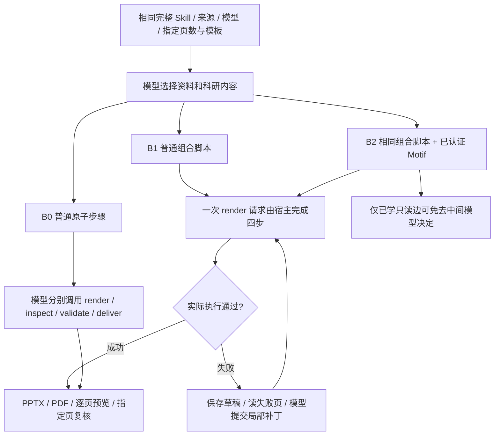

# 网页 PPT：组合交付、局部恢复与真实轨迹学习

实验 ID：`ppt-web-workflow-learning-20261016-v1`。初始冻结基于 main `d2871f5`，分支 `codex/ppt-workflow-learning`；随后合入 `91131ee` 的统计来源检查与 `0e0de8f` 的输入标签修复。组合交付、失败页局部恢复和真实轨迹读取库已接通。实测支持局部请求旁路，不支持同等质量下稳定降本。机器可读结果见 [results.json](ppt-web-workflow-learning-20261016-v1.results.json)。

## Skill 与网页执行链

网页 `/ppt` 已经追加原 CLI 的完整 `research-design/SKILL.md`，不是只提供名称。Skill 是设计指导，普通脚本负责执行；二者都不称为学得的 Motif。

| 步骤 | Skill 要求 | 本次网页接入 |
| --- | --- | --- |
| 明确任务 | 听众、研究决定、页数、语言、风格与边界 | 原文和完整 Skill 传给模型；显式页数绑定 job，不猜论文事实 |
| 读取证据 | 批准材料、实际图注、来源和条件 | 模型选择来源和页码，`pin_source/read_source/read_page/extract_figure`；不再预注入一遍重复全文 |
| 组织设计 | 每页一个信息任务，按证据选择布局，备注保留条件 | 模型负责内容、来源、页型、讲稿；固定渲染器负责几何 |
| 组合交付 | 生成、检查、实际渲染、验证、发布 | 两侧默认 `host_delivery`；`render_deck` 进入普通 render→inspect→validate→deliver 脚本 |
| 局部修复 | 根据真实反馈修正，保留其他页和科学条件 | 私有失败草稿、最新版本句柄、指定 1–5 页读取与字段/页补丁；禁止重发整稿 |
| 完成与复核 | 真实回执成功，另查内容、叙事、视觉 | `delivered=true` 终止自动交付续接；指定页复核保留，机械通过不冒充科学/视觉认证 |

旧网页没有冻结执行策略，模型可能自行使用原子调用或组合工具；只报两侧请求数无法归因。新 job 显式冻结策略，客户端不能用 scene options 改写。Web 修复由同一任务账本控制，不套用 CLI 的 6 次提交/8 次补丁上限；旧 CLI 的有限诊断行为保留。取消、费用、来源、文件、代码、schema、权限和旧版本拒绝保持有效。重复提交同一计划、正在执行的草稿和未授权写入仍拒绝。

`B0→B1` 是普通脚本和局部恢复的收益；`B1→B2` 才是新增 Motif 条件。模型的科研设计、图件选择、修复写操作和事实判断都没有被读取 Motif 学走。

## 冻结任务与核验方法

- 真实 DeepSeek Flash、Off，完整有序 21 工具；每次任务 $0.115，每对 $0.23，累计费用/次数和额外输出上限均为 null。保留共享原账本，不因测试重置预算进程。
- 训练决定：RAG 的问答采用条件、QLoRA 的单卡微调取舍；独立留出：DoRA 的适配选择。FlashAttention 留出尝试因预算预留拒绝，单列为失败；DoRA 在评测前改为独立留出，不再充当未见评测。训练选择第 2/4 页，留出第 1/3 页，验证读取参数没有硬编码历史页码。
- 未见论文评测用 AdaLoRA（三页）与 LoftQ（六页），每篇三条件；同篇任务、PDF 字节、模型、工具顺序、模板与复核要求相同。顺序提前冻结：AdaLoRA-Motif、LoftQ-script、AdaLoRA-atomic、LoftQ-Motif、AdaLoRA-script、LoftQ-atomic。没有通过扩大预算或重复同题择优补齐失败。
- 私有 stage 的 `ppt-atomic` / `ppt-script` 只用于服务端实验，产品 `/ppt` 两侧都使用组合脚本。实际上传走原生 binary receipt，执行走 Web Task API；另用普通聊天网页验证双栏、点击下载和刷新恢复。本次网页自动化错过运行期，未捕获流式画面，不能把后端轨迹当成本次前端逐字输出验收。
- 学习调用现有 Python witnessed-edge 编译器，不手写 DAG、不改冻结内核、不额外调用学习模型；原始事件逐字节冻结，决策身份仍是实验者声明。完整 schema 来自实际 MCP initialize/list_tools，采集 1–30 页并与网页六页 schema 对齐。
- 每份成功交付的 PPTX/PDF/预览核对真实回执 SHA，检查指定三/六页、可编辑文字及逐页备注，并查看全部页面。评审为 AI 辅助、非人工盲评；内容质量结果独立于只读参数边认证保存。即使读取结构通过，科研内容不合格也不提升成“同质降本”。

私有输入、逐请求账本、原始轨迹、实际文件及评审在隔离 stage `.local/ppt-workflow-20261016/`，不提交。公开库仅包含结构、schema、匿名哈希、参数契约与认证。模型费用是代理按峰值价格估费，账单实付未知；不把预算上限当作支出。完整训练采集、失败运行、补丁恢复和评测分别计费，编译模型调用为 0，CPU/开发/人工成本不假装为 0。

## 已保留的反例

1. 初版 QLoRA、FlashAttention 因附件全文重复注入和后续工具全文读取造成上下文增长，触发费用保守预留拒绝，未交付；实花金额低于任务上限不代表可以跳过预留检查。修正重复注入后做代码回归，旧任务、费用和失败证据不删除、不重置。
2. 第二版 RAG 局部修复达到旧 CLI 8 次上限后未交付。取消 Web 的这层次数限制后，第三版在原账本约束内继续修复并交付。未把工程重跑当作更多独立研究决定。
3. 第三版 RAG 虽机械交付通过，讲稿中的 MS-MARCO 指标顺序和部分引用页仍须核对；候选读取结构有效不等于最终科研稿已合格。

## 结果

### 学习与局部恢复

两项训练加一项留出共 85 次请求、代理估费 $0.093888144；包括前五项被排除的采集/工程失败共 177 次、$0.232263144。离线编译约 0.55 秒、0 次模型调用；再次合并来源守卫后用同一数据重新认证，没有追加训练或重复计算费用。新库为 `motif-libraries/ppt-web-v2-r4/`，原 `ppt/` 的图和证书未改。

版本关系：r1 冻结长论文评测，r2 保留最新草稿反馈并完成简短/网页实测；r3 合入 `15765fe` 的聊天加载/归档改动，r4 保留随后 `30aac30` 的已归档标题修复，分别针对变化的宿主源码重新编译代码锁。四者使用相同原始采集、图与参数契约，r3/r4 无新增采集/模型请求；旧候选、证书和实际评测版本均私有保留，没有把 r1 费用追改为 r4 实测。

实际学得两条边：`pin_source→read_source`、`pin_deck_pages→read_pinned_deck_pages`。生成器为现有 witnessed-edge compiler，library 摘要 `a76c43648c189046bed414c2acc45587e725a7974057446193c251fa6ab3372f`。来源/选定页版本、完整 schema、参数证据、代码及产物摘要全部守卫；页面图文、科学结论、写入/修复操作没有入库。正文质量不合格任务的只读结构证据可保留，但 `quality_cost_promoted=false`、`all_collection_decks_quality_passed=false`，不能宣传为科研内容训练成功。

最终 RAG 38 请求，实际超过旧 8 次补丁限制后完成；QLoRA 16 请求、DoRA 31 请求均交付。RAG 备注存在指标顺序/引用问题；DoRA 对冻结参数的解释有错且图件太小。其结果不能被读取结构认证掩盖。后续补充错误句柄反馈：拒绝错误草稿参数时返回同一任务最新草稿回执，模型仍须自己构造合法局部补丁，不自动替它提交写入。旧费用拒绝及错误句柄失败保留。

### 未见长论文（三条件，全部运行保留）

费用均为美元代理估费；token 为每次请求合计，包含重复输入。缓存命中/未命中、输出、耗时和事件摘要逐项在 results.json。

| 任务 | 条件 | 请求 | 总 token | 输出 token | verified skips | 估费 | 交付与质量 |
| --- | --- | ---: | ---: | ---: | ---: | ---: | --- |
| AdaLoRA | B0 原子 | 39 | 1,723,363 | 3,138 | 0 | 0.032536332 | 预留拒绝，未交付 |
| AdaLoRA | B1 脚本 | 18 | 595,068 | 8,813 | 0 | 0.023317380 | 三页交付；备注公式需修订 |
| AdaLoRA | B2 脚本+Motif | 39 | 1,716,906 | 15,931 | 1 | 0.041435556 | 多次无效草稿修复，预留拒绝 |
| LoftQ | B0 原子 | 20 | 667,233 | 27,132 | 0 | 0.044105628 | 整稿/参数错误，预留拒绝 |
| LoftQ | B1 脚本 | 31 | 1,157,216 | 16,117 | 0 | 0.038147796 | 局部排版修复后预留拒绝 |
| LoftQ | B2 脚本+Motif | 24 | 808,211 | 8,154 | 1 | 0.024649644 | 六页交付；对数轴单位/引用页需修订 |

B0、B1、B2 机械完成分别 0/2、1/2、1/2；均没有完整科学质量通过证据，不计算“合格任务省费百分比”。费用保守预留拒绝发生在下一请求之前，因此实际已花小于 $0.115 并不表示守卫失效。LoftQ-Motif 最后选择 `read_deck_plan`，没有命中指定页读取边；一次 skip 不是整个设计过程复用。

### 简短真实软件说明（三条件）

上传的是从真实运行报告冻结的 JSON（SHA `324c62d8469e814345fbf2383ad7e272c7c2549910128343d7f22500f7cc71f3`），非合成科研数据。相同逐字题面、三页 lab、Flash Off，指定最终第 1/3 页核验。此任务复杂度低于论文评测，分组报告，不拿它替代长论文质量。

| 条件 | 请求 | 缓存命中输入 | 未命中输入 | 输出 | 总 token | 估费 | 耗时秒 |
| --- | ---: | ---: | ---: | ---: | ---: | ---: | ---: |
| B0 原子 | 15 | 266,368 | 13,220 | 7,873 | 287,461 | 0.015011808 | 49.832 |
| B1 普通脚本 | 8 | 115,456 | 4,689 | 2,051 | 122,196 | 0.004560636 | 23.166 |
| B2 同脚本+Motif | 6 | 84,864 | 3,031 | 1,721 | 89,616 | 0.003483684 | 19.477 |

三组均交付五文件、正文可编辑、备注齐全，运行事实核对无重大错误。B1 金额照抄浮点长尾，B2 标题及信息分布仍需编辑。观察到 B0→B1 少 7 请求，属于普通脚本/局部恢复的收益；B1→B2 少 2 请求、总 token 少约 26.7%、估费少约 23.6%，其中两段 verified skips 来自新库。单次且修复数不同，不能把全部差额因果归于 Motif，更不能称人工盲评等质收益。

### 原生网页实测与反例

普通聊天入口上传同一 JSON 后执行 `/ppt`，Baseline / Motif 分别 11/9 请求、180,852/157,252 token、$0.008663388/$0.009034824。Motif 实际两次 skip，但估费高约 4.3%；更多输出及缓存构成可抵消少请求的收益。双方局部修复后交付三页、各五文件，逐个真实点击下载共 10 个、字节 SHA 全部匹配，刷新后仍完成。原生包装中的历史列表实际为 `[]`，没有带入旧对话；与独立三条件题面存在这一包装差别，因此单独报告。

两份网页稿均有叙事问题：把 B0/B1/B2 替代条件连成连续流程；金额长尾影响演示。Motif 图有四块却称三步。下载成功不代表内容质量已合格。测试浏览器使用已配置 CJK 字体，全页检查未见中文缺字或越界；不代表 Windows 全套渲染已验证。另两次浏览器导航/上传前置检查失败均在发送前终止，0 模型请求；保留诊断，不包装为生成失败或额外成功样本。

### 总成本、验证与边界

本轮学习（含失败）+ 六项长论文评测 + 三项简短对照 + 两侧网页共 **397 次真实请求，代理估费 $0.477209820**。账单实付、人工修订分钟及开发/维护/CPU 货币成本未知。共享账本还有其他并行正式调用，不能用全局计数差代替本实验支出。

确定性检查：根 `npm test`（Python 795、Node 734 通过，既有可选跳过 193/3）；PPT 121 项通过；新增真实库锁拒绝回归单独 9 项通过；smoke、motif:check 通过。这些不是模型效果证据，最终发布与 CI 回执另记。库锁用实际文件字节，隔离 stage 的旧 Git HEAD 不充当运行版本。

最终合入 `15765fe` 后全量复验：Python **796**、Node **738** 通过，既有可选跳过仍为 193/3；场景 build、smoke 和 motif:check 全通过。测试服务在全部终态后按进程签名关闭（166 completed、7 budget_exhausted、1 cancelled；74 completed/1 cancelled/2 failed 对照），不删除文件，生产应用及预算进程保持，停止前后累计账本均为 2806 请求。

当前可以交付的机制是宿主组合、同任务局部恢复、两条受守卫读取复用。下一步应先修订科学表达与引用、记录人工分钟，再做重复且独立人评的同质成本对照。不能从这批数据声称完整 PPT 规划已被 Motif 学会，或证明长期净收益。
