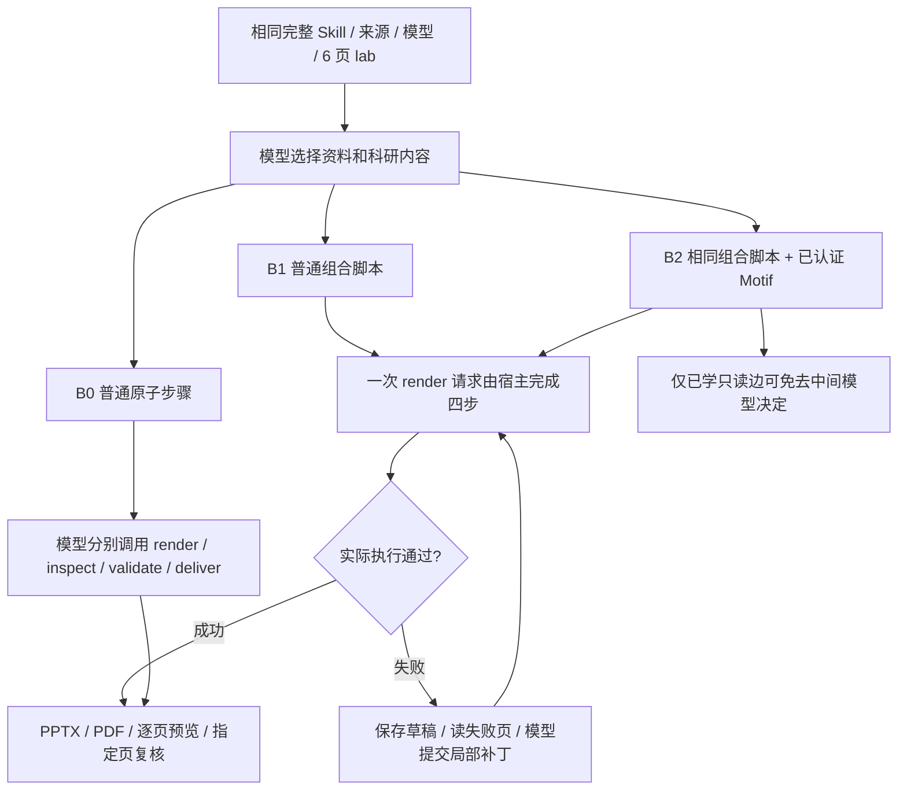

# 网页 PPT：组合交付、局部恢复与真实轨迹学习

实验 ID：`ppt-web-workflow-learning-20261016-v1`。基于 main `d2871f5`，分支 `codex/ppt-workflow-learning`。本记录先冻结方法，真实结果随后追加；未记录结果的项目不视为通过。

## Skill 与网页执行链

网页 `/ppt` 已经追加原 CLI 的完整 `research-design/SKILL.md`，不是只提供名称。Skill 是设计指导，普通脚本负责执行；二者都不称为学得的 Motif。

| 步骤 | Skill 要求 | 本次网页接入 |
| --- | --- | --- |
| 明确任务 | 听众、研究决定、页数、语言、风格与边界 | 原文和完整 Skill 传给模型；显式页数绑定 job，不猜论文事实 |
| 读取证据 | 批准材料、实际图注、来源和条件 | 模型选择来源和页码，`pin_source/read_source/read_page/extract_figure`；不再预注入一遍重复全文 |
| 组织设计 | 每页一个信息任务，按证据选择布局，备注保留条件 | 模型负责内容、来源、页型、讲稿；固定渲染器负责几何 |
| 组合交付 | 生成、检查、实际渲染、验证、发布 | 两侧默认 `host_delivery`；`render_deck` 进入普通 render→inspect→validate→deliver 脚本 |
| 局部修复 | 根据真实反馈修正，保留其他页和科学条件 | 私有失败草稿、最新版本句柄、指定 1–5 页读取与字段/页补丁；禁止重发整稿 |
| 完成与复核 | 真实回执成功，另查内容、叙事、视觉 | `delivered=true` 终止自动交付续接；指定页复核保留，机械通过不冒充科学/视觉认证 |

旧网页没有冻结执行策略，模型可能自行使用原子调用或组合工具；只报两侧请求数无法归因。新 job 显式冻结策略，客户端不能用 scene options 改写。Web 修复由同一任务账本控制，不套用 CLI 的 6 次提交/8 次补丁上限；旧 CLI 的有限诊断行为保留。取消、费用、来源、文件、代码、schema、权限和旧版本拒绝保持有效。重复提交同一计划、正在执行的草稿和未授权写入仍拒绝。

`B0→B1` 是普通脚本和局部恢复的收益；`B1→B2` 才是新增 Motif 条件。模型的科研设计、图件选择、修复写操作和事实判断都没有被读取 Motif 学走。

## 冻结任务与核验方法

- 真实 DeepSeek Flash、Off，完整有序 21 工具；每次任务 $0.115，每对 $0.23，累计费用/次数和额外输出上限均为 null。保留共享原账本，不因测试重置预算进程。
- 训练决定：RAG 的问答采用条件、QLoRA 的单卡微调取舍；独立认证：FlashAttention 的实现替换条件。只使用最终冻结版本的三项正常任务，前面工程诊断不算独立训练。
- 评测决定另用 DoRA 与 LoftQ；每篇三条件，任务要求、完整论文版本、模型、工具顺序、模板、页数和指定第 2/4 页复核相同。页面语义与生成内容仍由各次模型决定，不能假设随机生成结果天然同质。
- 私有 stage 的 `ppt-atomic` / `ppt-script` 只用于服务端实验，产品 `/ppt` 两侧都使用组合脚本。实际上传走原生 binary receipt，执行走 Web Task API；另用普通聊天网页验证双栏、真实流式及点击下载。
- 学习调用现有 Python witnessed-edge 编译器，不手写 DAG、不改冻结内核、不额外调用学习模型；原始事件逐字节冻结，决策身份仍是实验者声明。完整 schema 来自实际 MCP initialize/list_tools，采集 1–30 页并与网页六页 schema 对齐。
- 每份 PPTX/PDF/预览核对真实回执 SHA，检查六页、可编辑文字、六份备注，并逐页查看渲染与原论文。评审为 AI 辅助、非人工盲评；内容质量结果独立于只读参数边认证保存。即使读取结构通过，科研内容不合格也不提升成“同质降本”。

私有输入、逐请求账本、原始轨迹、实际文件及评审在隔离 stage `.local/ppt-workflow-20261016/`，不提交。公开库仅包含结构、schema、匿名哈希、参数契约与认证。模型费用是代理按峰值价格估费，账单实付未知；不把预算上限当作支出。完整训练采集、失败运行、补丁恢复和评测分别计费，编译模型调用为 0，CPU/开发/人工成本不假装为 0。

## 已保留的反例

1. 初版 QLoRA、FlashAttention 因附件全文重复注入和后续工具全文读取造成上下文增长，触发费用保守预留拒绝，未交付；实花金额低于任务上限不代表可以跳过预留检查。修正重复注入后做代码回归，旧任务、费用和失败证据不删除、不重置。
2. 第二版 RAG 局部修复达到旧 CLI 8 次上限后未交付。取消 Web 的这层次数限制后，第三版在原账本约束内继续修复并交付。未把工程重跑当作更多独立研究决定。
3. 第三版 RAG 虽机械交付通过，讲稿中的 MS-MARCO 指标顺序和部分引用页仍须核对；候选读取结构有效不等于最终科研稿已合格。

## 结果

训练库、三条件成本与质量表、网页下载和最终检查结果在实际完成后补齐。
