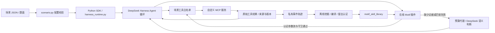

# DeepSeek Harless：场景、Motif 和 Harness 的接口

## 官方 Web 与统一任务接口（0.1.5-rc.3）

`npm run web` → `scripts/harness-web.py` → 官方 `dsh --profile web --patch <私有 host overlay>`。执行、会话、队列、模型消息和工具调度归官方 Harness；SDK 的 `run-scenario.py` 与 `harness_runtime.py` 保留。场景配置定义能力，不再固定一次用户任务。默认动态策略为 `src/adapters/dsh_web_tasks.ts`，请求规范化在 `web_task_request.ts`，双层预算路由在 `web_task_budget.py`；浏览器通过 `src/adapters/harless_web_client/` 装饰原生 `/harless` 命令，选择场景/模式/RSI。独立 `/tasks`、`/sss` 与 `/harless` 页面已移除，旧地址跳转聊天首页；任务 API 保留，历史代码/环境变量标识保持兼容。

后续涉及模型的联调与场景验收统一走真实 API：`npm run web:real` 等价于 `npm run web -- --real-model`；`npm run scenario:real` 等价于 `npm run scenario -- --call-model`。官方聊天真实任务发送后直接执行；任务 API 仍支持显式 preview/submit，SDK 入口仍先预览。两者均保留原有预算代理。用户已授权此测试用途，默认沿用现有 0.25 美元额度，扩大上限或外部副作用另行确认。纯单元、无模型 smoke 和故障注入仅作开发诊断；真实调用失败不得用模拟成绩替代。SDK 真实最小场景已完成 3 次 HTTP 200 与 4 次 MCP，见[真实调用记录](experiments/deepseek-real-api-smoke-20261009-v1.md)；现有 3080 模拟服务未重启，真实 Web 后端最小闭环已通过，浏览器交互仍待验收，见[恢复记录](experiments/web-real-recovery-20261009-v1.md)。

### 前端提交与任务生命周期

官方真实聊天的 `session/prompt` 登记 `entrypoint=native_chat` 的任务，随后在服务端校验输入、场景/工具版本并激活双层预算，再派发给官方 `Controller.prompt`。无需额外点击确认；相同请求 ID 幂等，不会重复调用模型。`entrypoint` 是服务器响应字段，不接受客户端自行指定；新的要求仍需新的任务/Session。旧版确认流程的[实验记录](experiments/native-chat-confirm-20261009-v1.md)仅作历史依据，当前直接发送的浏览器交互仍待验收。

先打开本次私有 `access-url.txt` 的官方认证地址，用根路径 token 交换 HttpOnly/SameSite cookie。`/api/harless/tasks` 复用官方连接认证；不是可匿名访问的 API，也未开放其他前端域名的 CORS。不要在 URL/header 中另传认证 token。旧 `/api/sss/tasks` 保留同语义兼容路由，新调用统一使用产品路由。

| 操作 | 请求与结果 |
| --- | --- |
| 预览 | `POST /api/harless/tasks`，`{"action":"preview","request":<业务请求>}`；返回任务、输入摘要、来源、预算、模式和 `confirmation_digest`，不调用模型 |
| 提交 | 同一路径，`{"action":"submit","task_id":"…","confirmation_digest":"预览值"}`；核验后启用预算并交给官方 `Controller.prompt` |
| 取消 | 同一路径，`{"action":"cancel","task_id":"…"}`；取消官方 Agent 并关闭该任务后续模型请求 |
| 上传文件 | 同一路径，`{"action":"upload","task_id":"草稿ID","name":"paper.tex","data":"规范base64"}`；走官方 `fileUploads`，返回更新后的预览；提交必须使用最新摘要 |
| 查询 | `GET /api/harless/tasks?task_id=…` 返回详情；省略 ID 返回任务列表、汇总统计及 `model_options`。目录来自服务器私有 `.env` 生效的模型配置，只包含 `provider`、`model`、`label`、`available`，不含密钥或 API 地址。预览与任务详情的 `provider`/`model` 是实际执行配置 |

`preview.request.model` 可传 `model_options` 中启用的模型 ID；不传时使用服务器目录首项。任务发送前可切换；任务创建后绑定到确认摘要和预算登记，执行中不能切换；更换模型需新建任务。GLM 当前只接受文字输入，使用私有 `.env` 的 `HARLESS_GLM_API_KEY`、`HARLESS_GLM_MODEL`、`HARLESS_GLM_BASE_URL` 和输入/输出美元估价。GLM 通过本地预算入口转发到智谱官方 Chat Completions，DeepSeek 仍使用原通道；两个通道共用任务和全启动上限。

原独立工作台页面已移除。官方聊天的免费模拟和真实模式都在发送后直接提交；真实模式仍经任务登记、配置摘要核验与双层预算代理。任务 API 继续支持 `preview → upload（如有文件）→ submit`，并保留规范化、最新摘要绑定和统计。

上传只对待确认任务开放，单文件上限 256 KiB。任务状态为 `awaiting_confirmation/running/completed/failed/cancelled/budget_exhausted`。单个 Harness 进程同一时刻只执行一个任务；账号网关为每名成员启动独立进程，同一会话的后续消息在上一轮结束后登记新的任务与预算路由，旧轮授权不会复用。未启用账号预算代理的单用户入口仍要求新任务使用新 Session。`request_id` 重复且内容相同返回已有任务；内容或模式/预算改变而复用该 ID 则拒绝。重复提交不重新执行已接纳任务。goal 续轮、队列内容编辑、fork/steer 均不能绕过任务绑定；更改输入须预览新任务。

业务请求可以直接是文字字符串，也可以是下面的对象：

```json
{
  "instruction": "检查这些批注，整理有来源依据的结论",
  "capability_profile": "example",
  "inputs": [{"resource_id": "paper-notes"}],
  "mode": "shadow",
  "budget_usd": 0.1,
  "request_id": "client-request-001"
}
```

对象必须在 `instruction`、`content`、`messages` 中三选一。`instruction` 是字符串；`content` 是字符串或有序官方内容块；`messages` 为 `[{"role":"user","content":…}]`，仅接受 user，以可见边界保序合成一次输入，不能伪造 system/assistant/tool 历史。正文原字节和顺序保留，拒绝 NUL、空任务及超限内容。规范化上限当前为 768 KiB、32 个内容块；文件另受上传上限。`task_id/session_id`、工具、provider、manifest 和输出/请求上限由服务器决定，不接受客户端覆盖。

Harness 原生 `SessionPromptRequest.content` 的实际格式为：

```json
[
  {"type": "text", "text": "检查附件"},
  {"type": "image", "mediaType": "image/png", "data": "规范base64", "name": "figure.png"},
  {"type": "file", "receiptId": "同Session此前上传返回的receipt"}
]
```

图片支持的声明类型为 PNG/JPEG/WebP/GIF。官方 Controller 再校验图片字节、模型输入能力和文件 receipt 所属会话；持久 `attachmentId` 不能替代上传 receipt。当前诊断确认不支持图片的模型会令任务明确失败、请求数为零；接收协议不代表已实现图片理解。`input_summary` 仅含文字/图片字节数与摘要、receipt 摘要和引用标识，不重复图片 base64；完整输入快照只留私有任务目录。

### 场景、资料与三种模式

每次启动由 `--scenario` 注册一个受信任能力配置，支持场景名或配置 JSON 路径；前端只能选择这一个 `capability_profile`。工具由该场景 MCP/preset 提供，默认编码工具仍待明确兼容。`prepare_scenario()` 的 `mcp_rows/environment_references` 同时服务 Web preset 与原 SDK patch。

`--resources .local/inputs/resources.json` 登记文本资料，格式是 `ID -> {"text_file":"相对登记文件的UTF-8文本路径"}`。单来源上限 256 KiB，启动时读取并计算原始字节 SHA-256；`inputs.resource_id` 只引用该注册表，不能指定路径或 URL。后端检查可选期望版本，追加带 ID/版本的文本，并记录 `sources[{resource_id,version,sha256}]`。本轮是不可变来源快照，原文件改动不会自动刷新；未登记资料拒绝，不能假装已读取。真实应用的对象解析器是后续扩展。

- `baseline`：正常 Harness，不接管结构步骤。
- `shadow`：有适用认证库时记录候选，继续模型路径。
- `execute`：有适用认证库且守卫通过时生成标准工具 stream，由 Harness 真正执行；结果复核后计 verified skip。

三种模式逐任务固定并写入统计。无库、无 embedding、认证无效或输入不适配时记录 `fallback_reason`，继续正常 Harness。example 尚无库；portfolio 精确冻结题面可使用首发历史库。新增附件、来源或题面不能自动继承旧认证任务绑定。真实 schema 按 `scopeOf(agent.ctx)` 和官方代码点工具顺序核验，参数来源和版本守卫仍保留；不能用“支持动态任务”为由取消认证。

### 预算、模型与记录

每任务默认 0.25 美元/24 次，全启动默认 0.25 美元/256 次，每请求最多 1000 输出 token。前端预算只能下调服务器任务上限；`--budget-usd/--request-limit` 定任务上限，`--run-budget-usd/--run-request-limit` 定全启动上限。`TaskBudgetRegistry` 先不可变注册，原生聊天随发送激活；显式 API 经 submit 激活。预算代理根据 `x-deepseek-harness-session-id` 路由，同一次请求原子占用两层额度，完整成功用量两层结算，新任务不重置全局限制。

私有控制服务仅监听 loopback，`/tasks/register/activate/cancel/stats` 均要求 `X-SSS-Control-Token`。该 token 由启动器生成，不提供给浏览器。固定 provider/model、`reasoning_effort="off"`、输出 cap，关闭标题模型、辅助请求和压缩；UI 模型菜单不能绕过预算连接。

默认模拟模式无实际支出；`npm run web:real` 显式开放 DeepSeek 连接，官方聊天发送后直接执行并产生真实模型费用。服务器私有根 `.env` 通过统一 `scripts/project.mjs` 的 `loadEnvFile` 加载（Node 20.12+，已有环境值优先），字段见 `.env.example`。SDK 基本连通已通过真实 API 验证；当前直接发送的真实 Web 浏览器流程尚未验收。其他收费 MCP 和人工费用也不在这份模型代理额度内。

任务响应含 `task_id/session_id/request_id`、模式、预算、状态/失败、时间、来源、摘要、答案与 `stats`。统计字段包括 `upstream_requests/model_requests`、`llm_decisions`、`tool_calls/tool_errors`、`motif_attempts/shadow_candidates/verified_skips`、`prompt_tokens/prompt_cache_hit_tokens/prompt_cache_miss_tokens/completion_tokens/total_tokens`、`estimated_cost_usd/observed_peak_cost_usd`、`denials/pending_requests/unknown_usage_requests/usage_complete`、`elapsed_seconds` 与全局预算/请求计数。未取得完整用量时保留保守预留，token 缺失不能当作零成本；代理估值不等于账单。模拟 `actual_paid_usd=0`，真实支出未核对时为 null。

启动输出独占 `.local/web/runs/<RUN_ID>/`，包含环境、commit/dirty 摘要、私有 policy/overlay/preset 和全局 `ledger.jsonl`。动态任务各自存于 `tasks/<TASK_ID>/`，包含 `task.json`、`effective-config.json`、`session-header.json`、`task-state.json`、`events.jsonl`、`answer.json/answer.md`、`ledger.jsonl`、`motif-audit.jsonl`，接管时另有 `bound-motif-task.json`。失败和取消记录保留，不能清空旧 ledger 重置额度；跨启动恢复尚未实现。

### 旧固定入口与验收范围

`npm run web -- --frozen` 保留原 `dsh_web_policy.ts`：一个启动周期一个固定题面/session，题面仅两端空白规范化，内部字符必须一致。服务器最终验收通过 146 项 Python、44 项 Node、`web:check` 的 11 组冻结协议、`web:tasks:check` 的 13 组动态 HTTP/MCP，以及 18 题/83 来源 smoke；Motif 样例闭环已通过，新增实际付费为零。详细条件与限制见[动态任务验收](experiments/dynamic-web-tasks-20261009-v1.md)和[Web 交接](handoffs/harness-web.md)。原生会话 unary `/api/session/<method>` 使用官方 client-request envelope，队列/事件流使用 `/api/remote.mux`；DeepSeek Harless 不替换 Agent 循环。

HTTP 检查不能代替实际浏览器和科研质量验收。安全边界仍是单操作人服务器联调：没有多账号、跨启动恢复或论文流程，认证浏览器的官方文件能力也不是多人文件沙箱。上游包只读，升级必须复核 Controller、Gateway、附件、事件与 preset 接缝。详见 [Web 交接](handoffs/harness-web.md)。

## 运行链路与边界



Python controller 与 JavaScript online runtime 是两条执行路径：在线插件使用 JS 子集，并未通过 RPC 调用 Python controller。不要把它们描述为完整同构实现。DSH 实际执行 MCP 工具；插件只在认证的只读步骤上替代一次模型决策。

## 已确定的技术路线与当前交付形态

后续采用 **Python 离线学习/编译，TypeScript 在线执行**。新增 Harness 在线逻辑使用 TypeScript；现有 JS 插件逐步迁移，Python controller 保留为参考和离线验证。生产在线 Runtime 以 TypeScript 为权威，不另建 Python 在线决策进程。双方通过版本化、带摘要及证据的 Motif IR/library 对接；类型定义之外仍需运行时校验和协议一致性测试。

当前安装清单固定 `@deepseek-ai/dsh` 为 `0.1.5-rc.3`，安装后由 `harness_runtime.py` 启动 `node_modules/@deepseek-ai/dsh/lib/bin.js`。因此运行时包含真正的本地 Harness，Git 仓库不内置其源码副本。`dsh_online_motif.mjs` 是原生插件，通过生成的 patch 和本地文件 URI 挂载；baseline 不加载该插件，shadow/execute 显式加载。

DeepSeek Harless 当前是“插件实现 + 编译器 + 科研实验环境”，还不是独立分发的 Harness 插件包。产品化需要严格类型、共享 Schema/兼容规则、构建/打包和安装入口。实验入口及预算代理使用 Python；在线 `runPureCode` 还会启动 `pure_code.py`。解除已有 library 执行对 Python 的依赖时，必须保留预算约束和纯代码隔离/校验，不能简单删掉这两项。外部 MCP 和 embedding 服务的部署依赖仍由具体服务决定。

## 1. 自定义 MCP 场景接口

每个场景放在 `scenarios/<name>/`，包含 `scenario.json`、题面、必要的服务/契约和独立测试。复制 example 即可。配置版本是 `schema_version: 1`；服务器顺序、工具名字/顺序和提示尽量保持稳定。

```json
{
  "schema_version": 1,
  "name": "my_scene",
  "prompt": "prompt.md",
  "servers": [{
    "server_name": "papers",
    "transport": "stdio",
    "command": "${PYTHON}",
    "args": ["${PROJECT_ROOT}/scenarios/my_scene/server.py"],
    "cwd": "${PROJECT_ROOT}",
    "env": {"PAPER_API_KEY": {"from_env": "PAPER_API_KEY"}}
  }],
  "allowed_tools": ["mcp__papers__find", "mcp__papers__read"]
}
```

支持 `${PROJECT_ROOT}`、`${PYTHON}`、`${CASE}` 三种公开占位符。题面路径相对配置文件；配置里的进程 cwd 默认是项目根。服务名限小写字母、数字、下划线，工具全名限制 64 字符，以避免 Harness 改写名字造成契约不一致。

HTTP 服务将 server 替换为：

```json
{
  "server_name": "papers",
  "transport": "streamable-http",
  "url": "http://127.0.0.1:8765/mcp",
  "headers": {"Authorization": {"from_env": "PAPER_MCP_AUTH"}},
  "tool_call_timeout_ms": 60000
}
```

`PAPER_MCP_AUTH` 应包含服务需要的完整认证头。`from_env` 只保存变量名，在 Harness 子进程中求值；预览、生成的 patch 和 Git 不包含其值。密钥不能写成 JSON 字面量。HTTP 配置路径已验证；真实 HTTP 服务握手仍需场景负责人联调。

白名单会限制模型可见工具，并在派发时再次拒绝其他工具。新增服务无需改图核心或上游 Harness。新场景默认先做只读验证；有副作用的 MCP 必须在服务端限制作用域、提供写操作预览与明确确认，现有通用入口不会替任意 MCP 实现业务授权。模型可调用的工具也不自动获得 Motif 执行资格。

## 2. MCP → Motif 的数据契约

推荐每个只读对象返回 `object_id`、`source_id`、`version_sha256`。句柄必须由前一步实际返回，绑定版本，旧版本应由服务端拒绝。参数或结果相等本身不是依赖证据。example 服务提供 `pin_note → read_pinned_note` 的最小实例。

`contracts.json` 将 Harness **实际完整工具名**映射到契约，主要字段：

| 字段 | 含义 |
| --- | --- |
| `required_params` / `default_params` / `parameter_shapes` | 参数名、真实默认值与形状；须与 MCP schema 相符 |
| `read_only` | 是否只读；写操作不进入当前结构执行子集 |
| `output_fields` | 可引用输出字段，允许显式点路径 |
| `provenance_params` | 必须来自工具返回的参数，而非模型猜出的值 |
| `replay_stable` / `observed_anchor` | 可认证重放，或仅允许正常 Agent 的新鲜结果作锚点 |
| `description` | MCP 提供的实际描述；有 schema 文件时通过 `tool_schema_contracts.py` 绑定 |

合成科研任务的完整范例在 `config/research-portfolio-tool-contracts.json`。`tests/fixtures/contracts/` 的 Gmail/Zotero 等只保留历史协议样本，用于参数来源回归；对应真实应用连接器已经归档。

## 3. 轨迹 → library → 在线 manifest

首发分发库在 `examples/motif-library/research-portfolio-v1/`：4 个历史 DeepSeek 轨迹编译出的 Motif，保留原认证摘要。`library.json` 是离线产物，插件加载 `online-manifest.json`；`task.json` 仅适用于所记录的 `l_retrieval_persistence` 来源快照。`npm run motif:rebuild` 从公开证据重新挖掘认证并核对相同产物，`npm run motif:check` 加验真实 Harness/MCP 的本机模拟闭环。重编译输出只写 `.local/`，不依赖历史私有轨迹，不改通用编译器的私有数据路径约束。样例重编译使用 witnessed-edge 路径；下面的通用 CLI 使用连续序列 library 路径，两者不能混报。

公开证据是审核后与仓库合成 MCP 逐项重放一致的最小夹具，不是允许提交原始运行日志的例外。历史云请求出处与当前模拟验收分别记录；该样例没有真实研究交付质量或实际费用结论。具体命令、来源、版本锁与范围见样例 README。

普通 Harness 的运行目录位于 `.local/runs/<id>/`：

- `manifest.json`：题目、任务 ID、提示/配置哈希、工具顺序、模型和预算；
- `agent-events.jsonl`：原始工具与模型事件，结果不能被压缩替换后的内容冒充；
- `answer.md`、`metrics.json`、`cost-ledger.jsonl`：交付、用量与逐请求预算记账；
- `.local/online-motif/<session-hash>.jsonl`：开启插件时的决策审计。

人确认不同研究决定的 ID 后，冻结每份轨迹：

```sh
node scripts/project.mjs python scripts/freeze-dsh-task-identity.py --task-dir .local/runs/RUN_ID --decision-id scene-decision-001 --events agent-events.jsonl
```

编译清单放在 `.local/`，内容如下。至少两项独立训练决定和一项独立认证决定；改 trace 名不能制造独立性。

```json
{
  "contracts": {"完整工具名": {"required_params": ["id"], "read_only": true, "output_fields": ["source_id"], "replay_stable": true, "description": "实际 MCP 描述"}},
  "train": [
    {"trace_id": "t1", "events": "runs/RUN1/agent-events.jsonl", "identity": "runs/RUN1/task-identity.json"},
    {"trace_id": "t2", "events": "runs/RUN2/agent-events.jsonl", "identity": "runs/RUN2/task-identity.json"}
  ],
  "heldout": [
    {"trace_id": "h1", "events": "runs/RUN3/agent-events.jsonl", "identity": "runs/RUN3/task-identity.json"}
  ]
}
```

这里的 contracts 只是字段说明，须换成场景的完整工具契约；只写一个工具无法构成示例读取链。可加 `tool_schema_file` 与显式 `provenance` sidecar；路径相对清单。编译器只接受 `.local` 下的原始轨迹和身份锁，并拒绝同决定/同问题的伪独立样本。

```sh
node scripts/project.mjs python scripts/compile-dsh-motif-library.py --manifest .local/traces.json --out .local/motifs/library.json
node scripts/project.mjs python scripts/export-online-motif-manifest.py --library .local/motifs/library.json --contracts scenarios/my_scene/contracts.json --version-fields .local/version-fields.json --output .local/motifs/online.json
```

`version-fields.json` 是参与该 library 的工具名到真实版本字段的映射；不能加入未编译工具或编造字段。可加 `--slot-rules` 限制初始标识符。library 含轨迹来源、参数流、DAG/局部代码、认证摘要；不是手写工作流或 Codex Skill。训练后必须留另一组独立任务做效果评测。

## 4. 在线 Motif 插件接口

准备结构任务 `.local/current-task.json`，由任务负责人填写：

```json
{
  "schema_version": 1,
  "task_id": "scene-next-decision",
  "session_id": "unique-unused-session",
  "intent": "此次研究决定的具体目标",
  "input_version": "此次输入的冻结版本",
  "bindings": {"完整入口工具名": {"真实参数名": "已授权标识符"}},
  "source_versions": {"完整工具名": "已验证来源版本"}
}
```

Bindings 必须是 manifest 认可的参数槽；版本可以使用运行时认可的 `@observed` / `@from_anchor`，其守卫仍依赖实际新鲜工具结果，不表示取消版本核验。参见 `parseStructuredTask` 及其测试。不要复制旧答案填成新任务。

```sh
npm run scenario -- --scenario scenarios/my_scene/scenario.json --mode shadow --manifest .local/motifs/online.json --task .local/current-task.json --embedding-endpoint http://127.0.0.1:8123/v1/embeddings --embedding-model LOCAL_MODEL
```

默认只校验并预览。加 `--call-model --budget-usd 0.25` 才开始付费任务。`shadow` 记录候选但继续调用模型；`execute` 尝试替代模型请求。插件使用环境变量 `SSS_ONLINE_MOTIF_*` 和 `SSS_MOTIF_EMBEDDING_*`，由入口统一设置。

插件依赖 DSH 的 `agent/created`、`tools/result`、`llm/stream` 和 agent-loop 标记。在匹配会话与冻结提示内，校验 library 摘要、实际可用工具 schema、参数来源、版本及依赖。命中时返回标准工具调用流，由 Harness 派发；工具结果复核通过后才记录 `model_request_skipped_verified`。无命中、歧义、权限/版本变化和工具失败会返回模型判断或停止结构继续，不能仅凭发起 bypass 计为成功节省。

当前插件要求本机 embedding 配置。唯一闭合的部分读取链可直接使用结构证据；其他匹配可能调用本机 embedding 服务。其服务/模型是可选依赖，基础安装不下载权重。`scripts/local_embedding_server.py` 和下载脚本保留为可选参考；需另装 torch、transformers、huggingface_hub，使用固定权重和版本自行验证。

Python 语义端口在 `motif_read_semantic.py`：接收明确的结构缺口，调用受预算代理保护的 `dsh_client.call_bounded_prompt`，校验输出，交回 `SemanticResolution` 恢复。`harness_runtime.py` 将 SDK 私有 `_launch_args` 接缝限制在一个文件；升级固定的 DSH/SDK 版本时必须重新验证。

`motif_output_projection.py` 与编译器的 evidence projection 只保留为可选机制及回归测试，不挂在新入口默认链路。旧 Distil/压缩启动器已归档。


## `/harless` 场景与模式控制（2026-10-13）

动态 Web 用 Harness `commandUi.decorate({kind:'popupSelect'})` 打开 `/harless` 原生菜单。`GET/POST /api/harless/settings` 的 `selection:{scene,mode,rsi}` 选择服务器 Registry 中的实际配置；四场景均有独立 MCP preset 与 Prompt。模式协议为 `baseline/shadow/execute`，Origin 显示对应 baseline，RSI Off 保留选择但本任务实际 baseline。菜单不调用模型，配置和工具不得由浏览器覆盖。已预览/确认任务冻结，之后选择只影响下一任务。旧单场景 policy、冻结 Web/SDK 继续保留。

字段、能力范围与复现见 [Harless 控制接口](harless-controls.md)。正式映射不使用 example/portfolio；四场景的成员部署沿用已有账号隔离，通过受控代码与依赖挂载补齐能力。
## 5. 科研 PPT 场景（V5 / V6）

入口是 `python -m scenarios.research_ppt.cli prepare/run/learn/improve`，配置与安装要求见 [场景 README](../scenarios/research_ppt/README.md)。当前接收 1–8 份 PDF/PPTX 和 1–30 页要求；生成可编辑文字、表格与原生 bar/line 图表，使用 `academic` / `lab` 两套内置风格。任意用户母版、OCR、动画保真未实现。

普通生成会话默认将版本化 `skills/research-design/SKILL.md` 加入稳定提示前缀并记录 SHA；`prepare --no-design-skill` 可关闭。Skill 是设计指导，不是 Motif。`render_deck(plan)` 页面新增可选 `takeaway`（1–90 字符）和 `layout="process"`、`process:{steps:[{label,detail},...]}`；2–5 步，label≤28、detail≤90 字符，`bullets=[]`，不与其他主体结构混用。流程框、文字和箭头原生可编辑；合法 schema 仍可能超容量，须据枚举诊断修正。manifest 记录 `layout_policy/layout_policy_sha256/semantic_content_sha256` 和几何检查，不冒称事实或像素视觉认证。

审查后契约修复只将缺失的页面 `bullets` 补为 `[]`，在深复制计划上执行并记录 `plan_normalized` 页号；显式 `null` 或错误类型仍拒绝，不删除正文、来源或 notes。修复后的对照使用独立配置与 cohort，不追改原运行记录。

`list_inputs → pin_source → read_source/read_page` 提供带来源版本的内容；素材只能引用实际返回的句柄。`render_deck(plan)` 或 `restyle_deck(source_id, template)` 在授权任务的私有副本目录写产物；`inspect_deck → validate_deck → deliver_deck` 检查实际 PPTX、LibreOffice PDF、逐页 PNG 和产物/输入 SHA256。缓存验证和交付前还重核全部 PDF/PNG 的私有路径、存在性及 SHA；缺失、替换或越界会使旧核验失效，需生成新副本并重建预览。旧验证、输入变更及产物篡改不能交付。图像为位图，不能称图内文字可编辑。

PDF 的 `read_page` 返回 `figure_candidates`（真实图注、页面归一化 bbox、`candidate_id`），`extract_figure(source_id, page, candidate_id=...)` 使用实际几何候选。旧 `bbox` 参数保持兼容，但局部裁图须有对应图注和图形依据；整页证据须标识为整页。无法定位时明确 abstain。图注/几何只能约束位置，不保证图意、选材或所有 PDF 图件识别正确。

`build_delivery(plan)` 组合相同的生成、检查、验收和交付函数，是普通脚本对照。`validate_deck.passed` 只表示包结构、真实渲染与文字完整性检查通过；事实、图意和视觉质量仍需审阅。不会自动覆盖原文件或把程序通过当作人工质量认证。

对已指定 `operation=restyle` 的任务，组合计划为 `{"operation":"restyle","source_id":"实际句柄","template":"academic或lab"}`，调用相同的重风格函数。当前受限转换识别标题、转换已知模板装饰并维持表头文字对比；未知形状与用户背景保留。文本、表格单元格、几何、原 notes、媒体、图表及嵌入数据均检查保留；布局或 notes 保留失败会返回业务错误，不交付。不是任意母版重建或复杂排版优化，仍须查看真实预览。

本场景默认 `contracts.json` 只描述 `pin_source.source_id → read_source.source_id` 的只读参数边；V6 动态目录契约须按实际 schema 另行导出并认证。生成/核验链不在在线只读 Motif 执行范围。RSI 的 `rsi_status/propose_guard` 只在显式 `--allow-rsi` 任务开放，可提出固定 schema 的 `formats/min_text_chars/max_pages` 准入程序，经过固定协议验证原子启用；该接口不能生成任意工具或扩大权限。领域效果与失败恢复须以独立真实任务另行验证。

服务端对每个任务持久限制最多 3 次准入提案，schema 失败也计数，重启不重置；超限拒绝并保留旧 active。`rsi_status.attempts_remaining` 返回余量。真实首次 RSI 的 6 次提案发生在硬限制补丁前，历史记录保留，不能追改为符合新限制。

V5 另提供受限布局学习：`prepare --layout-suite PRIVATE_SUITE --allow-rsi --allow-output` 固定真实历史计划与 train/heldout；`python -m scenarios.research_ppt.layout_learning --job JOB --prepare-training` 真实回放训练基线。对应 `cli improve` 只开放 `layout_policy_status/propose_layout_policy`，前者只读训练诊断、不泄露留出；后者提交完整七字段策略，最多三次持久提案，失败也计数。字段固定为 `schema_version=1`、`media_position=right/bottom`、`media_fraction=0.50–0.72`、`body_columns=1/2`、整数 `body_font_size=20–24/table_font_size=17–20`、`body_gap=0.08–0.28`。禁止代码、内容、权限与验证器变更；格式合法不自动晋级。

`layout_learning --job JOB --proposal PROPOSAL --certify` 将独立认证集绑定一个冻结候选，真实生成/渲染并复核内容、原生文字、notes/来源与证据版本。`prepare --layout-policy CERTIFICATE` 只加载完整机械认证证书；准备、运行和渲染入口重核提案、资料、代码及产物 SHA。策略布局失败仅对 `text_overflow/table_overflow/chart_label_overflow/out_of_bounds/content_overlap` 回退默认策略，新目录保留失败；证书或权限/版本错误不能借此回退。MCP 公开固定错误与合法 `page/role`，未知消息和路径屏蔽。机械认证不是审美或科学质量认证。

V5 的隔离实验控制器当时默认预览，显式 `--call-model` 才真实运行，并固定策略证据；缺证书时策略组明确跳过。该历史矩阵控制器不随当前产品分发；新任务使用 `python -m scenarios.research_ppt.cli prepare/run` 或 [双路试用入口](../scenarios/research_ppt/trial.md)，先核预览与预算，再显式调用模型。当前双路为普通 DSH／普通组合优化，不能当作 V5 三组矩阵复现。V5 已完成服务器回归、真实布局提案/独立机械认证及五题三组 API 对照；工具交付不代表科研内容合格或同质量降本。审查反馈修订 pilot 单列；实际数据、反例与权限见 [实验记录](experiments/research-ppt-v5-design-rsi-20261010.md)，与 V2 历史结果分别保留。

V6 新增 `read_deck_plan(deck_id)` / `revise_deck(deck_id, updates:[{page,changes}])`。V6当时仅支持同一 MCP 服务会话生成并保留原计划的 PPT；V7/V8后来增加的同job恢复见下节。新副本保留未指定字段，实际核验非目标页 OOXML/notes/媒体/表格/图表/几何及共享样式，否则不登记候选为可交付。原稿保留，新稿必须重新核验。`validate_deck` 实际写 PDF/PNG，MCP 标注为非只读，不纳入只读 Motif。

V6 `tool_learning` 是 Python 离线控制器，真实模型根据正常轨迹输出纯 JSON TypeScript 候选；受限 AST、真实 tsc/Node、至少两个真实训练来源、模型结果后 accept 决定和一次隐藏独立功能认证后才可加载。`prepare --generated-tool-certificate` 绑定证书 SHA，场景动态开放 `pin_figure_catalog(document_id)` 和模型命名 `read_pinned_…(source_id)`。该目录作用域句柄与普通来源句柄不同；返回 `source_id/version_sha256/figures/tool_code_sha256/evidence_scope`，只包含实际图注/页码/候选/bbox。TypeScript 模块实际执行，固定 oracle 另核结果；模型仍负责选图与科研解释。改变证书、宿主、编译器、代码、schema、来源或证据须重新认证，不能自动晋级诊断候选。

`motif_v6 --mining witnessed_edges` 复用公共完整轨迹参数边挖掘与独立认证，动态工具契约和实际 MCP schema 在私有实验中冻结；不手写 DAG、裁剪事件或修改公共在线规则。已认证结构仍需在线守卫和实际旁路审计，结构认证不自动注册产品或通过质量/总成本门槛。默认相邻挖掘仍保留，首次未发现目录参数边的负例单列。范围、真实对照及局限见 [V6 实验记录](experiments/research-ppt-v6-tool-rsi-20261011.md)；既有生成/修订/核验写链仍不能由只读 Motif 执行。

### V7/V8 发布扩展：同任务恢复与有限交付

V9普通`cli run`默认选择上述可靠TS入口；`--runtime legacy`保留旧服务。旧动态目录工具需legacy，RSI提案仍用原服务。`prepare --document-cache`为默认关闭的普通CAS，键绑定源SHA/实现/schema/库版本；不复用job授权或语义判断。

项目私有`FONTCONFIG_FILE/PATH`若已配置，由生成的场景spec及内层stdio适配器按固定白名单传递；不会复制全部凭证环境。验收实际CJK绘制覆盖和可见缺字；Type3路径化文字无法由当前oracle确认时严格拒绝，文本可提取不等于可读。有效快照记录字体配置及宿主/系统匹配文件SHA；不宣称全自动视觉或科学验收。

`evidence.schema.json`定义Unicode码点摘录、来源版本、可选panel及value/method/metric/unit/condition直接结果元组。`evidence_audit`从job批准的来源重新解析；有独立已人审元组才可pass该有限范围，否则unknown或fail。它尚未绑定PPT可见主张或交付质量gate，不认证全稿。

`conditional-continuation.schema.json`及TS模块定义默认off的一标量条件、两分支、全图最多3个顺序只读节点。当前只支持已有PPT页pin/read，必须保留实际schema和参数边证据，宿主冻结与实时scope、版本/依赖/权限守卫，结果复核和独立Python认证。协议测试通过不等于学习、晋级或实际跳过模型；公共在线插件尚未接此扩展。

独立 `delivery_server.py` 复用原有 PPTService 和错误映射，提供固定顺序的 15 个工具及同 job 的 checkpoint 恢复；原 `server.py` 入口保留。新 `dist/mcp-adapter.js` 为 TypeScript stdio MCP 入口，基于固定后端提供 `render_delivery(plan)`、`revise_delivery(deck_id, updates)`、`pin_deck_pages(deck_id, pages_csv)`、`read_pinned_deck_pages(source_id)`。前两个是有副作用的普通有限脚本，不能称作学得 Motif，也不进入只读旁路；后两个只固定并读取模型明确选定的页集合，核验来源/稿件/代码版本，不做科学选页。

pin/read 的 `version_sha256` 是任务输入 SHA 列表按 Python 默认 JSON 编码后的 SHA，另有稿件文件 SHA 与选页集合守卫，不能当作单篇 PDF 的 SHA。`--job` 必须在本仓库 `.local/`，`allow_output=false` 拒绝生成和修订，不因 MCP 重启提高权限。checkpoint 是同 job 受控恢复，跨 job、任意外部 PPT 内容编辑和旧私有实验 checkpoint 直接迁移均不在支持范围。

本次只是可维护能力的发布移植；旧实验冻结代码、schema、认证结果和失败仍保留原版本，不用新路径重签旧证书。V7/V8 模型生成证据工具均未通过晋级；这些候选不作为默认 MCP 工具发布。新页读取 Motif 来自正常轨迹编译及独立认证，公开契约不等于分发已认证库。安装、工具契约、真实无模型回归入口与恢复边界见 [delivery.md](../scenarios/research_ppt/delivery.md)。

### V15：双路试用与反馈管理接口

`npm run ppt` 对应 `python -m scenarios.research_ppt.trial`，复用现有公共DSH入口，在线MCP仍由TypeScript执行。`prepare_trial(inputs, instruction, slides, ...) -> trial.json`、`run_trial(path) -> (status, comparison_path)`、`review_trial(path, review_path) -> 新评审记录` 保留JSON边界，不依赖UI。默认预览，执行显式 `--call-model`，两路独立job；19工具/schema/来源/基础提示相同，仅steps/composed策略后缀不同。结果保留实际请求、缓存输入/输出、失败、代理费、交付SHA、策略遵守、待评审，未知不填零。lab为朴素科研样式，组合工具是普通脚本，不是RSI。

`FeedbackStore.collect/queue/preview/learn/activate/rollback/active_manifest/candidate_manifest` 是项目私有管理API，CLI通过 `npm run ppt:feedback` 调用。collect明确授权，learn默认false；不可变追加反馈。preview最小2训练/1留出，learn复用已有编译器，仅生成candidate。`--candidate-version` 隔离评测，与 `--use-active-learning` 互斥；无active记录普通fallback，不造证书。两路径沿用cli已有准入/schema/来源/权限守卫，新安装须独立准备准入程序。

训练兼容比较真实prompt固定前缀；配对另核共同题面，仅允许声明的策略差异；完整prompt仍绑定文件及实际manifest。晋级须新任务人评/全账本/人工分钟、真实execute对应manifest及冻结同会话verified旁路；仅标签或组合收益不合格。active与回滚重查最新批准。旧缺前缀证据拒绝认证，不默迁，不自动启用或改进行中的任务。参数和边界见 [试用接口](../scenarios/research_ppt/trial.md)、[反馈接口](../scenarios/research_ppt/feedback-learning.md)与[V15记录](experiments/research-ppt-v15-deployment-20261013.md)。

### V10：明确修改与布局学习基线

`python -m scenarios.research_ppt.direct_edit --job JOB --deck-id DECK --updates UPDATES --out NEW_PRIVATE_DIR` 是普通零模型入口。Python 只启动 `dist/direct-edit-cli.js`；TypeScript 连接实际 `mcp-adapter.js`，先 `read_deck_plan` 预览，再在显式执行时调用 `revise_delivery`，复核原稿和新计划并导出交付。它不启动 Harness/Provider，不属于学得 Motif 或 RSI；`model_requests=0` 的依据是代码路径，不是 API 账单测量。

`UPDATES` 为非空 `[{"page":2,"changes":{"title":"明确的新标题"}}]`，页号唯一且在原固定页数内。支持 `title/bullets/sources/notes/image/table/chart/layout/comparison/process/takeaway`，后续可选科研页型增加 `archetype/evidence_notes`（见下节），仍执行完整计划的类型、容量与来源约束；未指定字段保留，仅可选媒体/布局及科研页型字段允许显式 `null` 移除。只接受同 job、当前实现版本生成且保留完整计划的稿；不接受任意外部 PPTX、自然语言或无生成计划的重风格稿。

默认只读取计划并输出预览差异、原稿 SHA 和私有收据，不生成 PPT/PDF/PNG。确认后增加 `--apply --expect-sha256 PREVIEW_ORIGINAL_SHA256`，输出使用新的目录；job、updates 和输出均须在本仓库 `.local/`，既有 `allow_output=true` 授权及来源/checkpoint/实现版本守卫继续生效。实际新计划必须与明确修改一致，原稿、非目标页与共享样式必须保持，真实 PDF/PNG 及导出 SHA 验证通过才交付；不会自动重试、缩短内容或提高权限。只传工具链/字体白名单，不传 API 凭证。详细收据与限制见 [direct-edit.md](../scenarios/research_ppt/direct-edit.md)。

`ts/render.ts` 的默认媒体布局比较可保留全部正文的左右/上下版式，选择图件面积或表格宽度较好的候选。默认图页优先 22pt；仅证据面积提高至少 25% 或原版无法容纳时，逐页采用 20pt/0.08 间距，manifest 记录实际字号和间距；其他页不因图页紧凑而缩字。显式 `layout_policy` 仍按策略执行。表格 manifest 的 `column_widths` 传入原生表格 `colW`；内容、notes、来源与原图数据保留，溢出拒绝。V10 历史渲染版本为 `research-ppt-layout-v10.1`，当前为下述 `research-ppt-layout-v11.2`；实现摘要改变后旧 checkpoint/证书失效，不能重签历史证据。自动排版是普通规则，不证明科学正确或视觉审美认证。

布局学习 `prepare --layout-suite PRIVATE_SUITE --layout-baseline-mode renderer-default --allow-rsi --allow-output` 将 `layout_baseline_mode` 写入 job。`renderer-default` 基线真实回放不注入 `layout_policy`，以当前自动排版比较候选；`fixed-policy` 则注入原固定七参数默认策略。CLI 默认和缺少字段的旧记录仍解释为 `fixed-policy`，不得追改历史。`renderer-default` 必须与 `layout_suite` 一起配置；模式绑定基线缓存、训练诊断、冻结提案、独立认证及实际执行计划。候选胜过旧固定规则但输给当前默认规则时不应晋级，也不能据此宣称新增 RSI 收益。

### 可选科研页型：来源绑定的说明

`render_deck(plan)` / `render_delivery(plan)` 的 slide 可选 `archetype="evidence-focus" | "result-summary" | "method-map"`：分别必须具有 `image`、`table/chart`、`process` 主体，仍不能混用多个主体。`method-map` 需要 `layout="process"`，允许页级 `bullets`；未选择该页型的普通 process 页保持 `bullets=[]`。未 opt-in 页面不加入新可见来源字段。

仅有合法 `archetype` 的页面可携带 `evidence_notes:[{label,text,source_index},...]`，最多 3 项；label≤24、text≤110 字符，非空且不含非法控制字符。`source_index` 为本页**原请求 `sources` 数组的 1-based 整数索引**，不引用服务后来追加的图件备注；索引越界/布尔值/错误类型和未知字段在运行时拒绝。TypeScript 在线预检与 Python 工具后端独立检查，renderer 检查真实内容/几何，Python 验收复核实际 OOXML/PDF 与独立计划；不能用 TS 类型或程序通过代替科学/视觉审阅。

`visible_sources:string[]` 仅为服务内部派生字段，外部生成/修订请求禁止输入。服务使用已经核验的真实文件名与页码，保持原引用顺序、逐项索引与数量。本页首次及来源切换时显示文件名（`[1] paper-a.pdf · p.1`）；只有连续同一 `source_id` 的后续引用省略文件名（`[2] p.4`）。A→B→A 时再次显示 A，例如 `[3] paper-b.pdf · p.2`、`[4] paper-a.pdf · p.5`，下一页也重新建立文件名上下文。文件名可稳定缩短，但完整逐项文件名、SHA256 和证据说明的 `[source_index] label：text` 关联仍保留在 notes 中。图件信息不会新增可被说明引用的索引；图号若有只标记真实图注候选，未提供作者/年份元数据时不编造它们。公开原引用最多 20 项，图片附加的内部来源备注不扩大该索引范围。

`revise_deck` / `revise_delivery` / 明确页修改的 `changes` 允许新增两字段及用 `null` 移除。若有已有说明且 `sources` 被更换或重排，同一 `changes` 必须显式更新说明与来源关联或移除说明；明确更换合法 `source_index` 可接受，隐式重绑定拒绝。移除 archetype 时也须移除仍存在的 evidence_notes。来源/notes/新页型变更的有限 TS 修订入口先读取完整当前计划做预检；普通标题等修改不因此额外读取。保持既有权限、版本、原稿副本、非目标页和真实交付守卫。该接口扩展是普通工程能力，不代表新 RSI、审美改善或降本已验证。

V11.2 的 `evidence-focus` 几何选择增加原图面积下限 `min(10平方英寸, 满正文区等比容纳原图的面积×0.5)`。完整文字可容纳但所有候选低于该值时返回公开可恢复的 `text_overflow`（`role=image`）；不删除原图或科学内容、不进一步缩小正文。极窄长图适用比例自适应阈值；仅面积守卫不能认证图字可读。`plan_expectations` 独立保留完整可见 `label [source_index]`、说明、出处及 notes 关联；只改可见索引而 notes 不变也拒绝。`_check_scientific_footer` 检查真实 PDF 的绘制字形，要求大于 12pt 的正文距来源栏至少 3pt，缺失实际绘制出处也拒绝。它不覆盖全部重叠或科学含义，未 opt-in 的旧页不应用该新增来源栏检查。真实结果及边界见 [V11 记录](experiments/research-ppt-v11-scientific-design-20261012.md)。

## Harless 多场景任务桥接（2026-10-13）

生产菜单从 `config/harless-scenes.json` 获取 `ppt/paper-proofreading/research-data-analysis/files/new-scene`；通过 `POST /api/harless/settings` 的 `selection` 选择实际场景。`selected_mode/rsi/mode` 分别记录模式选择、独立开关和实际模式。RSI Off 即实际 baseline，不抹去模式选择。缺正式后端拒绝任务；生产 Execute 缺完整认证 schema、manifest/任务绑定或可用匹配服务拒绝准入。

`harless_task_scope.ts` 仅负责服务器分配的 Session cwd、私有 preset、批准上传文件、PPT job 与 Files 任务授权；共享匹配/执行仍由现有在线 Runtime 提供。PPT `{slides,template,allow_output}` 经任务 API `request.scene_options` 设置并冻结，默认6页/academic/只读；Web空 Session 只能只读初始化。任务响应含 `user_id/selected_mode/scene_options/scene_inputs`；完整有效配置与 scope/library/schema 摘要保存于私有任务目录。

用户边界沿用账号网关的独立 Harness/bwrap 与预算代理；启动器接受可信 `--user-id`，客户端不能指定 cwd/工作区、库或命令。上传收据经官方 Agent scope 解析，确认时检查字节摘要；任务 `approved-inputs.json` 同时约束后端 pin/read，不允许重新 pin 接受确认后漂移的文件。两成员真实环境部署诊断见 [上线准备记录](experiments/harless-launch-readiness-20261014-v1.md)。

### 2026-10-14 场景选项、认证与成员部署

`POST /api/harless/settings` 可传 `action:"set_scene_options",scene:"ppt",scene_options:{slides,template,allow_output}`，与可选 `session_id` 一起按用户/Session/场景保存。响应 `scene_option_fields` 来自服务器；原生菜单页数为 1/6/8/10/12，任务 API 保留 1–30 页。显式任务 `request.scene_options` 覆盖菜单值。默认6页、academic、只读，允许新副本仍需本任务批准来源。预览摘要冻结选项，改变菜单不能改变旧任务。

Files 由服务器 ID `files` 绑定 `scenarios/file-management/web-scenario.json`，MCP 名 `file_management`、13 工具和场景指令都从 Registry/Scenario 加载；前端只显示 Registry 下发的 `Files` 和 `scene_option_fields`。Files 的 `scene_options:{allow_output:boolean}` 默认 false；true 时生成任务级 `file-task.json`，列明实际批准上传文件、初始 SHA、最多 6 步、`copy/move/quarantine` 与 `organized/`、`copies/`、`quarantine/` 目标前缀。现有 `PlanScene` 的 `preview_actions → authorize_plan → execute_plan` 及同授权恢复只作用于该用户 Session 的副本，持久化收据写入 `file-results/<task_id>-<配置摘要>/`；预览后上传会建立新版状态，不覆盖旧证据。不接受客户端路径、MCP 命令或任意操作；只读任务的写工具保留稳定 Schema，但服务内拒绝计划。历史私有文件管理库未认证为产品库，Execute On 拒绝，Shadow 不计实际跳过。
Office ZIP 内单个 XML 成员限读取 4 MiB；Excel 最多解析 10,000 行，返回的元数据只预览前 50 行/每行 32 列/每格 200 字符，超限返回不可读状态。PDF 仅解析前两页，图片无 OCR。可写任务在没有已上传来源文件时不能提交，即使菜单选项已经开启。

PPT Registry 的 `rsi.bundle_from_env` 只引用管理员 `HARLESS_PPT_RUNTIME_BUNDLE`。包格式为五文件 `online-manifest.json/library.json/tool-schemas.json/task.json/certification.json`，认证绑定完整有序19工具 Schema、代码/证据哈希、`independent_trace_structure` 范围、`ppt_uploaded_sources_v1` 参数绑定和 `structural_only` 匹配策略。预览生成 `bound-motif-task.json`，绑定当前用户资料 SHA 与 Task/Session；执行再次核对摘要。闭合 pin/read 无需 embedding；有语义歧义时交回 LLM，不能用固定向量伪造匹配。只有真实工具结果通过才计 Verified Skip；其他四场景没有生产认证库，Execute On 明确拒绝。

私有网关 `memberSceneDeployment:{projectRoot,pythonExecutable,pythonRoots,libraryRoot?,rendererRoot?,fontRoot?}` 通过 `scripts/harless_member_scenes.mjs` 挂载只读代码、安装目录、纯 Runtime 文件、LibreOffice 与静态字体。拒绝原始轨迹、用户目录、API凭证和任意 MCP 命令。PPT 输出在每成员自己的 `/app/.local/web` 持久映射内；PDF/PNG/report 放在 job 内，checkpoint 拒绝其他任务或软链接越界，保留旧 CLI 全局目录兼容。未部署渲染依赖返回 `scene_output_unavailable`；来源、版本或验收失败不标记成功。账号/密码、Session归属和预算broker协议不变。
