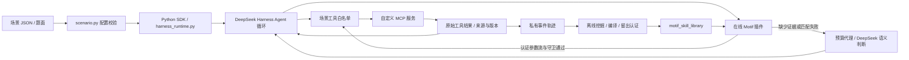

# 场景、Motif 和 Harness 的接口

## 普通文件管理探索场景（2026-10-13）

新增 `scenarios/file-management/`，通过既有 SDK 和 stdio MCP 调用十二个文件工具。工具、参数、权限和恢复机制详见 [逐项变化](changes/file-management-discovery.md)。没有新增共享 ToolContract、IR、Runtime 或预算字段。

私有环境 `FM_TASK_FILE` 绑定冻结任务，`FM_OUTPUT` 绑定当前 attempt 的私有产物目录。工作目录必须在 testpdf/file-management-experiment 子树且有实验副本标记，不能访问原始 PDF 或任意本机目录。file_id 是相对路径与内容身份；source_id 是任务/文件/解析版本绑定的句柄，不是密码学签名，MCP 服务仍是信任边界。

写操作使用 `preview_actions(actions)` 签发计划，`execute_plan(plan_id)` 再核验当前快照、授权动作和目标无冲突。执行保存原文件与逐步 journal；`restore_plan(plan_id)` 核验没有后续操作后恢复。此写操作协议只服务已授权实验副本，不能导入现有只读 Motif manifest。

`submit_report` 返回绑定输入和产物 SHA 的收据，完整内容写私有目录。独立验收实际文件状态、读取覆盖和生成材料的已知语义锚点；失败任务仍保留原生事件和费用。首轮统一学习复用现有只读参数边编译/认证。分支、数组控制和写操作图只作为观测候选，本阶段不宣称它们已经自动认证或上线。

实验预算通过场景调度器跨所有版本累计，用户总上限1000美元，单任务5美元保护；原有0.25美元默认入口和通用100美元单任务参数上限保持。价格已核对官方文档，实际估费仍采用现有代理峰值价格，未核实付账单。

## 多窗口读取续接（2026-10-13，复用现有核心）

独立`pdf_window_tools.py`/`pdf-window-scenario.json`只服务topic_search，新pin接口4个必填字符串paper_id/page/start/length；数字位置以有界规范十进制字符串表示，场景校验后调用原PdfScene。旧探针整数接口保持。此表示适配同时给H/M，不计学习收益；Runtime只接实际source_id，不生成页/窗口。

`window-study.py`先冻结题面直接含不同研究问题的3/2训练与1篇认证，再用原edge compiler/library/exporter产出私有v1 manifest；验证工具schema及完整源结果。SDK在线复用原`sss-online-motif`/proposeReadyBatch/失败交接/闭合source读取免embedding，不新增共享字段或插件。新实验学习/源码变化重新建ID；不把相同题面仅工具不同的任务当独立训练，不更改原SDK manifest。书面接口与GitHub说明见[实施记录](changes/pdf-window-continuation.md)。

CLI阶段train/learn/evaluate/summary，默认先预览，付费须--call-model。每任务0.25美元/4000输出，当前双方32 SDK步骤（包括Runtime步骤）；原16步pilot保留。`check-window.py`使用实际SDK/MCP及本机mock作正例/陈旧版本回退，API0；不参与训练。`window-component.py`从真实普通任务选择取冻结三窗口计划，核对两组完整原文包；不作为完整科研解释评分。

新`explore-workflows.run`仅增加可选scene_class/server_path/manifest/embedding_endpoint与protocol.max_steps；默认仍原探针/16步。收集器跳过真实isError调用，只重放成功结果；有效发布收据与SDK完整结束分别记录，SDK error标incomplete_workflow。预算/共享core/上游/Web默认不改，旧库不组合。实验[同包局部收益与全任务反例](experiments/window-continuation-20261012-0bc4ddc5.md)，类型字符串误用开销明确保留。

## 文献多流程探针（2026-10-12，场景内接口）

`workflow_probe_tools.py`复用`PdfScene`，独立场景`workflow-probe-scenario.json`；不改变共享Harness/Motif/预算协议、旧认证库或正式Web/Agent工具集。`explore-workflows.py`根据kind冻结实际工具允许集并调用原`run-scenario.py`，不是新LLM循环。

- 私有`SSS_WORKFLOW_PROBE_FILE`绑定schema_version/kind/task/citations/network_check_enabled；`SSS_WORKFLOW_PROBE_OUTPUT`仅允许项目.local。task仍是原PDF冻结清单/问题；kind为topic_search/citation_audit/resource_inventory。
- 共同`read_workflow_input()`返回实际论文/引用数组、任务/输入/执行版本；共同`submit_workflow_report(rows)`要求每个冻结目标恰好一行，target_id/status/explanation/references，解释最多700字符。回执artifact_sha256覆盖完整JSON；preview/needs_review均直接交付，不设人工审批。
- 主题工具复用search/pin/read签名，至少搜索每篇，located需要本次已读同篇source_id。缺命中不证全文没有报告。
- `check_citation_target(reference_id)`使用真实旧笔记的PDFSHA、窗口版本、物理页/页内绝对quote偏移与原句SHA，窗口读取时转换为相对偏移。返回current/stale/unresolved，不能替代科学支持核对；模型提交必须复制实际状态。
- `find_resource_links(paper_id)`返回同篇、同文档版本、正文URL/上下文/resource_id；不还原断行或PDF链接注释。`check_resource_url(resource_id)`只访问当前工具签发资源，固定4个公共HTTPS主机、无认证/query/redirect/body、单次5秒、任务最多8候选检查，重复使用本次观察。200为瞬时HEAD可达；403/429/超时为inconclusive；无权限/超界为blocked/unchecked。结果由同任务实际观察保留，不跨任务缓存可达性。

来源选择/文件/执行版本改变拒绝发布；所有工具只读用户PDF，派生工件写.local。本轮无正式工具契约库/可执行Motif导出，分析标candidate_only/approved_for_bypass=false，不能将上述手写工具当学习规则。下一步通用引用数组、多参数搜索网格、非入口前沿/条件汇合如需共享改动，先详细记录字段、来源证明、生命周期、兼容和失败交接，再实施。完整流程及实验边界见[场景清单](../scenarios/literature-notes/workflow-discovery.md)、[探索记录](experiments/workflow-discovery-20261012-eec15558.md)。

## 清单到准备的入口前沿（2026-10-12）

新增协议 `sss-entry-inventory-v1`，仍用固定 `sss-entry-motif` 插件和 SDK 成对 `--entry-policy/--entry-task`。`entry_read_policy.ts` 根据协议分派到 `inventory_entry_policy.ts`，旧 `sss-entry-read-v1` 与旧 manifest 保持原路径。SDK 校验策略全部工具都在场景允许集合内。

IR 为 `inventory_then_foreach`：零参数 source 工具返回 `papers` 对象数组，逐项取实际 `paper_id` 调用准备工具；task 冻结清单只是守卫，不能绕过实际 source 返回值绑定参数。须全部选中项、唯一、1–20 篇、每批≤8；校验 `task_sha256`、question、完整数组、PDF SHA、逐文 `document_version_sha256` 和 `parser_profile_sha256`。结果缺失/来源变化/工具失败/工具 schema 或 Session/提示变化交回模型；低文本和版面诊断原样保留，模型决定后续阅读或缺口。

离线学习要求两条不同任务/不同大小的原始 provider 前沿与另一任务认证；每个参数都有 source 数组索引、原始 call/result 配对、usage 和当前工具重放摘要。PDF 准备原契约 `replay_stable=false` 不改；新 `inventory_contract_signature` 单独绑定完整原契约与来源/解析器守卫，不放宽旧 contract_signature。仅缓存计数 `cache_stats` 不参与导航一致摘要，其他字段都参与；保留原始完整输出。

场景 `run-pdf.py --entry-policy` 和 `agent.ts run --reading-entry-policy/--claim-entry-policy` 显式加载私有认证策略。程序选项 `reading_entry_policy` 只应用于首次普通阅读；`claim_entry_policy` 只应用于第一轮 `claim_support_audit`，后续缺口与综合保持普通 Harness。两项默认关闭，旧 manifest 互斥；本机 Web/HTTP 拒绝客户端传这两项路径，官方 Web 未启用。`entry_verified_batches` 汇总新入口批次，实际净省用 HTTP 账本，不能把批次数当净省请求。变更与 GitHub 提交依据见 [记录](changes/inventory-prepare-motif.md)。

## 已认证的任务入口读取前沿（2026-10-12）

`prepare_scenario(..., entry_motif=False)`新增显式入口插件开关，只加载固定`dsh_entry_motif.ts`，默认关闭且仅native；场景JSON/HTTP不能传任意插件。SDK新增成对`--entry-policy <私有JSON>`和`--entry-task <私有JSON>`，暂与旧shadow/execute和PTC互斥。SDK绑定真实Session/完整提示SHA，清除普通组继承的入口环境变量，预算代理不变。

入口协议`sss-entry-read-v1`与旧在线manifest v1/v2分开，不替换旧接口。离线复用认证artifact和library摘要；IR唯一操作是`foreach_frozen_targets`，`all_targets`来自正常原始入口调用的完整参数覆盖，至少两条不同大小/不同任务训练和第三条认证。Task含`input_version`、`target_ids`及摘要、逐目标`target_versions`、`execution_version_sha256`，目标唯一且最多100，单批最多8。空集不调用；执行器/工具schema/Session/提示变化或失败交回原模型，不能执行任意代码或跳过语义判断。

在线复用原生工具流及结果回调；每条结果必须匹配调用参数、目标、冻结稿摘要与当前文档版本。审计追加`entry_motif_bypass_attempt`、`entry_motif_read_verified`、`entry_model_request_bypassed_verified`、`entry_motif_semantic_handoff`与失败/拒绝记录。SDK新增`entry_policy_digest`、`entry_mode`和`entry_model_requests_bypassed_verified`，不改旧`model_requests_skipped_verified`计数。真实请求以`upstream_requests`/HTTP账本为准；多批Runtime绕过不等于同样数量的实际净节省。

场景`repair-pdf.py --entry-policy`从服务端有效`RepairScene`产生当前目标与文档版本，不信任模型自报supported。结果仍由原提交/收据校验回收，预算与缺口规则不变。当前默认Web/Agent不开启新入口Motif；这是一个实验性复核阶段能力，三任务中两种已有证据复核观察到节省，单缺口补读反例仍需保留。详细接口/回退见[变更说明](changes/task-entry-motif.md)，实测见[记录](experiments/multitask-motif-20261012-4ba53478.md)。

## 文献工作台的场景内部接口

`scenarios/literature-notes/agent.ts` 是TypeScript阶段协调器和本机HTTP入口，不另建LLM循环。阅读、语义审阅、增量语义复核调用既有场景CLI，继续使用共享Harness/MCP和预算代理；Python `agent-support.py` 只做来源重放、工件封装及离线依赖编译。

新增逐论断修复阶段：`Options.repair_rounds`默认1，可选0–2；`repair_only=true`要求完整`parent_job`且1–2轮语义复核，用于只修冻结旧稿。状态新增`repairing`。第一轮全部字段、review_mode=evidence_first_reextract隐藏旧句独立重提取；后续为compare_existing_claim，仅缺口/数值缺口；`repair_stop_reason`记录无未解决项、轮数耗尽、预算不足或stage_failed。完整账本下额外语义阶段失败可交付上一份来源核验稿并展示repair_warning，不能标修复成功；账本/来源/工件失败仍拒绝。来源或处理契约变化不能续修旧稿；历史结果/账本保留。

场景内新增四个MCP工具（不改共享ToolContract/IR/manifest/预算）：`read_claim_repair_packet(claim_id)`、`search_claim_evidence(claim_id,query)`、`read_claim_evidence(claim_id,page,start)`、`submit_claim_repair(decisions,synthesis_hypothesis)`。目标列表绑定输入SHA，字段不能扩容；最多2次检索/3次6000字符读取，失败尝试同样占额度。检索不发引用许可；引文必须为该论断已读的同篇source_id/quote_id。分批提交有效决定暂存，错误只针对具体claim_id；每项3次事实校验尝试，耗尽后仅显式留缺口。supported由Runtime精确复制原句/引文；revised引用实际原文并检查数字；withdrawn/not_extracted使用标准缺口文本，无引文。合并保留非目标字段。默认逐论断阶段替代旧整稿审核；repair_rounds=0保留旧审核路径。原生收据同时绑定修订稿与审核audit摘要、冻结目标与repair_request_sha256；pending结果不是收据，只存在JSON文件不能证明模型已提交。另有显式receipt_origin=validated_model_final_json_recovery：从真实模型最终消息回收严格结构提案、重放原生读取并逐项验证，不伪造tool事件；不合格项由Runtime标技术缺口，额外模型请求0。recover --job创建新任务并单列原始提案费用。

Python只负责MCP与离线封装/回收；在线阶段与有界轮次仍由场景TypeScript协调，语义模型仍用现有Harness。没有新增Python LLM循环。文件清单和本次接口详情见[变更说明](changes/literature-claim-repair.md)。

当前默认交付策略为`automatic_v1`：不等待人工审核，完成为`delivered` / `delivered_with_gaps`；结果包含`human_review_required=false`，质量为`automatic_model_reviewed_unverified`或`automatic_source_validated_unverified`。来源重放、自动审阅与账本检查仍执行，错误不能直接改成成功。有缺口仍交付并标明缺口。网页不提供审批或逐字段核对门槛。

CLI `deliver --job <UUID>`用于旧完整工件的策略重交付：任务/来源、解析器和处理契约必须一致并重放来源；只允许交付工作流版本变化。新建任务链接旧任务，0新模型请求；不覆盖历史账本，不假称新语义审阅，不能将旧模型审阅绑定到后来编辑稿。

- `POST /api/run`：文件夹、问题、总预算、显式`call_model`、是否自动审阅、可选`parent_job`；返回任务UUID，轮询`GET /api/jobs/<UUID>`获取进展。默认不调用模型。
- `GET /api/jobs/<UUID>/cards|notes`：当前论断/引文/物理页/模型意见或Markdown下载；不能经任意路径读文件。工件限`.local/literature-notes/agent-jobs/<UUID>`。
- 兼容接口（非默认流程）`POST /api/jobs/<UUID>/revise`：当前`evidence_sha256`、完整字段陈述映射、综合分析。保留引文/旧候选，撤回当前批准状态并直接交付修订结果；不自动认证或补齐缺口。
- 兼容接口（非默认流程）`POST /api/jobs/<UUID>/approve`：当前摘要、所有字段ID、`synthesis_reviewed=true`。需当前来源与配置一致，卡片完整、无来源/数值缺口。这是用户明确进行来源核对的本机受信任声明，不是签名或专家盲评。所有POST需同源页面会话令牌；仅监听127.0.0.1。

场景依赖编译器兼容旧`reviewer_kind=Codex`，新增`Human`及对应质量`human_source_checked_expert_blind_review_pending`，要求审核身份、候选摘要、逐字段陈述/定位和综合核对声明一致。共享ToolContract、Motif IR/manifest、Runtime和MCP schema **本次均未改**。实现变更进入场景`contract_version`，历史依赖图在当前版本应失效，使用保留的来源审核记录重新编译，不覆盖历史实验。新增工作流版本摘要用于结果缓存失效，UI排版变化不改变研究工件版本。

自动结果的变化更新暂为完整重读；自动模型审核身份与逐字段复用许可尚未接入旧依赖图编译器。旧Human/Codex图保留历史兼容。

费用汇总保留失败阶段已知费用；缺少费用记录就标为不完整，并阻止后续模型阶段。既有增量入口的显式0请求/0费用/0复核字段收据及明确不加载模型的离线提案校验回收可记录本轮0费用；回收保留父任务费用。不能从缺少账本推断0费用。相同任务的结果缓存不计Motif验证跳过；详情见 [工作台变更](changes/literature-workbench.md)。

## 运行链路与边界



Python controller 与 JavaScript online runtime 是两条执行路径：在线插件使用 JS 子集，并未通过 RPC 调用 Python controller。不要把它们描述为完整同构实现。DSH 实际执行 MCP 工具；插件只在认证的只读步骤上替代一次模型决策。

## 已确定的技术路线与当前交付形态

后续采用 **Python 离线学习/编译，TypeScript 在线执行**。新增 Harness 在线逻辑使用 TypeScript；现有 JS 插件逐步迁移，Python controller 保留为参考和离线验证。生产在线 Runtime 以 TypeScript 为权威，不另建 Python 在线决策进程。双方通过版本化、带摘要及证据的 Motif IR/library 对接；类型定义之外仍需运行时校验和协议一致性测试。

当前安装清单固定 `@deepseek-ai/dsh` 为 `0.1.5-rc.3`，安装后由 `harness_runtime.py` 启动 `node_modules/@deepseek-ai/dsh/lib/bin.js`。因此运行时包含真正的本地 Harness，Git 仓库不内置其源码副本。`dsh_online_motif.mjs` 是原生插件，通过生成的 patch 和本地文件 URI 挂载；baseline 不加载该插件，shadow/execute 显式加载。

SSS 当前是“插件实现 + 编译器 + 科研实验环境”，还不是独立分发的 Harness 插件包。产品化需要严格类型、共享 Schema/兼容规则、构建/打包和安装入口。实验入口及预算代理使用 Python；在线 `runPureCode` 还会启动 `pure_code.py`。解除已有 library 执行对 Python 的依赖时，必须保留预算约束和纯代码隔离/校验，不能简单删掉这两项。外部 MCP 和 embedding 服务的部署依赖仍由具体服务决定。

## 1. 自定义 MCP 场景接口

每个场景放在 `scenarios/<name>/`，包含 `scenario.json`、题面、必要的服务/契约和独立测试。复制 example 即可。配置版本是 `schema_version: 1`；服务器顺序、工具名字/顺序和提示尽量保持稳定。

```json
{
  "schema_version": 1,
  "name": "my_scene",
  "prompt": "prompt.md",
  "servers": [{
    "server_name": "papers",
    "transport": "stdio",
    "command": "${PYTHON}",
    "args": ["${PROJECT_ROOT}/scenarios/my_scene/server.py"],
    "cwd": "${PROJECT_ROOT}",
    "env": {"PAPER_API_KEY": {"from_env": "PAPER_API_KEY"}}
  }],
  "allowed_tools": ["mcp__papers__find", "mcp__papers__read"]
}
```

支持 `${PROJECT_ROOT}`、`${PYTHON}`、`${CASE}` 三种公开占位符。题面路径相对配置文件；配置里的进程 cwd 默认是项目根。服务名限小写字母、数字、下划线，工具全名限制 64 字符，以避免 Harness 改写名字造成契约不一致。

HTTP 服务将 server 替换为：

```json
{
  "server_name": "papers",
  "transport": "streamable-http",
  "url": "http://127.0.0.1:8765/mcp",
  "headers": {"Authorization": {"from_env": "PAPER_MCP_AUTH"}},
  "tool_call_timeout_ms": 60000
}
```

`PAPER_MCP_AUTH` 应包含服务需要的完整认证头。`from_env` 只保存变量名，在 Harness 子进程中求值；预览、生成的 patch 和 Git 不包含其值。密钥不能写成 JSON 字面量。HTTP 配置路径已验证；真实 HTTP 服务握手仍需场景负责人联调。

白名单会限制模型可见工具，并在派发时再次拒绝其他工具。新增服务无需改图核心或上游 Harness。新场景默认先做只读验证；有副作用的 MCP 必须在服务端限制作用域、提供写操作预览与明确确认，现有通用入口不会替任意 MCP 实现业务授权。模型可调用的工具也不自动获得 Motif 执行资格。

## 2. MCP → Motif 的数据契约

文献场景的实验 CLI 新增可选 `run-evidence.py --frozen-plan`：只从 `.local` 私有常规文件加载完整批准计划，校验当前任务/来源；收集时要求输出计划完全相同。`compare-evidence.py` 复用原生成功运行进行轮换对照，默认预览；`reuse-evidence.py` 仅为完全相同显式问题/计划提供来源重放与结果缓存，不能给新问题复用旧凭证。它们未增加共享契约或 MCP schema，详见 [场景说明](../scenarios/literature-notes/README.md)。

推荐每个只读对象返回 `object_id`、`source_id`、`version_sha256`。句柄必须由前一步实际返回，绑定版本，旧版本应由服务端拒绝。参数或结果相等本身不是依赖证据。example 服务提供 `pin_note → read_pinned_note` 的最小实例。

`contracts.json` 将 Harness **实际完整工具名**映射到契约，主要字段：

| 字段 | 含义 |
| --- | --- |
| `required_params` / `default_params` / `parameter_shapes` | 参数名、真实默认值与形状；须与 MCP schema 相符 |
| `read_only` | 是否只读；写操作不进入当前结构执行子集 |
| `output_fields` | 可引用输出字段，允许显式点路径 |
| `provenance_params` | 必须来自工具返回的参数，而非模型猜出的值 |
| `replay_stable` / `observed_anchor` | 可认证重放，或仅允许正常 Agent 的新鲜结果作锚点 |
| `description` | MCP 提供的实际描述；有 schema 文件时通过 `tool_schema_contracts.py` 绑定 |

合成科研任务的完整范例在 `config/research-portfolio-tool-contracts.json`。`tests/fixtures/contracts/` 的 Gmail/Zotero 等只保留历史协议样本，用于参数来源回归；对应真实应用连接器已经归档。

## 3. 轨迹 → library → 在线 manifest

首发分发库在 `examples/motif-library/research-portfolio-v1/`：4 个历史 DeepSeek 轨迹编译出的 Motif，保留原认证摘要。`library.json` 是离线产物，插件加载 `online-manifest.json`；`task.json` 仅适用于所记录的 `l_retrieval_persistence` 来源快照。`npm run motif:rebuild` 从公开证据重新挖掘认证并核对相同产物，`npm run motif:check` 加验真实 Harness/MCP 的本机模拟闭环。重编译输出只写 `.local/`，不依赖历史私有轨迹，不改通用编译器的私有数据路径约束。样例重编译使用 witnessed-edge 路径；下面的通用 CLI 使用连续序列 library 路径，两者不能混报。

公开证据是审核后与仓库合成 MCP 逐项重放一致的最小夹具，不是允许提交原始运行日志的例外。历史云请求出处与当前模拟验收分别记录；该样例没有真实研究交付质量或实际费用结论。具体命令、来源、版本锁与范围见样例 README。

普通 Harness 的运行目录位于 `.local/runs/<id>/`：

- `manifest.json`：题目、任务 ID、提示/配置哈希、工具顺序、模型和预算；
- `agent-events.jsonl`：原始工具与模型事件，结果不能被压缩替换后的内容冒充；
- `answer.md`、`metrics.json`、`cost-ledger.jsonl`：交付、用量与逐请求预算记账；
- `.local/online-motif/<session-hash>.jsonl`：开启插件时的决策审计。

人确认不同研究决定的 ID 后，冻结每份轨迹：

```sh
node scripts/project.mjs python scripts/freeze-dsh-task-identity.py --task-dir .local/runs/RUN_ID --decision-id scene-decision-001 --events agent-events.jsonl
```

编译清单放在 `.local/`，内容如下。至少两项独立训练决定和一项独立认证决定；改 trace 名不能制造独立性。

```json
{
  "contracts": {"完整工具名": {"required_params": ["id"], "read_only": true, "output_fields": ["source_id"], "replay_stable": true, "description": "实际 MCP 描述"}},
  "train": [
    {"trace_id": "t1", "events": "runs/RUN1/agent-events.jsonl", "identity": "runs/RUN1/task-identity.json"},
    {"trace_id": "t2", "events": "runs/RUN2/agent-events.jsonl", "identity": "runs/RUN2/task-identity.json"}
  ],
  "heldout": [
    {"trace_id": "h1", "events": "runs/RUN3/agent-events.jsonl", "identity": "runs/RUN3/task-identity.json"}
  ]
}
```

这里的 contracts 只是字段说明，须换成场景的完整工具契约；只写一个工具无法构成示例读取链。可加 `tool_schema_file` 与显式 `provenance` sidecar；路径相对清单。编译器只接受 `.local` 下的原始轨迹和身份锁，并拒绝同决定/同问题的伪独立样本。

```sh
node scripts/project.mjs python scripts/compile-dsh-motif-library.py --manifest .local/traces.json --out .local/motifs/library.json
node scripts/project.mjs python scripts/export-online-motif-manifest.py --library .local/motifs/library.json --contracts scenarios/my_scene/contracts.json --version-fields .local/version-fields.json --output .local/motifs/online.json
```

`version-fields.json` 是参与该 library 的工具名到真实版本字段的映射；不能加入未编译工具或编造字段。可加 `--slot-rules` 限制初始标识符。library 含轨迹来源、参数流、DAG/局部代码、认证摘要；不是手写工作流或 Codex Skill。训练后必须留另一组独立任务做效果评测。

## 4. 在线 Motif 插件接口

准备结构任务 `.local/current-task.json`，由任务负责人填写：

```json
{
  "schema_version": 1,
  "task_id": "scene-next-decision",
  "session_id": "unique-unused-session",
  "intent": "此次研究决定的具体目标",
  "input_version": "此次输入的冻结版本",
  "bindings": {"完整入口工具名": {"真实参数名": "已授权标识符"}},
  "source_versions": {"完整工具名": "已验证来源版本"}
}
```

Bindings 必须是 manifest 认可的参数槽；版本可以使用运行时认可的 `@observed` / `@from_anchor`，其守卫仍依赖实际新鲜工具结果，不表示取消版本核验。参见 `parseStructuredTask` 及其测试。不要复制旧答案填成新任务。

```sh
npm run scenario -- --scenario scenarios/my_scene/scenario.json --mode shadow --manifest .local/motifs/online.json --task .local/current-task.json --embedding-endpoint http://127.0.0.1:8123/v1/embeddings --embedding-model LOCAL_MODEL
```

默认只校验并预览。加 `--call-model --budget-usd 0.25` 才开始付费任务。`shadow` 记录候选但继续调用模型；`execute` 尝试替代模型请求。插件使用环境变量 `SSS_ONLINE_MOTIF_*` 和 `SSS_MOTIF_EMBEDDING_*`，由入口统一设置。

### 4.1 批准计划的机械续接许可（2026-10-10）

用户已授权本场景修改共享接口；具体变更、兼容与提交说明见 [变更记录](changes/approved-plan-continuation.md)。本接口为有限只读三节点链提供免 embedding 的选择条件，参数边仍必须由真实轨迹挖掘、不同任务训练及留出认证得出。声明权限范围本身不叫学习。

| 层 | 新字段 / 版本 | 含义 |
| --- | --- | --- |
| Python `ToolContract` / JSON 契约 | 可选 `continuation_policy`，默认 `None` | 明确允许自动续接的三步机械操作；不从工具名或 read_only 推断 |
| policy | `schema_version=1`、`kind=approved_plan_continuation`、`steps` | 恰好三个不同工具，每步声明 `tool`、单一 `param`、`receipt_field`、`success_status`、完整 `input_schema_sha256` |
| 编译 / 认证 artifact | `continuation_policy_digest` | SHA-256 绑定策略；训练与留出中的每步须有一致且成功的真实工具许可 |
| online manifest | 新许可使用 `schema_version=2` | 旧 Runtime 会拒绝 v2，不能忽略许可后照常匹配；无新许可的导出仍为 v1 |
| structured task | 仍为 v1，新增可选 `continuation_policy_digests` | 由可信入口在冻结用户任务时批准有限策略；缺失时不授权新续接 |
| MCP 成功结果 | 可选 `continuation_grant` | 工具确认计划、任务、版本、当前阶段和输出凭证；不接受论文文本或模型最终答复替代 |

`continuation_grant` 必须恰好有这些字段：`schema_version=1`、`policy_sha256`、`task_input_version`、`execution_version`、`plan_id`、`completed_steps`、`receipt`。任务/执行版本为64位十六进制 SHA-256；计划为当前 MCP 会话签发的 `source-<32hex>`；输出凭证须等于对应步骤声明的 receipt 字段。`completed_steps` 依次1、2、3；工具 status 须等于契约声明的成功状态。

这些凭证是可信 MCP 的结构化断言和内容摘要，**不是数字签名**，不能防御恶意或被攻破的 MCP 服务。信任前提是用户授权的入口/契约以及 Harness 原生工具结果。文献内容、模型生成的布尔值、来源页码和 embedding 分数都不能单独授权。场景服务独立校验已注册计划、许可、私有凭证登记、文件摘要、当前来源与解析器，Runtime 独立校验当前会话、冻结提示、策略摘要、完整实际工具 schema、唯一绑定和同一计划的许可链。

支持的结构严格为 `anchor → step2 → step3`：每个后继只接受一个上一节点 receipt 参数，无额外默认值、无数组/代码节点、无跨来源版本。策略只限定可执行范围，实际边必须全部由历史调用见证。无法绑定全部参数、竞争后继、许可缺失/撤回、schema/任务/版本变化或失败时返回正常模型路径；带该策略的候选不能通过语义分数绕过拒绝。

新选择依据为 `closed_approved_plan_continuation`，审计 `motif_bypass_attempt` 记录 `continuation_policy_digests`。执行后复核 status、许可和参数/版本，再发 `motif_tool_result_verified` 与 `model_request_skipped_verified`。失败发 `bypass_result_unverified`，暂停当前会话的结构续接；`motif_continuation_rejected` 记录 `missing_stale_or_revoked_grant`。缺文本/needs_review 无成功许可，不能计成验证跳过或合格交付。

策略进入 `contract_signature → certified_digest → library_digest`，导出又绑定 `manifest_digest`。完整 schema 摘要既由离线 MCP schema 绑定器检查，也在在线候选构造中逐工具检查。修改策略/schema/工具实现后需新版本任务与新轨迹认证；禁止向旧轨迹补写许可以升级资格。原 v1 契约签名、library 和匹配行为保持不变。

在线新规则源文件是 `src/motif_core/approved_plan_continuation.ts`；旧 `.mjs` 插件调用随仓库提交的 `.generated.mjs` 桥接。运行不增加 TS loader 或 Python 控制循环；开发构建用 Node 22.18+ 的 `npm run build:continuation`，支持该构建器的 Node 版本在测试中检查产物一致。当前新功能实际验证环境是 macOS / Node 22.22.2 / Python 3.12.13；其他平台仍需 CI/场景实测。CLI 暂时仍要求本机 embedding 配置，新许可路径验证为零 embedding 请求；场景入口配置的是拒绝请求的本机诊断端点，不提供假向量。

插件依赖 DSH 的 `agent/created`、`tools/result`、`llm/stream` 和 agent-loop 标记。在匹配会话与冻结提示内，校验 library 摘要、实际可用工具 schema、参数来源、版本及依赖。命中时返回标准工具调用流，由 Harness 派发；工具结果复核通过后才记录 `model_request_skipped_verified`。无命中、歧义、权限/版本变化和工具失败会返回模型判断或停止结构继续，不能仅凭发起 bypass 计为成功节省。

当前插件要求本机 embedding 配置。唯一闭合的部分读取链可直接使用结构证据；其他匹配可能调用本机 embedding 服务。其服务/模型是可选依赖，基础安装不下载权重。`scripts/local_embedding_server.py` 和下载脚本保留为可选参考；需另装 torch、transformers、huggingface_hub，使用固定权重和版本自行验证。

Python 语义端口在 `motif_read_semantic.py`：接收明确的结构缺口，调用受预算代理保护的 `dsh_client.call_bounded_prompt`，校验输出，交回 `SemanticResolution` 恢复。`harness_runtime.py` 将 SDK 私有 `_launch_args` 接缝限制在一个文件；升级固定的 DSH/SDK 版本时必须重新验证。

`motif_output_projection.py` 与编译器的 evidence projection 只保留为可选机制及回归测试，不挂在新入口默认链路。旧 Distil/压缩启动器已归档。


## 文献场景自动来源依赖与全局综合（2026-10-10）

只新增场景接口，未改共享核心。`repair_scope`默认续修仅缺口；`target_claim_ids`把审阅限制在增量收据的变化字段，非目标精确保留。`prior_rejected_proposal`/`rejected_proposals`保存来源绑定的提案及错误，但不授予引用许可。字面候选只来自本论断已读片段。

`reuse_policy=automatic_source_bound_unverified`使用claim节点`source_bound`，不伪造旧`reviewed`审批。Runtime索引只证明字段与实际原文绑定，继承未认证模型内容；索引费用字段`index_model_requests`不覆盖任务记账。PDF/问题/解析器/契约/工作流变化受依赖守卫限制，论文集合变化重新综合，新论文不使全部旧字段失效；每次增量冻结图、索引底稿按版本保留。

`synthesis_only=true`冻结空目标，读取synthesis packet中的完整当前表和引文，提交空修改集仅更新项目假设。MCP schema仍要求decisions，场景collector明确允许此模式空集并比对全部字段未变；共享trace/工具shape接口未扩展。`native_tool_submission_recaptured`表示重新核验已有实际工具收据，区别于最终模型JSON提案的离线验证。详见[接口与提交说明](changes/literature-auto-incremental.md)。
# 文献场景：真实来源变化验证（2026-10-11）

本轮无新增共享接口。`pdf_incremental_tools.py`的私有`incremental_audit`新增`synthesis_requires_review`，`agent-support.package`传递为`incremental_synthesis_requires_review`；工作台默认自动审阅据此在删除且0新增字段时也执行完整证据表综合。工具成功输入schema、上游Harness、预算及Motif跳过计数不变。

增量提交错误仍是MCP工具错误，补充当前字段ID、实际/允许字符数、缺字段ID与缺字面数字。Unicode字符上限仍为120，reason上限400、引文最多3；这些技术诊断不认证语义支持。实现与提示版本进入原contract/workflow摘要，旧自动图失效；重新建立实验基稿，未绕过守卫。

`compare-source-changes.ts`仅在场景内协调已有`runWorkflow`，默认准备/预览、不调用模型。实验只比较全量Harness与普通自动依赖缓存，实际PDF版本和完整费用均保留；GitHub记录见`docs/experiments/source-changes-20261011.md`。


## 2026-10-11：文献读取计划与共享模型别名

场景新增read_pdf_evidence_plan(paper_id,document_version_sha256,windows:list[{page:string,start:int,length:int}])与read_claim_evidence_plan(claim_id,document_version_sha256,windows)。返回版本绑定contexts，引用仍为真实source_id/quote_id；先验证整计划，额度/范围/源变更安全失败，低文本不假称OCR。修复批量窗口与单读共用3次额度，已成功的重复批量窗口先核版本再复用。

support_audit从当前声明比较实际最终引文；80字符上限，supported/revised须给30–1600字符support_anchor，必须为最终选中的单窗连续quote集合内的实际原文。邻近读过但未选择的片段不授权anchor；缺口仍直接交付。anchor/技术名称/数字仅必要字面检查，不能发布Human或科学支持认证。--audit-all保持旧120字符盲重提取。默认Flash，Pro仅候选。

解析profile v3绑定几何修复实现SHA，修复页改由bbox词元生成，不冒充旧plain-text偏移；旧缓存、源句柄、依赖及相应Motif认证需要失效/重建。

正常自动交付默认最多两轮：首轮support_audit，第二轮unresolved_claims_only只修缺口（沿用120字符规则），已通过字段不改；无缺口不调用第二轮。repair-only仍默认一轮。bbox异常可回退已成功的普通文本，并明确布局未验证；策略绑定解析版本，普通解析失败仍拒绝。

批量来源复核先后各检查实际PDF。内部仅免去该请求的重复内存读取校验，ContextVar跨线程隔离、finally恢复，不能用于解析和缓存写入。机械比较入口check-read-plan.py使用真实模型已选计划，要求同上下文，不产生上游调用或Motif跳过。批量不是learned Motif，读取少调用不能推出更快。

support_audit policy v9再要求anchor实际原文到句末标点，必须在最后连续所选引文中，不允许自行补句号。句末只是技术边界，不认证完整否定对象/中文含义；其他旧scope沿用既有行为，第二轮缺口补读不自动获得该模式的科学认证。

唯一共享CLI改动：scripts/run-scenario.py --model接受deepseek-v4-pro，deepseek-pro旧别名归一到该官方ID；preview新增requested_model，model记录实际ID。价格表、预算约束、Harness/SDK、共享Motif IR/schema不改。详细兼容和GitHub提交正文见docs/changes/literature-read-plan.md。

## 2026-10-11：当前版本证据链重新认证

新增场景离线CLI review-evidence.py --run，只将当前来源重放、连续原生许可及前驱参数检查写成可复用机械review；模式必须为真实模型普通baseline。绑定packet/events/contracts/执行版本，旧包及不同已有review拒绝，不授予语义认证；模拟Provider不作真实学习。继续使用learn-evidence.py及既有v2 manifest/TypeScript Runtime，无本轮新增共享协议或MCP schema变化。

两训练/一独立问题认证产出1个当前版本三节点证据准备Motif，后续同计划实际9任务逐字同包，3次各2个原生验证skip；普通脚本也每次4请求且均值更便宜，因此默认不启用此库。该库不能与工作台literature_pdf库互换。接口/回退见docs/changes/literature-evidence-renewal.md，负面结果与完整费用见docs/experiments/motif-renew-20261011-14c3fc42.md。

## 2026-10-11：阅读归一化与决策诊断（场景接口）

read_pdf_evidence_plan参数不变，contexts对应实际归一化窗口；新增normalization及requested_to_contexts映射。完整验证后按真实页尾计算预算、合并重复/重叠范围，超过单窗限额分块；真正超过总实际字符仍拒绝，原文选择不删减。普通阅读8输入窗/36000实际字符/单窗12000、修复3输入窗/18000实际字符/单窗6000。不同claim权限隔离，已校验键不会按另一限额再次合并。

Evidence注册只合并同paper/purpose的选择，返回原请求与归一化计划两个SHA；许可仍绑定实际执行计划。list_pdfs新增reading_budget，空白页保留为低文本缺口。执行摘要包含pdf_read_plan.py，旧包/旧认证不可强制继承。会话原文缓存增加context_cache_hits，返回副本且保留当前源/profile守卫。

场景agent.ts自动写decision-log.json；decisions --job可免费重建。日志为带原事件SHA/序号的诊断，不是原生训练轨迹，不推测原因、不编造费用/skip；科研语义未认证。工作流frame包含新decision-log.ts。全部变化位于场景、测试及文档，没有新增共享核心/预算/Harness/Motif协议变化，详见docs/changes/literature-plan-efficiency.md。

## 2026-10-12：main Web同步与可选完成收据守卫

已带入origin/main bc1ecd5的Web动态任务/预算接口及npm入口，保留场景改动。main的原接口及服务器记录见docs/handoffs/harness-web.md；本地main跟踪origin/main，工作目录仍在feature/rsi-research-agent，不代表修复已提交到main。

scenario可选completion_guard={tool,statuses,max_continuations}，限定现有allowed_tools及0–2次续接。prepare_scenario返回agent_plugins，SDK补丁与官方Web preset加载同一TypeScript守卫。只接受成功工具结果和私有常规产物的规范JSON SHA收据，pending/error/文本不算完成；agent/turn-stopping使用公共steer续接同Session/turn、同预算，耗尽明确失败，取消不续接。消息来源task-completion-guard，不伪造用户授权、原生工具或Motif skip。SDK指标新增completion_guard_enabled/completion_continuations。新插件/工作流SHA进入快照及版本检查。

文献quote_spans新增citation_id；preview_research_notes和submit_claim_repair接受单字段引用，发布时规范化成旧source_id/quote_id，不修改原始模型参数。旧格式兼容，权限/来源/支持锚点/额度限制不放宽。阅读和修复启用守卫，其余场景未配置则保持旧行为。详见docs/changes/literature-receipt-guard.md。

最终自研前端，临时Harness Web；文献冻结任务仍由agent.ts→SDK生成，尚未宣称官方/tasks已完成任意PDF问题绑定。当前Web模型守卫与SDK都固定off，真实思考模式对照尚未进行。一次真实三论文任务与模拟故障路径分别记录，不能互相替代。

## Web 可选场景任务绑定（2026-10-12）

服务器policy可选task_binding={module,config}，HTTP客户端无该字段。固定文献模块先prepare生成唯一受信任preset和问题/源摘要，Controller创建独立Session；allowed_tools必须完全等于启动profile。submit前check来源/任务摘要，idle后collect核native成功工具收据+私有产物+当前来源重放；失败状态failed，不能idle即完成。budget/control/单任务槽仍原实现。

任务详情新增可选scene_binding_sha256、papers、delivery_status、delivery（Markdown/引用/字段/缺口/质量/任务SHA），原answer保留；completion_continuations计实际公开停止守卫消息。文献HTTP输入为单文本问题，inputs默认登记全部PDF或pdf:library/version，拒绝image/file receipt及原生聊天绑定；其他profile保持原接口。场景reading/claim-review/synthesis的工具权限与额度复用既有实现，不给客户端插件或文件路径权限。具体接口/兼容/回退见[变更说明](changes/literature-web-binding.md)，本次真实费用及边界见[验收记录](experiments/literature-web-binding-20261012.md)。

## 可选 Harness 原生 Code Mode 基线（2026-10-12）

SDK `--tool-presentation native|ptc`，默认native。PTC只改变原生工具呈现/run_code执行面，MCP白名单保持相同；实际modeFor(scope)=ptc才放行外层run_code，子调用走原守卫。当前与Motif shadow/execute组合拒绝。新DockerCodeRuntime是公开CodeRuntime.run部署实现，仍上游WorkerThreadCodeRuntime运行模型程序，无宿主私密/Key/论文挂载、无网络，不可用时失败，无unsafe host fallback。

原始ptc-dispatch-start/settled成对回收；project_ptc_dispatches的分析视图标来源seq/sha/root，原日志保留，不作为原始模型决定或单独训练见证；训练入口拒绝PTC轨迹。compare-evidence可--include-code-mode，四轮平衡四组；packet/source/prompt一致后比较包含失败的费用。代码、兼容、原生/隔离测试与回退见[变更说明](changes/literature-harness-comparison.md)，实际对照见[结果](experiments/harness-strong-20261012-5da6ab9f.md)。生产Web仍默认native，未声称完整科研质量/总成本或思考模式对照已完成。

## 增量更新的可选入口 Motif 与明确提交类型（2026-10-12）

新增独立 `sss-entry-incremental-v1`，复用固定入口插件、原预算账本及原生 MCP 调用生命周期。`entry_compiler.inventory_witness/compile_inventory_motif(frontier='incremental')`要求真实模型先读取更新计划，再用实际 `work[].paper_id` 完整准备受影响 PDF；两个独立不同大小任务训练，另一个任务认证。原inventory默认值与旧读取协议不变；Runtime事件、错误、语义调用插入、不完整遍历和来源重放不同不能认证。

增量task冻结完整source_result_sha256、plan_sha256、当前任务/问题、受影响PDF列表、document_version和解析profile。TypeScript在读取实际更新计划后检查完整返回摘要，参数只取真实work对象；随后至多8项一批准备，结果逐项核源，交回原模型读证据和写事实。变化或失败回退，不能处理retained论文、凭旧引用写新事实或宣称旧事实仍真。空work无认证路径；已有完全无变化0调用属于普通缓存。

场景 `run-incremental.py --entry-policy <私有认证策略>`；应用CLI `agent.ts update --job <父UUID> --incremental-entry-policy <策略>`。默认关闭，与旧manifest/脚本基线互斥；HTTP拒绝客户端策略路径。现有SDK --entry-policy/--entry-task、插件与预算接口不变。详见[实施前接口记录与提交说明](changes/incremental-work-motif.md)。

`submit_claim_repair` MCP工具名和语义验证不变，Schema改为有verdict分支的类型。支持复核supported/revised必填support_anchor（30–1600原文字符），revised必填statement（最多80）/citations（1–3）；普通复核上限120、不要求anchor。supported优先省略原句/引文，兼容显式传入但必须与原值完全一致。gap只传claim_id/verdict/reason，Runtime补规范缺口文本。来源、证据权限、连续引用、句末、数字和技术名检查以及每论断3次语义提交尝试不变；MCP类型错误在进入场景提交前拒绝，不消耗其额度。这是公共接口修补，两组一致使用，不能算Motif收益；旧工具schema绑定库需要重新认证。

## 已认证收据后的终止前沿（2026-10-12）

独立`sss-terminal-receipt-v1`/task_terminal_receipt，Python terminal_compiler学习真实单一submit_claim_repair→成功收据→一次实际最终模型文本/stop的关系，至少两个不同目标数独立任务、第三认证。末尾文字留作原证据，不把任意事实总结编成模板。TypeScript terminal_receipt_policy只支持claim_repair_v1，开发者限定的状态JSON复制程序不称自动学习。

当前Session实际工具回调、最后单一工具结果及对应模型提交、相同prompt/user envelope/Schema、输入/目标集合/源码/PDF快照、私有artifact/audit及摘要/计数全部核验才截获下一次agent-loop请求，产生producer=certified_terminal_runtime、scientific_truth_certified=false的状态JSON/stop。失败、pending、混合批次、用户续问和变化交原模型；当前库只见preview，needs_review未认证仍原模型。正文/引用交付依然由原工具与collector负责，不由末尾文字代替。

SDK新增配对--terminal-policy/--terminal-task，私有常规文件/当前Session/实际题面绑定；只native baseline，与旧entry/manifest/PTC拒绝组合。复用固定dsh_entry_motif与现有prepare_scenario插件装载开关，旧入口行为不改；普通baseline清空新SSS_TERMINAL_MOTIF_POLICY/TASK，防止继承。终止审计与terminal_model_requests_bypassed_verified单列，真实HTTP预算/账本不改。

场景repair-pdf --terminal-policy；agent.ts claim_terminal_policy/CLI --claim-terminal-policy只第一轮claim_support_audit，后续缺口/综合不启用，HTTP拒客户端路径；job.terminal_verified_batches独立于entry/旧skip。源码/修复入口变化会正常使旧自动缓存失效，历史不改写。默认关闭，Web未启用。详情和回退见[共享接口与GitHub说明](changes/terminal-receipt-motif.md)。


## PDF 文献目录创建与更新（2026-10-12）

本轮无共享核心接口变化。场景新 MCP `literature_catalog`：`read_catalog_plan()` 返回完整 `work[].paper_id`、retained/removed IDs、精确文件重复组和当前 plan/task/执行版本；`read_catalog_packet(paper_id)` 读取受影响论文的有界首页原文包，返回 PDF/解析/文档版本；`submit_catalog(entries)` 接收标题、作者、年份、DOI、arXiv 的类型化值及原文锚点，完整校验工作集合、原文、输入变化和旧记录，保存私有 catalog.json/catalog.md/catalog.bib。未知值留 null，作者允许空数组；短姓名可使用本身的非空原文锚点。不从文件名/编号补出版年份，不把 literal/source 校验当文献身份认证。

CLI `run-catalog.py --papers-dir ... [--previous <私有catalog.json>] [--entry-policy <私有认证策略>] --call-model` 复用原 SDK、预算和 completion_guard，首次导入省略可选 previous 的 from_env 引用。收据 artifact_sha256 校验整个 JSON 封装文件，catalog_sha256 单独校验内部目录；共享守卫不改。完全未变时普通程序零模型复用，非 Motif 收益。

`learn-catalog.py --split ... --output ...` 使用两个独立不同 work 大小普通原生完整任务与第三认证，实际 plan/packet/出版物/Schema 重放。复用原 incremental IR/TS 控制器，工具名和执行版本重新绑定；不编辑或冒用旧库。CLI 默认预览，策略默认关闭，不接入 Web/旧工作台。本轮变化与后续结果见 [实施前记录](changes/pdf-catalog-motif.md)。


## 文献目录日期类型与作者候选覆盖（2026-10-12）

本轮仅改变目录场景契约，共享核心无变化。read_catalog_packet新增date_candidates（候选id、类型、年份、原文位置、是否允许引用）与author_regions（id、原文位置、姓名词元、探测类型）。只识别有界显式日期标签/带日期的arXiv页脚和部分Latin署名格式，不认证完整学术身份。

submit_catalog.year改为{candidate_id:string|null}；出版/预印本候选允许选择，接收/接受/版权类型拒绝。未选时，唯一明确年份由普通程序投影，多年份冲突留真实缺口。新增author_coverage={status:covered|partial|unavailable,region_ids,reason}；covered必须覆盖当前全部候选区域词元，partial必填原因并使收据needs_review，有候选不能声明unavailable。覆盖不保证姓名分组/完整作者表。

记录submission、author_coverage和year.selection_origin；复用时重新重放提交和当前packet，不能把model选择和Runtime日期投影混为一谈。新catalog_metadata.py进入执行版本，旧目录/策略自动失效，必须新原生训练与独立认证；旧实验不改写。MCP只改场景数据，SDK/预算/原incremental IR/TS控制器/CLI参数/收据封装不变。详细记录：[实施前说明](changes/catalog-metadata-guards.md)。

## 显式来源句柄读取能力（2026-10-13）

在线manifest的工具契约新增可选`source_dereference: true`，供非`read_pinned_*`名称的直接来源读取使用。Python导出器新增仅关键字`source_dereferences=()`和可重复CLI`--source-dereference`。默认输出不变，schema仍1/2，显式启用需重算执行manifest摘要；library/认证证据保持。权威校验由TypeScript`source_dereference.ts`提供，生成桥接沿用旧Node20运行路径。

只允许认证的两个只读工具、一个同来源`source_id→source_id`边、双方`source_version`守卫；目标只有一个必需参数、无默认值/任务槽/代码节点且返回实际来源句柄。实际pin之后才可能续接；schema、屏障、唯一后继、任务允许版本和结果复核照常生效。声明是受限执行能力，不能把观测边升级为自治写入/语义分支权限。普通文件场景在新执行清单显式开启，默认Web/其他场景不变。逐项变更、兼容性、回退和实验定位见[记录](changes/file-management-online.md)。

显式声明的读取另使用TS`sourceDereferenceHistoryCapacity`按已有版本范围保留12–64条工具观察，避免13来源在固定12条历史内丢失未读pin；每批仍最多8，32版本范围上限保持。此为有界历史保留修正，不是新Motif或权限扩展；未声明的旧路径保持12条。第一版完整负结果与第二版定向验证分开记录。

## 模型选定集合后的foreach/gather图（2026-10-13）

独立`sss-collection-read-v1`策略/任务与旧manifest、entry/terminal/PTC互斥，支持源`files[].file_id`到逐项pin/file_id、同迭代pin.source_id到read/source_id，再将完整实际读句柄和collection_id汇总。Python collection_compiler需要不同大小、独立原始模型调用/结果及第三认证任务；TypeScript collection_read_policy只解释该认证图形状，每批8、集合最多32，并核对实际参数/成员/状态/版本/schema/覆盖。源集合仍由模型选择，完成后交回模型。

新CollectionScene两组一致增加`select_files(file_ids)`和`collect_reads(collection_id,source_ids)`；前者只声明实际当前选择，后者只核验完整已读集合，空选择显式空覆盖、损坏/仅属性状态保留、semantic_judgment_certified=false。原FileScene12工具不改，build_index/写操作不纳入此图。私有选择/覆盖记录用于审计，用户文件无新副作用。

SDK CLI新增配对`--collection-policy/--collection-task`，仅native baseline；私有常规文件、允许工具、session/prompt与权威Node校验，普通组清空`SSS_COLLECTION_MOTIF_POLICY/TASK`。现有dsh_entry_motif装载接缝新增post-selection gate，保持旧entry只入口限制与terminal行为。新增collection_policy_digest/collection_mode及collection_model_requests_bypassed_verified；实际HTTP/费用和counterfactual收益另算。新TS路径Node22.18+、默认Web/SDK未启用；[逐项变更/回退](changes/file-management-collection.md)。

## 普通批量脚本对照与预授权计划（2026-10-13）

读取手写基线独立sss-collection-script-v1，--collection-script/--collection-script-task，SSS_COLLECTION_SCRIPT/SSS_COLLECTION_SCRIPT_TASK；origin=handwritten_no_library、script_digest，无artifact/认证伪装。它和认证集合入口共享同一字节/版本/结果守卫与批次8调度，审计collection_script_*及collection_script_batches_verified，与Motif计数分开。SDK/Web默认关闭，与所有Motif/PTC互斥。

新scenarios/file-management/plan_tools.py独立13工具，旧FileScene签名不变。新服务preview_actions(actions)输出plan_id/plan_sha256/preview_sha256、实际input/snapshot/execution_version/grant摘要和copy_only/permission_status；authorize_plan(plan_id)依据冻结task write_grant签发唯一authorization_id及authorization_sha256，精确绑定计划和当前授权。该grant是已经授权的实验副本范围，不让模型扩大权限。

write_grant v1字段：allowed_ops只copy/move/quarantine，source_paths为冻结原文件路径，destination_prefixes为工作区相对前缀，max_actions整数1–6，allow_restore布尔。保留原Action schema，format默认none，拒绝覆盖/路径越界/重复来源。新execute_plan(plan_id,authorization_id)、restore_plan(plan_id,authorization_id)均双参数，拒绝失效task/grant/version/snapshot和错误能力；已成功效果/恢复重复返回原收据，部分执行禁止重做effects。恢复只能回到相同计划原字节，当前目录必须匹配对应日志，后来不同字节变动或未知中断拒绝。

私有plan-state/journals/backups/staging持久化版本与摘要、逐动作边界和收据；原子私有字节写入后同文件系统无覆盖发布。仅单服务串行/字节快照/有限原子边界，未认证目录属性/时间戳/同字节inode替换、任意断电或跨进程并发。摘要是可信本机artifact完整性检查，不能当成数字签名。

新的sss-authorized-plan-v1 artifact含三工具graph/四类守卫、三个实际参数边、真实训练/认证引用、schema摘要/执行版本/独立任务摘要/认证摘要。Python编译独立原生普通轨迹并实际重放文件；TS仅在真实模型preview后续接authorize/execute，验证实际权限token和效果收据后记plan_model_request_bypassed_verified，失败即交回语义层。恢复调用由模型产生，没有认证自动恢复/任意分支。

CLI --plan-policy/--plan-task；环境SSS_PLAN_MOTIF_POLICY/TASK；实际session/prompt绑定、私有路径/准许scene工具/权威Node验证，互斥全部其他Motif/脚本/PTC，普通入口清空环境。experiment.run_one新增可选计划/脚本路径及snapshot hash；验收函数异常也写失败outcome与已耗费用。新TS路径需Node22.18+，未改上游Harness、依赖或预算代理。完整实施/失败/协议变化见docs/changes/file-management-batch-plan.md，真实费用见docs/experiments/file-management-batch-plan-20261013.md。

## 已冻结父库完成后的新模型选择与第二代库（2026-10-13）

独立sss-collection-reentry-v1包含parent_policy（原认证L1）、next_policy（新经验独立认证的集合图）和跨任务episode证据。Python offline/reentry_compiler先验证旧库实际装载/当前版本与第一集合完整Runtime回执，再截取原事件边界后的真实模型区域，复用collection_witness；原seq/usage/call-result引用不重标。至少两个独立不同大小的新native残余图和第三任务认证，Runtime读取只证明旧能力完成，不能充当新参数发现。artifact绑定父完成边界、真实下一选择、残余见证、schema/执行版本和认证摘要；TS权威验证每一引用及child一致性。

TypeScript collection_reentry_policy复用单集合createCollectionController，max_episodes=2、trigger=fresh_model_selection_after_verified_gather、auto_select=false。第一集合完全核验后，等待实际下一条模型select_files及当前结果才进入next图；不从任务通知预选ID。每段沿用版本/范围/当前参数/覆盖/批次8守卫，失败或变化结束自动续接，第三集合走普通模型。新语法/解释器是工程限定，学习支持来自真实新轨迹；未认证任意控制流、写入、语义报告或其他库的组合。

SDK仅native baseline可配对--reentry-policy/--reentry-task；SSS_REENTRY_MOTIF_POLICY/TASK，私有常规文件、允许工具、权威Node校验、当前Session和实际题面绑定，与旧manifest、entry/terminal/collection/script/plan/PTC互斥；普通入口清空环境。dsh_entry_motif新增后选择gate；run_one保留可选策略/任务hash，preview记录实际摘要/模式。默认SDK/Web关闭，Node22.18+；原14工具schema、旧L1和预算接口保持。

旧collection_*审计追加library_epoch=1/2、library_role=frozen_L1/learned_L2_residual；collection_model_requests_bypassed_verified延续其完整核验batch含义、现在包含两段。新reentry_model_frontier_observed、reentry_epoch_batch_verified、reentry_deferred及汇总reentry_epoch_batches_verified单列第二段真实前沿/批次/回退。这些事件不等于反事实少HTTP数，HTTP/费用仍由预算代理独立记账。错误/不完整批次保留原事件且不记完整核验。

本轮45次审计通过来源/机械契约，不证明全部任务成功：新留出H10/12、L1 6/12、L2 7/12，检索报告集合失败保留。受限两代闭环/共同合格盘点收益/费用/回退与边界见[实验](experiments/file-management-rsi-cycle-20261013.md)，逐文件变化与兼容见[接口实施](changes/file-management-rsi-cycle.md)。已冻结库/任务/付费源码不回写，文档更新后重现须用归档源码或prepare新版本。

## 明确报告类型与实际检查/检索收据（2026-10-13）

新独立report_tools.ReportScene，最终契约sss-file-report-v3；不改变旧FileScene/CollectionScene或历史报告。两组相同14工具及顺序。read_task追加report_contract/version/kind、inspection_stages和报告/读取执行摘要；源阶段允许path_prefix与extensions或extensions_notice_path。select_files先检查上一集合已完成及本阶段集合恰好符合前缀/实际已读notice扩展名，再调用原实现；错范围/额外阶段在生成集合前拒绝，不替模型选文件或读隐藏答案。

submit_report(summary,file_ids,gaps,report_kind,search_receipt_id=null)，report_kind必需inspection|literal_search|task_result且等于任务声明。inspection完成全部声明集合后，file_ids恰好包含所有collect_reads成员及实际读取集合，含先前上下文；artifact保存真实inspection_receipts。literal_search建立最后完整目标集合索引、使用实际冻结/notice query、调用search_index，提交真实search_receipt_id及恰好命中ID；允许零命中。task_result用于写操作等当前文件结果，保持旧当前身份/效果收据规则。

search_index追加搜索ID、query/collection/coverage/input/snapshot/索引观测/执行版本及search摘要、file_ids含义、原文excerpt/source、unsearchable和范围限制。错误集合/query/kind/收据/版本或提前提交均不发布成功report，模型纠正后才可deliver；原完成守卫/费用/失败记账保持。封装与集合校验是两组共用普通工具程序，非学得语义规则；图片无OCR、PDF前两物理页/6000字符，无字面命中不等于语义不存在。

v1仅报告层变化、读取四方法继承；v2/v3源守卫/执行版本变化，原库保留ancestor，需从新普通轨迹及独立任务重新认证L1，再从L1真实残余学L2，禁止编辑旧摘要。读取execution_version绑定新report_tools及原三依赖，整个source_code另冻结；library-lock在零留出时记录两新策略。TS在线解释器、SDK CLI/环境和预算接口未变，新服务仅显式实验，默认SDK/Web不开。

v1三十任务14合格/16失败，v2十四任务9合格/5失败且L2编译拒绝，全部保留；v3新增inspection，14获取/认证全部合格。质量门保持36全部完成、主H/L2各12/12合格，再启动12流程×2条件×两组×三重复144完整基准。实际版本/兼容/失败与费用见[接口实施](changes/file-management-report-contract.md)、[质量与基准实验](experiments/file-management-report-benchmark-20261013.md)。

最终v3质量36/36合格；完整基准144次H60/72、L2 62/72，60共同合格610→401HTTP/估费−16.02%，22主失败保留。基准第二段再入为0，读取执行版本与报告绑定不等于语义/效果完全正确。194次独立来源/库锁/原事件/HTTP/效果来源/最终副本审计通过；同shape更新的两代库与全部反例/费用留存，默认入口保持关闭。


## 有界任务验收与普通Harness修复（2026-10-13）

场景schema_version仍为1，新增显式acceptance_guard={kind:"file_management",max_repairs:0..2}；只允许native及已允许的mcp__file_management__submit_report，不接受客户端验收程序路径。配置会替代completion_guard，避免叠加续写次数。SDK与普通Web preset共用sss-acceptance-guard TypeScript停止钩子，固定Python验收器仅检查原FM_TASK_FILE、真实交付与实际副本。每轮档案不可覆盖；原任务SHA/权限/预算代理/步数/MCP状态保持。task-acceptance-repair为后端生成来源，全部Motif门收到该来源后回普通模型；失败非成功或认证跳过。

验收报告必须与当前workspace快照一致；历史额外读取不能通过删除日志修复，权限/版本/预算/次数不足保持失败。CLI指标acceptance_guard_enabled/acceptance_checks/acceptance_repairs/acceptance_passed/acceptance_trace_dir/max_repairs；Web stats暴露修复/验收次数及最终验收布尔，最后验收失败或缺少结果不得显示completed。默认场景不启用。前端接入见handoffs/frontend.md，源和验证见changes/acceptance-repair.md。

## 文件任务操作与读取范围契约（2026-10-13）

新任务显式使用task_tools.TaskScene/sss-file-task-v1，14工具及参数结构保持，read_task追加任务/读取契约、task_execution_version_sha256、全局rename_targets或仅表示候选路径的classification_targets；submit_report追加任务契约版本和读取口径。预览前校验原输入实际读取/完整集合，重命名全局编号、转换指定参数及分类完整目标路径，空/空白必须实际读取且保持原位。无匹配时不生成写计划。未知版本/字段拒绝。

转换区分必读原件与可选/必读产物，产物需真实执行、当前字节/版本/日志及成功原生读取事件；无关读取仍不合格。重命名新题显式allow_optional_original_reads=true，零必读不等于禁止正文。固定验收器只对含task_contract的新输入分流，旧基准不重判，失败/费用/每轮归档与最多2次普通修复保留。读取图四方法及依赖/实际schema未改，旧L2锁不改，新效果验收另记源摘要。详见[逐项改动](changes/file-management-task-contract.md)、[前端Schema](schemas/file-task-contract.schema.json)、[48次实验记录](experiments/file-management-task-quality-20261013.md)。
