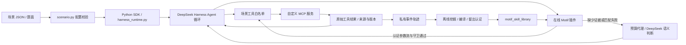

# DeepSeek Harless：场景、Motif 和 Harness 的接口

## 完整工具批次与调度通道 Shadow（2026-10-11）

`trace_rsi_batch_compiler.py` 从合格正常 Session 的完整下一请求编译 `trace_rsi_batch_continuation_shadow`。`batch` 保留全部工具声明顺序、当前 `/input_id` 绑定或实际无参读取契约；见证包含声明/派发/每项结果、消息摘要、来源版本和全部真实请求。失败、未知项、句柄或投影不一致拒绝整批，单 Session 只留候选；在线至少两个 Session 支持才预测。

`code_files_sha256` 保留原训练代码，`code_additions_sha256` 显式增加编译器、批次插件、实验入口三个文件；运行配置 `code_files` 必须等于两者并集。原工具及原提示文件不改。`dsh_trace_rsi_batch_shadow.ts` 仍调用原生模型和工具，公开流组装器及工具事件只作观察；预测的 `expected_tools`、`expected_results` 一一对应，完整声明、派发、每项结果及当前版本全部一致才产生 `shadow_batch_result.verified=true`。已成功检查同输入的去重为工程守卫，不称本批学习出的状态条件；只阻止重查，不阻止有见证的只读后继。

`paper-rsi-batch-shadow.py` 默认只预览，无 execute 入口。`--protocol-version narration-v1` 采用弱调度约定；`tool-channel-v2` 将正常工具调度放在工具通道，修订依据保留在最终回复，冲突、依据不足、恢复和授权仍允许即时文字交接。各版本的 baseline/Shadow 使用相同题面、schema/顺序和工具；版本分别保存，不能追改旧带文字请求为严格通过。严格统计要求整个请求无其他实质块，并保留全部真实请求作分母。

三条预定 v2 Shadow 共6/15严格机会；其中两条原字段保留通过、另一条失败仍保留。机会对应的原生请求费用占比23.1%，不是替代后反事实费用；实际跳过与费用节省为0。本轮真实冻结库仅两个单工具后继；多工具批次能力通过免费诊断，尚未有两正常Session支持的真实多工具认证。范围是同论文结构修订子任务，未验收完整参考文献核验/PDF/Web。详见[实验记录](experiments/paper-rsi-batch-shadow-20261011-v2.md)。

## 从正常正反轨迹学习状态续接（2026-10-11）

`trace_rsi_state_compiler.py` 复用完整正常轨迹校验，提取 `prior_same_input_check`。输入/报告/来源/候选/目录摘要一致且本Session有成功生成工具结果才为true。正例来自实际局部边，负例来自下一请求修订或结束；冲突不强行认证，缺负例不虚构条件。状态库kind=`trace_rsi_state_shadow`，保存原库、派生库、正反见证、特征协议和显式新增观察器摘要，policy仍为shadow_only。

`dsh_trace_rsi_state_shadow.ts` 在原Shadow上过滤预测，不修改工具或模型流。检查失败清除完成状态，新版本不会继承旧版本记录，跨Session不共享。原训练代码不迁移，只追加状态观察/编译/控制三个文件并绑定摘要。守卫字段本身是工程提供，具体条件值来自正常轨迹；不称任意模型自生成守卫。

`paper-rsi-state-shadow.py` 默认显式preview，提供compile/shadow/verify/score，无execute；提示和生成工具沿用上一轮。`replay-trace-state-shadow.mjs` 在临时副本重建报告并消费原完整事件，仅免费历史诊断，不冒充前瞻请求减少。结构、来源、原字段保留仍独立验收。已知多工具批次反例及实际结果见[状态实验](experiments/paper-rsi-state-shadow-20261011-v1.md)。

## 生成工具的正常任务与轨迹编译 Shadow（2026-10-11）

`scenarios/paper-submission/trace-rsi-task-server.ts` 加载同一 `model_generated_trace_tool`，不改写生成算法。MCP 名 `paper_trace_rsi`，从 `SSS_TRACE_RSI_TASK_CONFIG` 读取私有配置。工具是 `read_task_state({})`、`write_report({report_sha256,report})` 以及冻结候选名 `{input_id}`。库的原始算法输入契约与 MCP 句柄契约不同：适配器按冻结 `provenance.proposal.input_bindings` 投影当前 `catalog.json/triage.json`，严格校验原 schema 后执行纯数据程序。

读取返回 `report/input` 与收据；写入返回新收据；检查返回 `output` 与收据。收据字段为 `input_id/input_sha256/report_sha256/source_version/candidate_sha256/catalog_sha256`，句柄摘要另绑定 Session，且只有该服务实际登记过的当前句柄可调用。报告为固定私有副本，CAS 防止覆盖旧版本；库、目录、来源、代码、链接文件与超限数据均受守卫。虚拟目录 locator 不是实体文件或论文真实性证明。

`trace_rsi_motif_compiler.compile_trace_rsi_motifs(runs)` 仅从合格正常 baseline 的完整声明/调用/成功结果学习局部 anchor→生成工具边。有效配置、逐请求、工具集合及真实 provider 顺序、版本、事件摘要和独立 `verification.json` 均绑定。不同 Session 支持计数、原文字存在和失败拒绝保留；单 Session 不预测。生成 `kind=trace_rsi_continuation_shadow`、`execution_policy=shadow_only` 的版本库，参数绑定来自当前收据 `/input_id`。

`dsh_trace_rsi_shadow.ts` 按冻结图匹配，而不是内置 write→check DAG。请求前只读重算当前参数与纯结果，随后继续原模型请求；真实工具执行后再次核对。模型工具顺序可能与 MCP 声明顺序不同，使用实际 provider 顺序冻结并精确比较。工具变化、歧义、漂移或新失败不预测。

`scripts/paper-rsi-generated-task.py` 提供 preview、baseline、compile、shadow、verify、score。付费阶段复用统一预算、SDK/Harness；无 execute。严格评分要求整次模型内容仅含完整匹配工具调用；带文字的匹配单列。运行后免费诊断不作为训练调用见证。两图及结束状态反例见[实验记录](experiments/paper-rsi-generated-task-shadow-20261011-v3.md)；公开阅读摘要不授权执行。

## 真实轨迹驱动的 RSI 工具发现（2026-10-11）

`scripts/paper-rsi-trace.py` 接上 `prepare → learn → freeze`。`prepare` 收集正常任务的真实 bash 调用、结果和前后工具；保留不支持的记录。`trace_tool_evidence.py` 只对已登记内存文件运行有界 AST，不执行旧 shell，不使用 Python `exec/eval`；重放结果须与历史 stdout 一致，打印字典仅允许键顺序差异。当前默认两 Session 来自同一论文，仅两个源脚本可重放，不代表支持任意 bash。

`dsh_trace_rsi_learning.ts` 为独立学习 Session 提供 `rsi_trace_list/read/propose/test/trial` 和原生 Cordis。模型选择源调用、工具名、输入字段投影、原程序输出子集及算法；读取返回类型结构，提案通过后返回三个开发样例。提案 `contract` 可只含 `name/description`，通用编译器推导 JSON 结构；也可同时提供 `input_schema/output_schema`。`input_bindings` 指向登记 JSON 的 pointer，`fields` 仅投影数组中的对象；`output_bindings` 将安全 snake_case 字段映射到原打印标签。相同投影输入却对应不同输出、纯回显/常量、实际样例不符合 schema 均拒绝；不能丢反例让它通过。

模型通过 `ctx.get('sssTraceRsi').installProgram(program)` 提交受限 JSON 程序；完整 `install(candidate)` 保留。Cordis 跨 realm 对象在提交边界先校验为有界 JSON 再归一化，解释器仍拒绝函数、getter、循环、危险字段和任意宿主能力。程序复用 `paper_rsi_program.ts`，增加 `sort/split/at/keys`；工具不读文件、不联网、不生成科研判断。上游 Cordis host VM 本身不是安全隔离边界，学习进程仍仅限已授权服务器实验。

`freeze` 检查正常源见证、程序生成/开发测试/真实调用记录及冻结的训练/留出划分，再用独立源程序计算的未见反例验证；失败保留、不发布。`frozen-tool.json` 保存动态契约、程序、见证、认证范围和摘要。它是单工具能力产物，与描述调用衔接的 Motif 图不同。当前认证只支持选中输出的同源反事实，不认证独立论文、整请求替代或事实正确性。

`scenarios/paper-submission/trace-rsi-server.ts` 从 `SSS_TRACE_RSI_CONFIG={"library_path":私有冻结文件}` 加载生成工具，通过 MCP stdio 以其动态名称/schema 提供纯数据调用，结果包含 `output/candidate_sha256`；读取前后核对库字节。加载已有工具只需 Node。免费 `scripts/check-trace-rsi-mcp.mjs FROZEN CASES` 实际调用 stdio 的 initialize/list/call，逐项核对 schema、摘要和输出。输入来源真实性及当前版本仍须后续场景/Motif 参数绑定守卫负责。

## RSI局部修订与显式execute（2026-10-12）

`apply_revision_plan({report_sha256,plan})`接受set_ids、keep_once_keys、remove_keys、add_records，由已认证RSI AST生成当前行的替换/倒序删除/最小追加。宿主拒绝受保护字段改写、未知key、冲突旧版本、陈旧摘要及不完整计划效果。写入的是本任务完整副本，返回新的版本收据；模型仍决定修订内容。

`export_revision_report({input_id})`用当前生成检查结果与完整前/后报告导出结构Markdown；既有来源、数组和科研文字均保留在材料中。排版为工程实现，不把真实性、正式版本或PDF视觉写成通过。

显式 `--context-view` 返回当前key/标识、目录配对及同一版本的RSI审计；完整字段仍保留在私有报告并进入完整导出。这是工程视图，不能归为学到的Motif。`--private-export`另行绑定当前私有产物权限：图节点的 `effect=private_current_report_export` 只能导出固定 `revision-report.md`，收据、实际独占普通文件及内容SHA必须一致。该选项不允许任意路径、报告内容自动修订或外部写入。V2/V3反例见[记录](experiments/paper-rsi-local-view-shadow-20261012-v2-v3.md)。

`paper-rsi-patch-task.py`提供full/baseline/compile/shadow/execute，默认preview免费。本轮新权限仅来自当前私有授权文件；Shadow library自身不授予execute。`dsh_trace_rsi_batch_execute.ts`要求同图至少两个独立纯工具正常Session，混合文字见证仍保留；按当前来源/代码/schema顺序与收据判断有界后继，由Harness派发真实MCP并逐项核验，失败后停止接管。actual HTTP请求、verified skip和未核验跳过分别记录。`--strict-tool-channel`只重申消息格式，所有新对照条件共享相同提示，实质冲突、恢复说明和最终依据不得省略。

真实算法样例和初版对照见[V1实验记录](experiments/paper-rsi-local-patch-execute-20261012-v1.md)。最新[V4](experiments/paper-rsi-local-view-execute-20261012-v4.md)三项同工具真实请求15→9、六次全部核验、估费下降13.24%；仅局部结构修订，前期反例保留、学习未摊平。学习/重试/恢复记入累计额度；默认产品费用上限仍1美元。当前仍依赖私有历史输入和Python控制器，不是完整生产插件、Windows模型验收或Web产品。

## DeepSeek 自生成检查工具与 RSI 接缝（前次固定目标原型，2026-10-11）

独立学习进程显式加载固定版本 `@deepseek-ai/dsh-cordis-host-runner` 与 `@deepseek-ai/dsh-tool-cordis`，仅开放Cordis检查/定义/生命周期、`rsi_test`、`rsi_trial`。`dsh_paper_rsi_learning.ts` 提供 `ctx.get('sssPaperRsi').install(candidate)`；模型通过纯host动态包提交程序，可追加不可变包版本、自测和修复。上游VM不是安全隔离边界，当前只在授权实验的独立进程使用，不能面向不可信用户直接开放。

候选为 `{schema_version:1,name:"check_report_structure",description,program}`。`paper_rsi_program.ts` 接受JSON表达式（字段读取、绑定、map/filter、集合差、去重、条件与比较）；没有任意代码求值、文件/网络/进程操作。限制64KB程序、1500节点/40层、20万运算、2000数组元素、192KB输入输出。此工具程序与Motif图是两种协议：前者描述单工具算法，后者由正常轨迹描述工具间衔接。

输入为当前报告、源码计算的期望 `[key,arxiv_id]` 配对、当前/期望来源版本。输出 `missing_pairs`、`unexpected_pairs`、`duplicate_pairs` 三个配对数组，以及 `source_mismatch`、`scope_mismatch`、`malformed` 三个布尔值；不判定引用真实性、正式版本、年份或科研结论。

`paper-rsi-program-check.mjs` 用未提供给学习会话的样例验收，要求开发测试通过、生成工具实际被调用以及Cordis源码见证。不通过则不生成新冻结库；冻结库保存候选、生成/测试摘要与manifest摘要。摘要用于完整性检查，不代替信任审核或签名。契约、样例、有界解释器和工具包装仍由开发者提供；算法和修复版本由DeepSeek生成，尚非从任意bash自动提炼通用MCP。

`scenarios/paper-submission/rsi-server.ts` 通过MCP stdio提供：

- `read_report({})`：只读固定副本、期望配对和当前摘要。
- `write_report({report,previous_sha256})`：只写当前 `triage.json`，旧摘要、符号链接或来源变化即拒绝；实验副本写入已授权，非通用用户文件修改入口。
- `check_report_structure({})`：运行已验收的模型生成程序，返回结构结果及来源/报告/候选摘要，不读取任意路径。

加载已生成工具不启动Python；当前实验控制器、离线编译和预算代理仍用Python，不能宣称全项目无Python部署。此入口需已验收的Node22，尚未独立插件产品打包。

Python从两条完成的正常修订轨迹挖掘局部续接，保存成功结果、相同来源/报告摘要、契约/顺序和两Session见证；没有调用见证就不加图。含旁白的消息可以支持局部边，整请求可跳过统计仍排除非空模型内容。`dsh_paper_rsi_shadow.ts` 在真实请求前按冻结图和当前写入结果/报告/来源/schema预测，只调用原模型路径，不注入结果或删文本。见[首轮实验](experiments/paper-rsi-tool-learning-20261011-v1.md)。

## 论文 Motif 诊断扩展（2026-10-10）

`scenarios/paper-submission/server.py` 提供六个只读 stdio MCP：`pin_paper_{sources,build,pdf}(case_id)` 返回版本化 `source_id`，对应 `read_pinned_paper_{sources,build,pdf}(source_id)` 返回 `kind/version_sha256/diagnostic`。案例由私有 `SSS_PAPER_INPUTS` 注册，模型不能指定路径或代码；句柄限本进程/案例/视图，读取前后验证源与工具版本。build 只读既有日志/记录，不执行编译；真实退出码缺失时明确未知，shell-escape 未知为 null。sources 是有覆盖声明的静态解析；pdf 是固定 pdfinfo/pdffonts 元数据检查，无页面视觉或合规结论。

library/在线 manifest 新增可选 `certification_scope`（`independent_decisions` / `protocol_diagnostic`）与 `tool_schema_hashes`（工具名 → 实际参数 JSON Schema 的规范 SHA-256）。旧 manifest 不含字段时保留原行为；声明 schema 哈希时，必需参数以外的类型/schema 漂移也必须回退。普通 `apply` 拒绝诊断认证库。

`dsh_online_motif.mjs` 导出共享 `installOnlineMotif`，原 `apply` 行为不变。新 `dsh_paper_motif.ts` 显式 opt-in `SSS_PAPER_MOTIF_DIAGNOSTIC=1`，只允许上述诊断 scope，并复用共享 Runtime；需要语义排名时返回真实模型，不调用 embedding、不强行接管。shadow 只记候选，execute 返回标准工具 stream，由 Harness 执行并逐结果复核，整个 batch 成功后才计 verified skip。任务/Session/题面、参数来源、工具可见性、权限及版本守卫仍然有效。

实验入口 `scripts/paper-motif-experiment.py` 默认预览，付费阶段显式 `--call-model`，累计原论文账本并保留 1 美元上限、不设请求次数上限；这不是 Web 产品入口或跨平台通用运行器。协议、依赖和复现边界见[场景说明](../scenarios/paper-submission/README.md)，实际结果见[实验记录](experiments/paper-motif-shadow-execute-20261009-v1.md)。

## 官方 Web 与统一任务接口（0.1.5-rc.3）

`npm run web` → `scripts/harness-web.py` → 官方 `dsh --profile web --patch <私有 host overlay>`。执行、会话、队列、模型消息和工具调度归官方 Harness；SDK 的 `run-scenario.py` 与 `harness_runtime.py` 保留。场景配置定义能力，不再固定一次用户任务。默认动态策略为 `src/adapters/dsh_web_tasks.ts`，请求规范化在 `web_task_request.ts`，双层预算路由在 `web_task_budget.py`，DeepSeek Harless 界面为同源 `/tasks`。旧 `/sss` 是兼容别名，历史代码/环境变量标识保持不变。

后续涉及模型的联调与场景验收统一走真实 API：`npm run web:real` 等价于 `npm run web -- --real-model`；`npm run scenario:real` 等价于 `npm run scenario -- --call-model`。前者仍通过工作台预览确认任务，后者直接执行预算预览后的一次场景；均保留原有预算代理。用户已授权此测试用途，默认使用用户指定的 1 美元上限，扩大上限或外部副作用另行确认。纯单元、无模型 smoke 和故障注入仅作开发诊断；真实调用失败不得用模拟成绩替代。SDK 真实最小场景已完成 3 次 HTTP 200 与 4 次 MCP，见[真实调用记录](experiments/deepseek-real-api-smoke-20261009-v1.md)；现有 3080 模拟服务未重启，真实 Web 后端最小闭环已通过，浏览器交互仍待验收，见[恢复记录](experiments/web-real-recovery-20261009-v1.md)。

### 前端提交与任务生命周期

官方真实聊天的 `session/prompt` 首次提交登记 `entrypoint=native_chat` 的待确认任务，返回 accepted，不直接调用模型。公开 Web `tapIndex` 注入题面/预算确认框，显式确认通过下述 submit API 才派发原消息；相同请求 ID 幂等，取消零模型调用。工作台 `?task_id=...` 和任务卡可以恢复同一待确认预览。`entrypoint` 是服务器响应字段，不接受客户端自行指定；新的要求仍需新的任务/Session。实际接口验收见[记录](experiments/native-chat-confirm-20261009-v1.md)，真实浏览器点击待确认。

先打开本次私有 `access-url.txt` 的官方认证地址，用根路径 token 交换 HttpOnly/SameSite cookie。工作台及 `/api/harless/tasks` 复用官方连接认证；不是可匿名访问的 API，也未开放其他前端域名的 CORS。不要在 URL/header 中另传认证 token。旧 `/api/sss/tasks` 保留同语义兼容路由，新调用统一使用产品路由。

| 操作 | 请求与结果 |
| --- | --- |
| 预览 | `POST /api/harless/tasks`，`{"action":"preview","request":<业务请求>}`；返回任务、输入摘要、来源、预算、模式和 `confirmation_digest`，不调用模型 |
| 提交 | 同一路径，`{"action":"submit","task_id":"…","confirmation_digest":"预览值"}`；核验后启用预算并交给官方 `Controller.prompt` |
| 取消 | 同一路径，`{"action":"cancel","task_id":"…"}`；取消官方 Agent 并关闭该任务后续模型请求 |
| 上传文件 | 同一路径，`{"action":"upload","task_id":"草稿ID","name":"paper.tex","data":"规范base64"}`；走官方 `fileUploads`，返回更新后的预览；提交必须使用最新摘要 |
| 查询 | `GET /api/harless/tasks?task_id=…` 返回详情；省略 ID 返回任务列表及汇总统计 |

免费工作台点击“开始免费联调”会自动执行 `preview → upload（如有文件）→ submit`，不展示额度表单或要求第二次确认；服务端仍保留规范化、任务登记、最新摘要绑定和统计。真实模式必须展示预算预览并由用户明确确认，不能利用免费流程绕过。

上传只对待确认任务开放，单文件上限 256 KiB。任务状态为 `awaiting_confirmation/running/completed/failed/cancelled/budget_exhausted`。同进程支持连续多任务，同一时刻一个活动任务，一任务一 Session；后续问题创建新任务/Session，不复用旧任务授权。`request_id` 重复且内容相同返回已有任务；内容或模式/预算改变而复用该 ID 则拒绝。重复提交不重新执行已接纳任务。goal 续轮、队列内容编辑、fork/steer 均不能绕过任务绑定；更改输入须预览新任务。

业务请求可以直接是文字字符串，也可以是下面的对象：

```json
{
  "instruction": "检查这些批注，整理有来源依据的结论",
  "capability_profile": "example",
  "inputs": [{"resource_id": "paper-notes"}],
  "mode": "shadow",
  "budget_usd": 0.1,
  "request_id": "client-request-001"
}
```

对象必须在 `instruction`、`content`、`messages` 中三选一。`instruction` 是字符串；`content` 是字符串或有序官方内容块；`messages` 为 `[{"role":"user","content":…}]`，仅接受 user，以可见边界保序合成一次输入，不能伪造 system/assistant/tool 历史。正文原字节和顺序保留，拒绝 NUL、空任务及超限内容。规范化上限当前为 768 KiB、32 个内容块；文件另受上传上限。`task_id/session_id`、工具、provider、manifest 和输出/请求上限由服务器决定，不接受客户端覆盖。

Harness 原生 `SessionPromptRequest.content` 的实际格式为：

```json
[
  {"type": "text", "text": "检查附件"},
  {"type": "image", "mediaType": "image/png", "data": "规范base64", "name": "figure.png"},
  {"type": "file", "receiptId": "同Session此前上传返回的receipt"}
]
```

图片支持的声明类型为 PNG/JPEG/WebP/GIF。官方 Controller 再校验图片字节、模型输入能力和文件 receipt 所属会话；持久 `attachmentId` 不能替代上传 receipt。当前诊断确认不支持图片的模型会令任务明确失败、请求数为零；接收协议不代表已实现图片理解。`input_summary` 仅含文字/图片字节数与摘要、receipt 摘要和引用标识，不重复图片 base64；完整输入快照只留私有任务目录。

### 场景、资料与三种模式

每次启动由 `--scenario` 注册一个受信任能力配置，支持场景名或配置 JSON 路径；前端只能选择这一个 `capability_profile`。工具由该场景 MCP/preset 提供，默认编码工具仍待明确兼容。`prepare_scenario()` 的 `mcp_rows/environment_references` 同时服务 Web preset 与原 SDK patch。

`--resources .local/inputs/resources.json` 登记文本资料，格式是 `ID -> {"text_file":"相对登记文件的UTF-8文本路径"}`。单来源上限 256 KiB，启动时读取并计算原始字节 SHA-256；`inputs.resource_id` 只引用该注册表，不能指定路径或 URL。后端检查可选期望版本，追加带 ID/版本的文本，并记录 `sources[{resource_id,version,sha256}]`。本轮是不可变来源快照，原文件改动不会自动刷新；未登记资料拒绝，不能假装已读取。真实应用的对象解析器是后续扩展。

- `baseline`：正常 Harness，不接管结构步骤。
- `shadow`：有适用认证库时记录候选，继续模型路径。
- `execute`：有适用认证库且守卫通过时生成标准工具 stream，由 Harness 真正执行；结果复核后计 verified skip。

三种模式逐任务固定并写入统计。无库、无 embedding、认证无效或输入不适配时记录 `fallback_reason`，继续正常 Harness。example 尚无库；portfolio 精确冻结题面可使用首发历史库。新增附件、来源或题面不能自动继承旧认证任务绑定。真实 schema 按 `scopeOf(agent.ctx)` 和官方代码点工具顺序核验，参数来源和版本守卫仍保留；不能用“支持动态任务”为由取消认证。

### 预算、模型与记录

每任务默认 1 美元/24 次，全启动默认 1 美元/256 次，每请求最多 1000 输出 token。前端预算只能下调服务器任务上限；`--budget-usd/--request-limit` 定任务上限，`--run-budget-usd/--run-request-limit` 定全启动上限。`TaskBudgetRegistry` 先不可变注册，确认后激活；预算代理根据 `x-deepseek-harness-session-id` 路由，同一次请求原子占用两层额度，完整成功用量两层结算，新任务不重置全局限制。

私有控制服务仅监听 loopback，`/tasks/register/activate/cancel/stats` 均要求 `X-SSS-Control-Token`。该 token 由启动器生成，不提供给浏览器。固定 provider/model、`reasoning_effort="off"`、输出 cap，关闭标题模型、辅助请求和压缩；UI 模型菜单不能绕过预算连接。

默认模拟模式无实际支出；`npm run web:real` 显式开放 DeepSeek 连接，仍须工作台预览确认。服务器私有根 `.env` 通过统一 `scripts/project.mjs` 的 `loadEnvFile` 加载（Node 20.12+，已有环境值优先），字段见 `.env.example`。真实模式拒绝原生聊天直接执行付费任务。SDK 基本连通已通过真实 API 验证，真实 Web 尚未验收；其他收费 MCP 和人工费用也不在这份模型代理额度内。

任务响应含 `task_id/session_id/request_id`、模式、预算、状态/失败、时间、来源、摘要、答案与 `stats`。统计字段包括 `upstream_requests/model_requests`、`llm_decisions`、`tool_calls/tool_errors`、`motif_attempts/shadow_candidates/verified_skips`、`prompt_tokens/prompt_cache_hit_tokens/prompt_cache_miss_tokens/completion_tokens/total_tokens`、`estimated_cost_usd/observed_peak_cost_usd`、`denials/pending_requests/unknown_usage_requests/usage_complete`、`elapsed_seconds` 与全局预算/请求计数。未取得完整用量时保留保守预留，token 缺失不能当作零成本；代理估值不等于账单。模拟 `actual_paid_usd=0`，真实支出未核对时为 null。

启动输出独占 `.local/web/runs/<RUN_ID>/`，包含环境、commit/dirty 摘要、私有 policy/overlay/preset 和全局 `ledger.jsonl`。动态任务各自存于 `tasks/<TASK_ID>/`，包含 `task.json`、`effective-config.json`、`session-header.json`、`task-state.json`、`events.jsonl`、`answer.json/answer.md`、`ledger.jsonl`、`motif-audit.jsonl`，接管时另有 `bound-motif-task.json`。失败和取消记录保留，不能清空旧 ledger 重置额度；跨启动恢复尚未实现。

### 旧固定入口与验收范围

`npm run web -- --frozen` 保留原 `dsh_web_policy.ts`：一个启动周期一个固定题面/session，题面仅两端空白规范化，内部字符必须一致。服务器最终验收通过 146 项 Python、44 项 Node、`web:check` 的 11 组冻结协议、`web:tasks:check` 的 13 组动态 HTTP/MCP，以及 18 题/83 来源 smoke；Motif 样例闭环已通过，新增实际付费为零。详细条件与限制见[动态任务验收](experiments/dynamic-web-tasks-20261009-v1.md)和[Web 交接](handoffs/harness-web.md)。原生会话 unary `/api/session/<method>` 使用官方 client-request envelope，队列/事件流使用 `/api/remote.mux`；DeepSeek Harless 不替换 Agent 循环。

HTTP 检查不能代替实际浏览器和科研质量验收。安全边界仍是单操作人服务器联调：没有多账号、跨启动恢复或论文流程，认证浏览器的官方文件能力也不是多人文件沙箱。上游包只读，升级必须复核 Controller、Gateway、附件、事件与 preset 接缝。详见 [Web 交接](handoffs/harness-web.md)。

## 运行链路与边界



Python controller 与 JavaScript online runtime 是两条执行路径：在线插件使用 JS 子集，并未通过 RPC 调用 Python controller。不要把它们描述为完整同构实现。DSH 实际执行 MCP 工具；插件只在认证的只读步骤上替代一次模型决策。

## 已确定的技术路线与当前交付形态

后续采用 **Python 离线学习/编译，TypeScript 在线执行**。新增 Harness 在线逻辑使用 TypeScript；现有 JS 插件逐步迁移，Python controller 保留为参考和离线验证。生产在线 Runtime 以 TypeScript 为权威，不另建 Python 在线决策进程。双方通过版本化、带摘要及证据的 Motif IR/library 对接；类型定义之外仍需运行时校验和协议一致性测试。

当前安装清单固定 `@deepseek-ai/dsh` 为 `0.1.5-rc.3`，安装后由 `harness_runtime.py` 启动 `node_modules/@deepseek-ai/dsh/lib/bin.js`。因此运行时包含真正的本地 Harness，Git 仓库不内置其源码副本。`dsh_online_motif.mjs` 是原生插件，通过生成的 patch 和本地文件 URI 挂载；baseline 不加载该插件，shadow/execute 显式加载。

DeepSeek Harless 当前是“插件实现 + 编译器 + 科研实验环境”，还不是独立分发的 Harness 插件包。产品化需要严格类型、共享 Schema/兼容规则、构建/打包和安装入口。实验入口及预算代理使用 Python；在线 `runPureCode` 还会启动 `pure_code.py`。解除已有 library 执行对 Python 的依赖时，必须保留预算约束和纯代码隔离/校验，不能简单删掉这两项。外部 MCP 和 embedding 服务的部署依赖仍由具体服务决定。

## 1. 自定义 MCP 场景接口

每个场景放在 `scenarios/<name>/`，包含 `scenario.json`、题面、必要的服务/契约和独立测试。复制 example 即可。配置版本是 `schema_version: 1`；服务器顺序、工具名字/顺序和提示尽量保持稳定。

```json
{
  "schema_version": 1,
  "name": "my_scene",
  "prompt": "prompt.md",
  "servers": [{
    "server_name": "papers",
    "transport": "stdio",
    "command": "${PYTHON}",
    "args": ["${PROJECT_ROOT}/scenarios/my_scene/server.py"],
    "cwd": "${PROJECT_ROOT}",
    "env": {"PAPER_API_KEY": {"from_env": "PAPER_API_KEY"}}
  }],
  "allowed_tools": ["mcp__papers__find", "mcp__papers__read"]
}
```

支持 `${PROJECT_ROOT}`、`${PYTHON}`、`${CASE}` 三种公开占位符。题面路径相对配置文件；配置里的进程 cwd 默认是项目根。服务名限小写字母、数字、下划线，工具全名限制 64 字符，以避免 Harness 改写名字造成契约不一致。

HTTP 服务将 server 替换为：

```json
{
  "server_name": "papers",
  "transport": "streamable-http",
  "url": "http://127.0.0.1:8765/mcp",
  "headers": {"Authorization": {"from_env": "PAPER_MCP_AUTH"}},
  "tool_call_timeout_ms": 60000
}
```

`PAPER_MCP_AUTH` 应包含服务需要的完整认证头。`from_env` 只保存变量名，在 Harness 子进程中求值；预览、生成的 patch 和 Git 不包含其值。密钥不能写成 JSON 字面量。HTTP 配置路径已验证；真实 HTTP 服务握手仍需场景负责人联调。

白名单会限制模型可见工具，并在派发时再次拒绝其他工具。新增服务无需改图核心或上游 Harness。新场景默认先做只读验证；有副作用的 MCP 必须在服务端限制作用域、提供写操作预览与明确确认，现有通用入口不会替任意 MCP 实现业务授权。模型可调用的工具也不自动获得 Motif 执行资格。

## 2. MCP → Motif 的数据契约

推荐每个只读对象返回 `object_id`、`source_id`、`version_sha256`。句柄必须由前一步实际返回，绑定版本，旧版本应由服务端拒绝。参数或结果相等本身不是依赖证据。example 服务提供 `pin_note → read_pinned_note` 的最小实例。

`contracts.json` 将 Harness **实际完整工具名**映射到契约，主要字段：

| 字段 | 含义 |
| --- | --- |
| `required_params` / `default_params` / `parameter_shapes` | 参数名、真实默认值与形状；须与 MCP schema 相符 |
| `read_only` | 是否只读；写操作不进入当前结构执行子集 |
| `output_fields` | 可引用输出字段，允许显式点路径 |
| `provenance_params` | 必须来自工具返回的参数，而非模型猜出的值 |
| `replay_stable` / `observed_anchor` | 可认证重放，或仅允许正常 Agent 的新鲜结果作锚点 |
| `description` | MCP 提供的实际描述；有 schema 文件时通过 `tool_schema_contracts.py` 绑定 |

合成科研任务的完整范例在 `config/research-portfolio-tool-contracts.json`。`tests/fixtures/contracts/` 的 Gmail/Zotero 等只保留历史协议样本，用于参数来源回归；对应真实应用连接器已经归档。

## 3. 轨迹 → library → 在线 manifest

首发分发库在 `examples/motif-library/research-portfolio-v1/`：4 个历史 DeepSeek 轨迹编译出的 Motif，保留原认证摘要。`library.json` 是离线产物，插件加载 `online-manifest.json`；`task.json` 仅适用于所记录的 `l_retrieval_persistence` 来源快照。`npm run motif:rebuild` 从公开证据重新挖掘认证并核对相同产物，`npm run motif:check` 加验真实 Harness/MCP 的本机模拟闭环。重编译输出只写 `.local/`，不依赖历史私有轨迹，不改通用编译器的私有数据路径约束。样例重编译使用 witnessed-edge 路径；下面的通用 CLI 使用连续序列 library 路径，两者不能混报。

公开证据是审核后与仓库合成 MCP 逐项重放一致的最小夹具，不是允许提交原始运行日志的例外。历史云请求出处与当前模拟验收分别记录；该样例没有真实研究交付质量或实际费用结论。具体命令、来源、版本锁与范围见样例 README。

普通 Harness 的运行目录位于 `.local/runs/<id>/`：

- `manifest.json`：题目、任务 ID、提示/配置哈希、工具顺序、模型和预算；
- `agent-events.jsonl`：原始工具与模型事件，结果不能被压缩替换后的内容冒充；
- `answer.md`、`metrics.json`、`cost-ledger.jsonl`：交付、用量与逐请求预算记账；
- `.local/online-motif/<session-hash>.jsonl`：开启插件时的决策审计。

人确认不同研究决定的 ID 后，冻结每份轨迹：

```sh
node scripts/project.mjs python scripts/freeze-dsh-task-identity.py --task-dir .local/runs/RUN_ID --decision-id scene-decision-001 --events agent-events.jsonl
```

编译清单放在 `.local/`，内容如下。至少两项独立训练决定和一项独立认证决定；改 trace 名不能制造独立性。

```json
{
  "contracts": {"完整工具名": {"required_params": ["id"], "read_only": true, "output_fields": ["source_id"], "replay_stable": true, "description": "实际 MCP 描述"}},
  "train": [
    {"trace_id": "t1", "events": "runs/RUN1/agent-events.jsonl", "identity": "runs/RUN1/task-identity.json"},
    {"trace_id": "t2", "events": "runs/RUN2/agent-events.jsonl", "identity": "runs/RUN2/task-identity.json"}
  ],
  "heldout": [
    {"trace_id": "h1", "events": "runs/RUN3/agent-events.jsonl", "identity": "runs/RUN3/task-identity.json"}
  ]
}
```

这里的 contracts 只是字段说明，须换成场景的完整工具契约；只写一个工具无法构成示例读取链。可加 `tool_schema_file` 与显式 `provenance` sidecar；路径相对清单。编译器只接受 `.local` 下的原始轨迹和身份锁，并拒绝同决定/同问题的伪独立样本。

```sh
node scripts/project.mjs python scripts/compile-dsh-motif-library.py --manifest .local/traces.json --out .local/motifs/library.json
node scripts/project.mjs python scripts/export-online-motif-manifest.py --library .local/motifs/library.json --contracts scenarios/my_scene/contracts.json --version-fields .local/version-fields.json --output .local/motifs/online.json
```

`version-fields.json` 是参与该 library 的工具名到真实版本字段的映射；不能加入未编译工具或编造字段。可加 `--slot-rules` 限制初始标识符。library 含轨迹来源、参数流、DAG/局部代码、认证摘要；不是手写工作流或 Codex Skill。训练后必须留另一组独立任务做效果评测。

## 4. 在线 Motif 插件接口

准备结构任务 `.local/current-task.json`，由任务负责人填写：

```json
{
  "schema_version": 1,
  "task_id": "scene-next-decision",
  "session_id": "unique-unused-session",
  "intent": "此次研究决定的具体目标",
  "input_version": "此次输入的冻结版本",
  "bindings": {"完整入口工具名": {"真实参数名": "已授权标识符"}},
  "source_versions": {"完整工具名": "已验证来源版本"}
}
```

Bindings 必须是 manifest 认可的参数槽；版本可以使用运行时认可的 `@observed` / `@from_anchor`，其守卫仍依赖实际新鲜工具结果，不表示取消版本核验。参见 `parseStructuredTask` 及其测试。不要复制旧答案填成新任务。

```sh
npm run scenario -- --scenario scenarios/my_scene/scenario.json --mode shadow --manifest .local/motifs/online.json --task .local/current-task.json --embedding-endpoint http://127.0.0.1:8123/v1/embeddings --embedding-model LOCAL_MODEL
```

默认只校验并预览。加 `--call-model --budget-usd 1` 才开始付费任务。`shadow` 记录候选但继续调用模型；`execute` 尝试替代模型请求。插件使用环境变量 `SSS_ONLINE_MOTIF_*` 和 `SSS_MOTIF_EMBEDDING_*`，由入口统一设置。

插件依赖 DSH 的 `agent/created`、`tools/result`、`llm/stream` 和 agent-loop 标记。在匹配会话与冻结提示内，校验 library 摘要、实际可用工具 schema、参数来源、版本及依赖。命中时返回标准工具调用流，由 Harness 派发；工具结果复核通过后才记录 `model_request_skipped_verified`。无命中、歧义、权限/版本变化和工具失败会返回模型判断或停止结构继续，不能仅凭发起 bypass 计为成功节省。

当前插件要求本机 embedding 配置。唯一闭合的部分读取链可直接使用结构证据；其他匹配可能调用本机 embedding 服务。其服务/模型是可选依赖，基础安装不下载权重。`scripts/local_embedding_server.py` 和下载脚本保留为可选参考；需另装 torch、transformers、huggingface_hub，使用固定权重和版本自行验证。

Python 语义端口在 `motif_read_semantic.py`：接收明确的结构缺口，调用受预算代理保护的 `dsh_client.call_bounded_prompt`，校验输出，交回 `SemanticResolution` 恢复。`harness_runtime.py` 将 SDK 私有 `_launch_args` 接缝限制在一个文件；升级固定的 DSH/SDK 版本时必须重新验证。

`motif_output_projection.py` 与编译器的 evidence projection 只保留为可选机制及回归测试，不挂在新入口默认链路。旧 Distil/压缩启动器已归档。

## 论文基础环境与原生基线边界

`node scripts/project.mjs python scripts/check-paper-env.py` 用公共夹具验证三种 LaTeX 引擎、BibTeX、PDF 信息与字体，产物只写 `.local/paper-env/runs/`。它不是论文 MCP，也不会调用模型；安装说明在 `scenarios/paper-submission/environment/README.md`。

私人原生基线保留 SDK profile 的 Agent 循环与 native 工具，不加载场景 MCP/守卫或 Motif；共享基础程序不等于提供了可用的终端沙箱。当前容器拒绝 bubblewrap namespace、内核 5.4 无 Landlock，首次原生终端因此失败；用户仅对本次私有实验授权非沙箱运行；后续重测在代理与通知守卫两层关闭次数限制，保留累计 1 美元及单次输出 3000 token 限制，已有费用继续累计。已生成 PDF 与中文报告（包含分段交付恢复），但证据复核发现误读和计数错误，质量未人工盲评。此授权不改变通用入口的沙箱默认值，其他入口的次数限制未在本轮修改。论文任务状态须按实际交付与质量判定，不能直接将 Harness 的 `finish_reason=completed` 当成成功。详见[重测记录](experiments/paper-native-baseline-20261009-v2.md)及[历史失败记录](experiments/paper-native-baseline-20261009-v1.md)。

PTC 对照只在私有 patch 将 tools.mode 设为 ptc 并插入官方 dsh-code-runtime-worker-thread；模型仅调用 run_code，子调用仍走工具流水线并落 tool/ptc-dispatch 事件。SDK profile 默认不挂 worker，不能只改 mode 就假定可用。worker 不保证系统/目录隔离；失败统计用 isError，并另查 shell 真实退出码。真实试跑及质量/费用限制见 [PTC 实验](experiments/paper-ptc-baseline-20261009-v1.md)。

## 原生参考文献轨迹诊断（尚未完成效果评测）

参数化局部证明新增 `parameter_motif_compiler.py`、`dsh_parameter_motif.ts` 与 `scripts/parameter-motif-proof.py`，其 scope 为 `parameterized_continuation_probe`，与下述精确回放及生产认证分开。输入契约见 `schemas/parameter-motif-binding.schema.json`：版本化库摘要、显式 motif_id、选定 items 和来源哈希。频次是支持度，不代替授权；只有指定会话在读取完整、未变的绑定后可尝试接管。Runtime 用读取/网络只读契约展开独立节点，所有结果验证后汇合并回到模型；不自动选择科学任务、执行任意脚本或写文件。环境 `SSS_PARAMETER_CONFIG` 指向由私有实验入口生成的 config，不是公共 Web 参数。网络结果核验实时 URL/状态/页面身份，不能用历史字节哈希或把结构收集称作科研正确性认证。实际两类局部验证 3→2 请求，边界见[证明记录](experiments/parameter-motif-proof-20261010-v1.md)。

连续输入绑定 opt-in：`SSS_PARAMETER_CONFIG` 增加 `catalog_path` / `catalog_hash` 时使用 `createSelectedParameterInterceptor`。v2 `selection.json` 含 `schema_version=2`、`catalog_sha256`、`library_digest`、`motif_id`、`items`，不携带自报来源列表；目录在实验准备时冻结完整来源哈希与每个可选项，绑定须逐项精确匹配。指定会话必须先完整 read 目录，再原生 write 成功提交与磁盘字节一致的计划，才能尝试续接。每批至多 8 项，允许不同计划多轮提交；重复计划/条目、错误版本、目录外目标拒绝。已取得的同批原生结果不重复派发；全部已到齐时返回原模型而不虚报 skip。失败结果使该批回退，之后新有效计划可继续。输出/科研真实性不由这些结构守卫认证。模型选择与目录适配协议为手工工程接缝，不能称为已学到选择策略或完整 DAG。详见 `schemas/parameter-motif-selection.schema.json` 与阶段实验记录。

顺序学习入口 `scripts/paper-motif-learn.py --store <私有目录> --train-run <正常运行> [--validation-run <验证运行>]` 调用 `parameter_learning.advance_round`。保存 `round-NNNN/round.json` 与 `library.json`，原子更新 `latest.json`；核验父版本和证据，拒绝重复/重叠会话、证据变动及 execute 自证，历史验证会话永久不能移入训练。库 scope 仍为 `parameterized_continuation_probe`，发布不等于生产认证或默认激活。目录与内容摘要、编译器摘要、新增/移除原型均记录；验证证据不决定新增原型。

论文原文工具 opt-in：`SSS_PAPER_REFERENCE_RECORDS=1` 为现有 stdio 服务添加 `read_pinned_paper_references(source_id: string, keys: string[])`，使用 pin_sources 返回的来源句柄；默认六工具，opt-in 七工具。结果包含 `source_id/version_sha256/requested_keys/records/missing_keys/duplicate_keys`；每条有 `key/kind/bib_file/entry_index_in_bib/bib_file_sha256/record_sha256/raw_bibtex`。每批1–64唯一键，按原文件条目顺序保留重复；索引不等于正文编号。原文哈希基于返回 UTF-8 字节，文件哈希基于完整原文件；真实性/渲染编号未检查。读取前后核验全部注册材料及解析器版本，拒绝动态输入、不支持语法、越界或输出大于1MB；没有 shell/网络/写文件。Python MCP 能力不改变 TS 在线分工；新工具没有自动获得库认证，后续组间工具/schema/order须一致。真实免费通道见[工具化记录](experiments/paper-bash-toolization-20261010-v1.md)。

论文入口 `--learning-store` 要求 `.local/paper-reference/` 的直接子目录，使所有新运行仍计入原累计账本；`--learn-after` 只接受 baseline/shadow，在 completed 后登记新轨迹并输出 `learning-update.json`。当次 Runtime 读取固定 `library-snapshot.json`，不会使用运行中更新的 latest。`--input-zip` 只接受私有 `.local/` ZIP，目前仍要求 `main.tex`/`references.bib`；题面范围是引用预印本阶段，不是完整 PDF 报告。准备器产生来源/目录哈希，不自动授权私有原件修改。

Crossref 项为 `{item_id,query,source_path}`，目录新增 `metadata_query_items/metadata_motifs/metadata_requests`。`crossref-search-fetch-v1` 原型从真实正常轨迹提取 `query.bibliographic` 或 `query.title`、rows（1–5）、select（必须含 DOI/title）及其顺序；仅允许固定 `https://api.crossref.org/works` 的只读模板，不把任意 URL/命令参数化。Runtime 核对完整来源哈希及字面 BibTeX 标题（分组花括号移除、不拆词；含 TeX 命令留给模型），逐项严格匹配请求，并验证实时 HTTP 200、JSON status/items 和 DOI/title 形状。空 items 只表示查询未命中；正式版判定仍交回模型。新增契约不会自动获得独立任务认证或执行任意脚本的权限。

`scenarios/paper-submission/reference-audit.prompt.md` 冻结用户参考文献核验/PDF 题面。`scripts/paper-reference-experiment.py` 默认预览，显式 collect/compare 与 `--call-model` 才调用真实模型；原始 ZIP、配置/请求/事件/文件版本/费用/产物均位于忽略的 `.local/paper-reference/<ID>/`。累计论文预算包含之前 Native/PTC/MCP 与所有新 ID，不重新计零；控制台在途预留不等于已结算费用。

`src/adapters/native_motif_compiler.py` 从五个新原生会话实际轨迹编译 `schema_version=1`、`certification_scope=same_task_repeated_runs` 的诊断库，三训练/两留出，拒绝配置或 schema 漂移。此 scope 不等同生产的独立科研决定认证，也不加载进普通生产插件。候选为带文件字节/输出证据的受限读取，或实际 `bash.value.jobId -> job_output.job_id`；后台 ID 在 Session 内有效，不是全局唯一。不能将任意生成程序直接重放。

`src/adapters/dsh_native_motif.ts` 注入 `llm/agents/jobs` 服务，环境绑定 `SSS_NATIVE_MOTIF_MANIFEST/WORK/SESSION/PROMPT_SHA256/INPUT_SHA256`，复用 `dsh_online_motif.mjs` 的 `attachMotifInterceptor` 和标准工具 stream。绑定题面、会话、原始 ZIP、实际 schema；读取验证路径/字节/真实结果，后台结果只读已结束的本会话任务。`motif_bypass_attempt` 是尝试，真实结果通过才记录 `model_request_skipped_verified`；失效/错误/歧义回到模型。空库允许正常回退。诊断库不表示完整场景技能、科研语义认证或独立插件打包。

原生事件同时保留原始 `agent-events.jsonl` 与带 `session_id/event` 的 `session-events.jsonl`；文件快照使用 `session_id/call_id` 区分归属。编译仅挖掘根会话，不能拼接同一步骤号或同一个 job ID 的子会话。旧多 Agent 事件缺归属时拒绝认证。JSONL 仅按 ASCII 换行分隔，保留工具内容中的 Unicode 段落分隔符。预算重启核算恢复 `State.book` 持久收据中尚无终态用量的预留，结算后替换而不重复计数；旧入口局部文件序号不用于恢复预算 ID。

当前原生环境沿用用户已授权的私有副本非沙箱终端；新目录不构成访问隔离，需额外审计跨运行读取。原稿占位引用导致编号依据待明确，模型结束、PDF 存在、质量合格分别记录。此入口尚未接入 Web，依赖 Linux `fcntl`，未验收 Windows。v5 用户授权提高本轮累计上限至 5 美元、输出 32768、无次数限制；不改变通用默认值。最新进度见 [v5 实验记录](experiments/paper-reference-five-native-two-motif-20261010-v5.md)，旧失败保留在 [v2 记录](experiments/paper-reference-five-native-two-motif-20261010-v2.md)。


论文 shadow 评测：`paper-reference-continuation.py` 模式默认 `shadow`，模型调用仍须 `--call-model`，显式 baseline/execute 兼容保留。`evaluate-shadow-continuation.py` 只接受 `mode=shadow` 且实际 bypass 为零的已有轨迹；以 root Session 中成功写入绑定后的下一条模型消息核对完整工具调用集合，再关联在线结果守卫。纯工具、工具加文本需语义审阅、混合/不同动作、证据不足分别记录；潜在机会必须结果齐全，并按 turn/step 去重，不能把匹配局部子图直接算成整请求可跳过。分析结果记录输入和分析器哈希，实际请求/实际跳过与潜在机会分列，反事实费用不填推测数字。

逐响应 `request_inventory` 额外记录绑定协议、未绑定收集、脚本/命令及其他动作，`execution_authorized_by_inventory=false`；仅观察到纯工具输出不能取得执行授权。完整输入 token 为 Harness 分离的未缓存输入、缓存读取和缓存写入之和，不把缓存当成已省费用。

## 论文活动引用与批查询诊断接口（2026-10-10）

`SSS_PAPER_CITATION_FLOW=1` 在默认六个只读工具后增加 pin_paper_citations(case_id)、read_pinned_paper_citations(source_id)、read_pinned_citation_records(citation_id)。citation_id由活动稿件字面cite集合生成，排除nocite，最多64键、进程内有效；读取前后核验版本。返回完整原文/哈希/缺失/重复及required_reference_pairs，后者仅是原文arXiv语法候选，不是真实性或渲染编号确认。动态或不支持的TeX拒绝，不能称完整TeX解析。

同时设置 `SSS_PAPER_ARXIV_BATCH=1` 增加第十个 fetch_pinned_cited_preprint_metadata(citation_id)。固定官方arXiv API，返回逐ID元数据/缺失/取证失败、实际request_url/响应哈希/获取时间；published与updated分开，DOI/journal_reference不是正式出版确认。拒绝实体、越界ID、未请求/重复版本和异常重定向；源变化导致失效。

Python离线从正常轨迹编译局部边和链，诊断库不进生产/Web。TS closedCitationBatchRead仅开放已认证父字段到单一citation_id的直接只读续接，普通 Runtime默认不开；未知操作屏障后必须有新的有效入口。scripts/evaluate-citation-shadow.mjs逐整次响应比较工具及参数，并核对在线候选位置；含文本或未覆盖动作单列，机会不等于实际跳过。

scripts/paper-citation-rsi.py默认预览，`--arxiv-batch --bounded-evidence` 显式开启固定阶段7工具，write/edit只写自己的triage.json，guard错误反馈当前登记case_id；原生默认工具和其他场景不变。每个条件的各组必须同schema/order/题面/权限；工具权限变化与Motif收益分别评测。执行仍在服务器、累计费用不重置、无次数上限，已有run/lib拒绝覆盖。入口未接Web或完整修订PDF，详情见[引用链记录](experiments/paper-citation-rsi-20261010-v2.md)、[批查询记录](experiments/paper-citation-batch-20261010-v1.md)、[权限失败记录](experiments/paper-citation-batch-bounded-20261010-v1.md)。

## 论文复合取证与交付校验（2026-10-10）

`SSS_PAPER_COMPOSITE_EVIDENCE=1` 独立增加 collect_paper_citation_evidence(case_id)，复用已有活动引用/原文/官方元数据方法并保留版本与内部步骤；默认六工具不变，单独opt-in为七工具。它是工程复合能力，当前旧九工具编译器不认证新节点。场景MCP仍Python，在线检查/工具生命周期新增逻辑使用TypeScript。

`SSS_PAPER_CHECK_CONFIG` 只由私有实验启动器提供：schema_version、session_id、case_id、source_version、source_root/source_files、work、code_files、mode(off/shadow/enforce)。配置绑定固定triage.json及冻结文件集合/代码摘要，不接收模型路径或任意代码。插件注册 scoped check_paper_triage()，与自动写入后检查共用 paper_triage_validation.ts 和共享JSON Schema；其他会话不安装。readonly校验不会撤销已经完成的write，enforce遇错会返回修复反馈，不宣称科研质量通过，不自动结束Agent。

CLI `--composite-evidence --arxiv-batch --bounded-evidence` 为明确新条件，实际模型工具5个；`--delivery-check off/shadow/enforce` 分别对应baseline/shadow/execute。题面、工具schema/order在各组一致，自动反馈为实验变量；旧工具/默认Coding/Web不改变。execute须成功shadow、当前最终产物校验通过、整次检查请求机会及对应来源/事件；复合条件不加载不兼容的旧Motif拦截器。请求替代统计与检查次数分列，新的Hook暂不计为学习成果。详见[实验记录](experiments/paper-composite-delivery-20261010-v1.md)。

`scripts/paper-citation-rsi.py --budget-record <私有JSON>` 可选择新授权的累计额度记录，默认仍是旧冻结记录；文件须位于本仓库 `.local/`、非符号链接、≤16KiB，cap_usd为有限正数。预览记录路径/摘要，运行前复核不变，各运行保存 authorized-budget-snapshot.json 和manifest摘要；历史失败、重试与其他论文入口费用继续累计，不因新ID或新记录归零。提高额度须先获用户授权，参数本身不构成授权；通用SDK/Web默认预算不受影响。最新结果与预算见[追加额度实验](experiments/paper-composite-delivery-20261010-v2.md)。

## 论文局部 Shadow 候选与逐请求审计（2026-10-11）

`scripts/compile-paper-shadow.py --train <正常baseline> --train <另一baseline> --output <新私有JSON>` 调用 Python 离线编译器，只接受 completed、来源/覆盖通过、自动检查关闭的正常工具轨迹。输出 `artifact_continuation_shadow_probe`、`execution_policy=shadow_only`；共享协议 `schemas/paper-shadow-library.schema.json`。模型拥有 write/edit 锚点，候选只含只读 check_paper_triage；训练见证、Session支持、请求/来源/工具/校验器摘要进入不可覆盖库。单轨迹候选与重复支持分列，不是生产执行认证。

TypeScript `createPaperShadowMatcher(library, config)` 消费受信适配器的当前来源绑定与成功产物结果，`takePrediction()` 在下一模型响应之前提取局部预测。它校验库摘要与协议、工具schema、校验器版本、固定产物角色、本次来源与文件摘要；失败编辑、证据失效或未知插入使预测失效。没有执行器，不改写工具结果，不注册新 Agent Loop，尚未接入官方 Web。检查结果一致且整响应只有同参数检查时，才能计严格候选；文本与混合调用不自动删除。

`scripts/audit-paper-shadow.mjs --library <冻结库> --run <留出shadow> --output <新私有JSON> [--parameter-library <既有参数库>]` 只读历史事件与审计。逐请求标记整请求候选、局部复用及语义/恢复缺口，保留预测不一致和含文本匹配；实际跳过/新增API均为0。历史留出不等于前瞻盲测，结果见 [本轮审计](experiments/paper-shadow-compiler-audit-20261011-v1.md)。


## 论文 RSI 前瞻 Shadow（十任务）

`scripts/paper-rsi-overnight.py` 默认预览，付费运行仅限已授权服务器。模块化 MCP 提供原始引用、arXiv 元数据和 Crossref 著录候选；`read_current_triage` 只读当前产物供恢复，`check_paper_triage` 只验证结构、范围与来源。

Python 从正常基线编译 `source_bound_readonly_batch_shadow` v1：当前任务绑定、来源参数边、并行只读批次、成功写入后的检查与失败编辑后的读取。TypeScript 在真实 LLM 请求前用冻结库记录预测，模型照常运行，无自动执行与实际跳过。工具 schema/顺序、代码与来源版本必须一致；分支歧义或守卫失败即不预测。详细结果和限制见 [实验记录](experiments/paper-rsi-overnight-20261011-v1.md)。


### 查询恢复、版本迁移与第三轮结果

`SSS_PAPER_QUERY_RECOVERY` 指向私有冻结的查询协议库时，stdio MCP 注册 `recover_pinned_formal_reference_queries(citation_id)`。使用当前来源、原始标题和有正常轨迹见证的固定查询信封，最多2种协议/30次只读GET、6并发、12秒超时、每响应2MB/5条候选；返回候选/空结果/错误及来源版本，不作论文身份或正式发表判断。正式取证工具通过 `SSS_PAPER_FORMAL_METADATA=1` 显式注册。当前库实际只有Crossref，DBLP的HTTP200验证页不构成元数据成功。

`read_current_triage({})` 只读固定工作产物，带报告摘要与来源版本，不接受任意路径。编译器可从正常工具轨迹挖掘成功write/edit→check、失败edit→read，以及needs_repair检查→同摘要read的局部边；没有训练见证就不加边。当前最终9候选均为单步局部边，后者单Session支持且本轮未触发。

`track_completed_frontier` 是显式观察器选项：同来源/当前参数已成功的读取节点不重复预测；新pin重置、失败刷新失效。冻结流库保存 `training_code_sha256`、当前 `code_sha256` 及逐文件迁移记录；仅无执行器的观察器/离线编译器允许本轮迁移，改变工具实现、提示或来源逻辑必须重新训练。工具集合及顺序仍冻结，错误/分支歧义回模型。

新增 `scripts/paper-rsi-recovery.py` 和 `scripts/paper-rsi-repair-shadow.py` 默认预览；后者复用第二轮三条正常baseline，只运行Shadow，无execute入口。十变体三轮最佳整组37/114=32.5%，实际跳过0，存在交付失败和语义错误，见[最终记录](experiments/paper-rsi-overnight-20261011-v3.md)。公开 [candidates.summary.json](../examples/motif-library/paper-shadow-v1/candidates.summary.json) 只有可读结构，没有来源见证/工具契约，不是可加载执行库。

## RSI生成程序局部编译与修订Shadow（2026-10-11）

`scripts/paper-rsi-revision.py` 默认免费preview。prepare/prepare-proposal从已有正常轨迹提取当前前后报告、目录和版本，learn显式调用真实Harness生成受限程序，freeze做独立验收。新增免费compile-counts、compile-counts-fields、compile-counts-fields-details从已审计生成代码选取输出、保留变量依赖，再组合为MCP程序；用 `--experiment` 指定新的.local目录，已存在结果拒绝覆盖。模型失败大程序与局部认证分别记录，不用历史留出再冒充新独立样本。

`revision_tool_evidence.py` 的 project_generated_outputs保留原表达式和必要绑定，compose_generated_candidates检查输入schema、输出冲突并隔离变量；rebind_generated_input仅改当前input字段读取，拒绝input遮蔽、不改JSON字面数据。`revision_rsi_macros.ts` 只将通用pairs_without展开为现有纯AST。具体计数与字段对比来自DeepSeek生成代码；不提供任意bash求值。

当前冻结生成工具 `triage_revision_audit({input_id})` 在原stdio MCP中加载；当前句柄绑定报告/来源/目录/代码/候选/Session，旧句柄或版本拒绝。生成输出包括对象数、初始及当前重复key种类数、新增/移除唯一key数、覆盖/缺失/多余/ID差异、existing_fields_preserved、top_level_preserved和changed_existing_records。后者直接导出模型原程序的违规对象变量；它不写文件或判定文献事实。当前重复数不等于初始重复数，唯一key变化不等于对象增删数量。

`scripts/paper-rsi-revision-task.py` 默认preview，支持baseline/compile/shadow/verify/score，没有execute入口。`--experiment` 与 `--tool-library` 必须在.local；准备时保存独立初始状态catalog，不覆盖旧catalog，检查MCP全局名≤64后才允许模型运行。write_report只接收report_sha256/report；其返回的新input_id绑定后续检查。提示与schema在本版本各组一致，调用顺序仍由模型决定。

最后两正常Session冻结write→check；read→check仅单Session候选。三个已知失败范围恢复Shadow严格4/17、两条结构通过单列2/10，实际跳过0。完整请求分母、费用、恢复集边界和字段失败见[本轮记录](experiments/paper-rsi-revision-counts-20261011-v1.md)。入口依赖私人旧实验、Linux预算锁与Python控制器，不是通用独立插件或Windows模型验收；未接Web/完整论文流程。公共[计数](../examples/rsi-tools/revision-counts-v1/README.md)与[字段](../examples/rsi-tools/revision-fields-v1/README.md)程序只供阅读/免费诊断。

## 连续输入Schema与效果状态守卫（2026-10-12，V5）

`trace_rsi_schema_adaptation.py`只根据已验证对象放宽required，保留类型/闭合字段/限制和生成AST；输出新工具版本，不改旧manifest。`trace_rsi_effect_guards.py`从正反状态学习通用类型特征合取，不是模型生成代码；未知字段/类型不放行。

`dsh_trace_rsi_effect_guard.ts`在原Batch观察/执行器之外读取版本绑定的`effect_guard_path`/`effect_guard_sha256`。条件作用于当前实际检查输出，不合格则保留原模型请求，不注入虚构结果。守卫自身不授权导出，仍要求原私有effect权限及Batch的正常见证/来源/代码/完整请求守卫。`paper-rsi-effect-task.py`是显式V5入口，公共旧入口不自动改变；各组同题面/工具，用新正常轨迹冻结版本。结果和回退边界见[本轮记录](experiments/paper-rsi-effect-guards-20261012-v5.md)。

## 完整导出与模型收据投影（2026-10-12，V6）

`paper-rsi-receipt-task.py`显式启用`export_result_protocol=revision_receipt_v2`。`revision_export_receipt.ts`只投影已知且结构检查通过的导出output为`{structural_check_passed:true,audit_sha256:<完整当前检查的digest>}`；完整检查仍写入当前报告，失败或未知字段保留完整output。原检查、文件摘要、来源/版本六字段收据及固定导出effect权限不变；没有投影写入计划或删除科研内容。缺省保持旧完整输出协议。

离线Batch编译将可选协议字段绑定进新library，TypeScript拒绝库/config切换或未知协议；在线期望由当前冻结算法完整结果计算相同投影，再校验真实工具结果和真实文件。新正常轨迹/新快照重新冻结，不能修改旧库hash。相同最终答复约束用于原生与execute，属工程输出协议，不是RSI生成算法或语义接管。费用与原生无变化写入的路线反例见[本轮记录](experiments/paper-rsi-export-receipt-20261012-v6.md)。

## 跨平台实验／学习互斥锁

`src/adapters/file_lock.py::exclusive_lock(path)`提供非阻塞独占进程锁：POSIX沿用历史flock，Windows用msvcrt锁同一固定文件的字节0；竞争者拒绝，异常后释放，不删除锁文件或重置账本。只在取得锁时加载平台模块，免费预览、编译及测试导入不依赖fcntl。调用方仍负责授权、累计账本和预算限制；此模块不替代预算代理。新生成任务将其纳入代码hash注册，旧manifest不可改，见[Windows修复记录](experiments/windows-rsi-lock-20261012-v1.md)。
