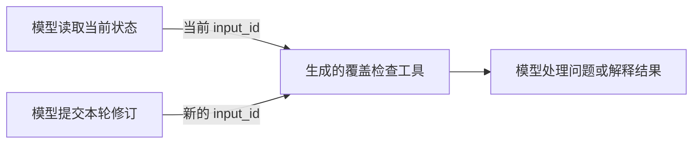

# 生成工具的局部 Motif：可读样例

这个目录展示“工具从哪里来、图从哪里来”，不包含私人论文、请求、Session 或来源见证。`candidates.summary.json` 不是可加载的 Motif library，不授权自动执行。

1. DeepSeek 从历史正常 bash 中选择目标，生成 `triage_catalog_coverage`；原算法见[生成工具样例](../../rsi-tools/trace-coverage-v1/README.md)。
2. 后续主稿和摘要修订实际调用这个工具，形成两条合格正常轨迹。
3. 编译器观察到“读当前报告→检查”及“写当前报告→检查”，保存两个局部图；不是人工预设完整流程。
4. 新任务里读取或写入产生新 `input_id`；图从当前返回值绑定参数，旧任务 ID 不可复用。检查内容仍由模型生成程序计算，当前报告和来源变化时重新计算。

例如一次修订删除重复项、修正标识并补上待核验占位后，`write_report` 返回新报告收据。Shadow 在模型调用前预测下一步检查的工具名、句柄和结果，再与模型实际操作比较。科研判断、修订内容和最终解释仍来自模型。

两条新范围任务各6次真实请求，合计4次局部调用/结果匹配，占4/12=33.3%；所有匹配请求附带文字，严格整请求0/12，实际跳过0。还有2次错误预测：模型最后重读报告后输出总结，图却预测再检查。因此“历史曾经这样接”不足以决定当前应该继续，下一步需要学状态条件。

这是同论文范围变化和故障注入的机制实验，结构及原字段保留通过，科研事实质量未评审，不能声称跨论文认证或降本。完整记录见[本轮实验](../../../docs/experiments/paper-rsi-generated-task-shadow-20261011-v3.md)。
