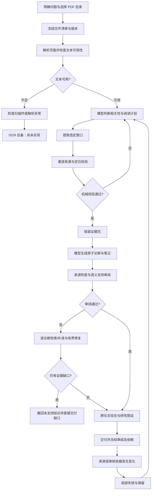

# 普通 PDF 文献与知识管理：总体流程与 Motif 候选

当前目标是“整理选定目录的论文，形成可追溯笔记，资料或审阅变化后局部更新”。下面区分现有功能、执行规则、可学习的续接，以及尚未接入的产品能力。消费者示例中的40篇批处理尚未支持；现有输入上限20篇，不静默放宽。

## 总体流程与现有实现

图中的业务次序由场景设计；不将这张手写图称为学到的 Motif。来源版本变化只指出“必须重审”，不自动理解新反证。

| 业务节点 | 当前代码/状态 | 模型边界 | 可学习部分 |
| --- | --- | --- | --- |
| 任务与输入 | `run-pdf.py`、`pdf_tools.inventory` 已实现冻结清单 | 含糊问题与研究范围 | 固定任务下的后续准备；不学习授权来源 |
| PDF 解析 | `PdfScene.prepare_pdf` 与版本缓存已实现 | 异常解释、复杂图表 | 明确解析决策后的操作续接；缓存本身是普通基线 |
| 扫描件后备 | 低文本标记已实现；OCR 未接入 | 判断文本不足的原因 | 条件明确后可选后备工具；目前没有可执行链 |
| 检索与阅读选择 | `search_pdf_text`、模型选页已实现 | 相关性、阅读目的、证据覆盖 | 不把字面命中当语义相关性 |
| 证据准备 | 新 `pdf_evidence_tools.py` 三节点链 | 模型明确计划后进入；文本不足退出 | 提取→校验→组装，第一优先级 |
| 论断与笔记 | `preview_research_notes` 已跑通 | 方法、发现、条件与限制的理解 | 已有 `pin→read` 只读 Motif；不认证论断 |
| 语义审阅 | `pdf_review_tools.py` 已实现；质量未通过 | 引文是否完整支持论断 | 原文匹配等机械检查可续接；支持判断保持语义层 |
| 综合与归档 | Markdown/JSON 交付已实现；组会稿、用户知识库写回未实现 | 可比性、冲突与研究启示 | 已批准内容的引用绑定、组装与交付检查，第二候选 |
| 更新与撤回 | `pdf_dependencies.py`、`pdf-incremental-policy.ts`、增量工具已验证局部保留 | 新内容是否改变结论 | 失效集合确定后组装重审材料，第三候选；当前是手写规则 |
| 收集/去重/批注 | 本地文件收集；BibTeX 只读预览；下载、学术版本识别、批注提取未接入 | 版本合并和选择冲突 | 能力缺失时不编造可运行 Motif |

## 候选契约与优先级

| 候选 | 进入条件与参数来源 | 复用与成功条件 | 退出/回退 | 状态 |
| --- | --- | --- | --- | --- |
| 1．证据准备 | 当前冻结任务；模型登记绑定 task_sha256 的计划及显式继续权限，获得短plan_id；下游只用服务返回的凭证 | 原文提取缓存按 PDF/解析器版本复用；逐节点重查文件、选择、任务、解析器、工具实现；来源窗口逐字一致；文本可用；计划窗口全部覆盖 | false、未知凭证、来源变化、越界、损坏、低文本、空/过短窗口；不产生下一阶段句柄 | 已重新训练/留出认证；v2批准计划许可在线实测2次验证跳过、0 embedding；科研质量未认证 |
| 2．笔记交付 | 逐论断审阅通过，确定引用与目标输出；自动交付范围明确，语义审核scope记录 | 引文和自动审核范围仍有效；组装与文件收据一致 | 撤回、来源变化、语义审阅缺口、写回授权不足 | 候选；工作台已自动交付；结构学习/认证仍待完成 |
| 3．局部重审准备 | 手写守卫已经确定失效集合，现有任务批准相关范围 | 保留字段完全一致，材料覆盖全部受影响论断及综合节点 | 不确定依赖、选择/任务变化、执行中变更、新语义冲突 | 候选；依赖图本身仍非学习产物 |

### 第一条链的实现契约

0. `register_reading_plan(plan: string)`：模型登记计划JSON，指定 paper_id、十进制字符串物理页、start、length、purpose，显式 `allow_deterministic_continuation`。最多6窗、每窗6000字符、总12000字符。false 不发可执行凭证；有效计划签发39字符plan_id，绑定任务、来源和实现。该登记是手写工具与模型判断边界，未学习为自动批准步骤。
1. `extract_evidence_windows(plan: string)`：使用上一工具返回的短plan_id，提取冻结计划中的全部窗口并发extraction_id；保留长JSON兼容旧调用，但默认使用短凭证以符合当前在线锚点约束。不推断相关性。
2. `verify_evidence_windows(extraction_id: string)`：句柄必须属于本次服务；私有工件摘要、任务与执行版本匹配；重新读取并比较所有窗口。低文本页或窗口规范文本少于40字符返回 needs_review，不发 `verification_id`。40字符只是机械检查阈值，不证明科学支持。
3. `build_evidence_packet(verification_id: string)`：验证凭证绑定原提取；再次核对当前来源并输出带页码、精确 source_id、quote_spans 和覆盖限制的原文包。终点是交回模型；不生成科学解释。

每步共用 execution_version_sha256，包含冻结任务/来源选择、解析器 profile、场景工具实现和契约摘要。精确窗口与模型目的另由凭证内容摘要绑定。同一问题下的其他计划不会拿到彼此的专属句柄，MCP凭证不跨会话使用；独立 `reuse-evidence.py` 可重放核验并复用完全相同已批准请求的结果，不能将旧凭证传入新服务。`read_only` 指不写用户文件；缓存和收据写私有 `.local`。

### 现有接口可用性与未来缺口

用户授权后已增加有限批准计划许可契约、训练/认证检查、manifest v2 和共享在线选择/结果复核守卫，见 [逐文件记录](../../docs/changes/approved-plan-continuation.md)。沿用三节点 witnessed-chain 编译器、权威 manifest 校验器与原生在线插件。多个窗口的有限遍历由预先实现的 MCP 工具负责；Motif 学习凭证的两个参数传递和工具续接，不学习数组遍历算法。新增 Python 是 MCP 服务与启动/离线编译；新增在线规则是 TypeScript，既有 `.mjs` 调用生成桥接，不增加另一套 Agent 循环。

原插件的 `read_pinned_* / source_id` 特例仍保持不变。新核验/组装通过独立的许可守卫：完整实际 schema、当前任务/计划/版本、每阶段可信工具许可及唯一参数全部通过，才免 embedding 续接；缺许可或不明确时回退。新真实任务已验证两次原生跳过，但同计划免费对照与普通脚本都少两次模拟请求，尚无超越脚本的实际成本依据。

后续真实固定计划三轮已完成：[记录](../../docs/experiments/frozen-evidence-20261010-997d9e47.md)。每次baseline/script/Motif为6/4/4真实请求，包相同；Motif均值更快，脚本费用差仅1.8%且第三轮反向，不主张稳定额外降费。完全相同任务结果缓存0请求，优先复用；新计划的未缓存机械步骤才是续接对象。三论文和同计划重复不代表泛化，正式后续按 [分层方案](../../docs/experiments/literature-evaluation-protocol.md) 另验收新语料与科学支持。

如要让 Runtime 从 Motif IR 自己选择/遍历每个窗口，而非当前句柄封装，需先讨论：动态数组输出的元素来源证明、整数 start/length 绑定、窗口级版本作用域、受验证条件分支与多结果汇合。没有在共享核心实现这些变化。

## 学习、实验与否定条件

- 先运行正常 Harness 轨迹，两项不同阅读决定训练、一项不同决定认证；保留原始事件与独立机械来源核对。模型字段批准不会升级为科学质量认证。
- `learn-evidence.py` 只从实际输出→下次输入边挖掘，要求连接的是同一个中间调用，并复用现有链编译/认证/导出器。单轮演示、重复一个问题、模拟 Provider 或手填边不能成为真实学习证据。
- 正式对照采用普通 Harness、已认证 Motif 和普通脚本。脚本调用完全相同的提取/校验/组装方法；它是 Code Mode 可以采用的程序合并基线，不冒称已经实测 Code Mode 自主编程。
- 对照需记录计划/窗口差异、缓存与顺序。固定同一批准计划的协议试验只测续接；自由选页试验包含模型决策差异。当前三论文是已知语料，不证明独立语料泛化。
- 校验成功且最终模型循环实际没有发生的请求，才计 verified skip。失败、回退、训练/认证费用全部计入；模型请求变少不是费用更低的充分证据。
- 单条论断审阅修复可并行；当前完整科研交付质量未通过。机械证据准备可以单独验收，不能把其通过替代论文理解或合格总成本验收。
- 否定条件：陈旧/未批准资料仍被执行，低文本仍被当成完成，缺一个窗口仍交付，或同等机械输出下学习机制没有超过脚本的可测收益。接受缩小机制范围或保留普通脚本为默认。

最新用户要求取消人工审阅门槛，自动交付及逐论断修复见[参考设计](reference-design.md)。新增修复控制仍是手写，第二轮只复核缺口，不代表自动依赖图或新Motif学习已经完成。
